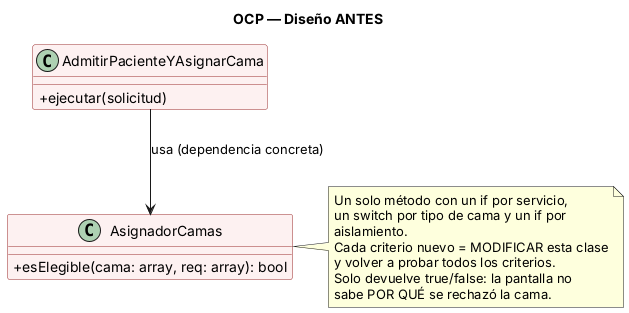
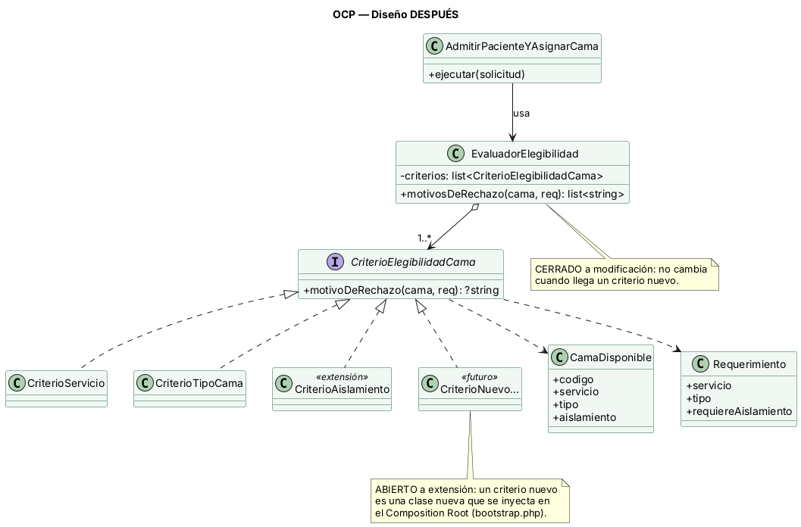

# Semana 2 (parte B) — OCP en la compatibilidad de camas

**Principio:** Abierto/Cerrado (OCP). Una clase debe estar abierta a extensión y cerrada a modificación.

**Dónde se aplica:** en la regla RN-03 del flujo «admisión de paciente y asignación de una cama disponible». Es el paso A-08 del diagrama de actividad: decidir si una cama es compatible con lo que requiere el paciente.

## 1. Por qué este punto

La compatibilidad es la parte del flujo que **más cambia**. Hoy son tres criterios (servicio, tipo de cama y aislamiento). Mañana pueden llegar otros: camas reservadas, equipo disponible o restricciones por edad. Si cada criterio nuevo obliga a modificar el mismo método, ese método crece sin control y se arriesgan reglas que ya funcionaban.

## 2. Antes



Código: `ejemplo/antes/AsignadorCamas.php`.

- `AsignadorCamas::esElegible()` concentra todos los criterios en un `if` por servicio, un `switch` por tipo y un `if` por aislamiento.
- Cuando llegó el requisito de aislamiento **hubo que modificar** el método. El comentario en el código marca dónde.
- Solo devuelve `true` o `false`. La pantalla no puede decir **por qué** una cama no sirve, aunque el flujo UX lo necesita (E-05).
- El caso de uso depende de una clase concreta: para probarlo con otro criterio hay que tocar esa clase.

## 3. Después



Código: `ejemplo/despues/elegibilidad.php`.

| Clase | Responsabilidad única | Depende de |
|---|---|---|
| `CriterioElegibilidadCama` (interfaz) | Contrato: dada una cama y un requerimiento, devolver `null` o el motivo de rechazo | `CamaDisponible`, `Requerimiento` |
| `CriterioServicio` | La cama es del servicio pedido | La interfaz |
| `CriterioTipoCama` | El tipo de cama coincide | La interfaz |
| `CriterioAislamiento` | El aislamiento coincide; la cama de aislamiento se reserva | La interfaz |
| `EvaluadorElegibilidad` | Recorrer los criterios y juntar los motivos | **Solo** la interfaz, nunca un criterio concreto |
| `AdmitirPacienteYAsignarCama` | Orquestar el flujo | `EvaluadorElegibilidad` |

### Justificación de las dependencias
- El evaluador depende de la **abstracción**. Por eso queda cerrado: agregar un criterio no cambia ni una línea suya.
- Los criterios se eligen en un solo lugar, el Composition Root (`bootstrap.php`, semana 3). Ese es el único punto que se toca para activar un criterio nuevo.
- Cada criterio devuelve su motivo, y así la UI puede mostrar «El paciente requiere una cama de aislamiento» en lugar de un rechazo mudo. Esto cubre E-05 y sirve a la ayuda contextual de la semana 8.
- Los nombres de las clases son los mismos que tendrá la capa Domain del Micro-HIS.

## 4. Evidencia verificable

Desde la carpeta `ejemplo/`:

```powershell
php verificar-ocp.php --evidencia=../../evidencia/salida-verificar-ocp.txt
```

El script hace tres verificaciones y termina con código 0 solo si todas pasan:

1. **Equivalencia:** para cuatro requerimientos, el diseño antes y el diseño después eligen exactamente las mismas camas. El refactor no cambió el comportamiento.
2. **Motivo de rechazo:** `B-201` se rechaza con el motivo de aislamiento, cosa que el diseño anterior no podía informar.
3. **Extensión sin modificación:** el script define ahí mismo un criterio nuevo («cama reservada»), lo agrega al evaluador **sin modificar `EvaluadorElegibilidad`** y la cama reservada `B-202` queda fuera.

Salida obtenida al ejecutarlo en mi entorno (PHP 8.3):

```text
[OK]    Mismo resultado antes/después para «Medicina interna general»: B-201, B-202
[OK]    Mismo resultado antes/después para «Medicina interna con aislamiento»: B-210
[OK]    Mismo resultado antes/después para «Cirugía general»: C-101
[OK]    Mismo resultado antes/después para «UCI»: U-01
[OK]    B-201 rechazada con motivo: El paciente requiere una cama de aislamiento.
[OK]    Criterio nuevo agregado sin modificar EvaluadorElegibilidad: B-201

Resultado: todas las verificaciones pasaron.
```

Con `--evidencia`, el script guarda la misma salida en UTF-8 en `semana-02/evidencia/salida-verificar-ocp.txt` (no se usa `>` porque PowerShell 5 la guarda en UTF-16).

## 5. Relación con los requerimientos
- **RNF-06** (mantenibilidad): queda demostrado con la verificación 3.
- **RN-03 / RF-03** (compatibilidad): las verificaciones 1 y 2 reproducen el resultado que espera **CA-05** (Medicina interna general: `B-201` y `B-202`) y el de **CA-06** (Medicina interna con aislamiento: solo `B-210`). El filtro de camas operativas (RN-04) no es parte de este ejemplo: lo aplica el catálogo en la semana 3.
