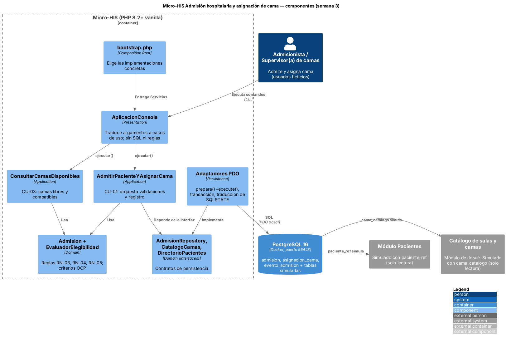
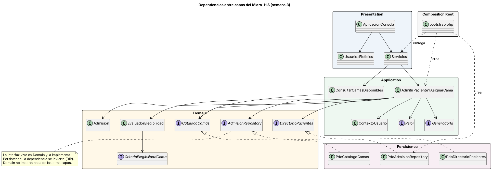

# Semana 3 — Diseño arquitectónico, vistas y patrones

Módulo: **Admisión hospitalaria y asignación de cama** · Flujo: **admisión de paciente y asignación de una cama disponible**

Esta semana se inicia el **Micro-HIS** en PHP 8.2+ vanilla, en `../micro-his/`. El código se entregó en las partes A a H (código y pruebas). Esta parte I agrega la vista arquitectónica, el diagrama de dependencias, una prueba de arquitectura y la evidencia de la ejecución completa.

## 1. Partes de la semana

| Parte | Contenido en `micro-his/` |
|---|---|
| A | Ejecutor de pruebas propio, autocarga y objetos de valor (`CodigoPaciente`, `TenantId`, `TipoCama`, `Requerimiento`) |
| B | Criterios de elegibilidad (OCP de la semana 2), `CamaDisponible` y datos ficticios |
| C | Entidad `Admision`, eventos de trazabilidad y sus reglas |
| D | Interfaces Repository, excepciones, `ContextoUsuario`, DTOs y puertos `Reloj` / `GeneradorId` |
| E | Casos de uso `AdmitirPacienteYAsignarCama` y `ConsultarCamasDisponibles`, dobles de prueba |
| F | Docker (PostgreSQL 16, puerto 55443), esquema en PHP, conexión PDO y catálogo de camas |
| G | Repositorio PDO de admisiones: transacción, RN-01 y RN-02 en la base, concurrencia |
| H | Presentación por consola, Composition Root (`bootstrap.php`) y README del Micro-HIS |
| I | Este README, diagramas, prueba de arquitectura y evidencia |

## 2. Vista arquitectónica (C4, nivel componentes)



- **Presentation:** `AplicacionConsola` traduce argumentos a llamadas de casos de uso y errores a mensajes. No contiene SQL ni reglas.
- **Application:** los casos de uso orquestan el flujo con los mismos pasos A-NN del diagrama de actividad de la semana 1. Están anotados en `AdmitirPacienteYAsignarCama.php`.
- **Domain:** `Admision` protege RN-03, RN-04 y RN-05. `EvaluadorElegibilidad` aplica los criterios de la semana 2. Aquí viven las **interfaces Repository**.
- **Persistence:** los adaptadores PDO usan siempre `prepare()` + `execute()` y abren una transacción por admisión. Además traducen el `SQLSTATE` de PostgreSQL a errores del dominio.

## 3. Dependencias



Todas las dependencias apuntan hacia **Domain**. Persistence implementa las interfaces del dominio (inversión de dependencias) y solo `bootstrap.php` conoce las clases concretas. Esto se **verifica** con `pruebas/unitarias/prueba-dependencias.php`, que revisa el código fuente:
- Domain no usa Application, Persistence ni Presentation.
- Application no usa Persistence ni Presentation.
- Persistence no usa Application ni Presentation.
- Fuera de Persistence nadie usa PDO ni escribe SQL.

## 4. Patrones aplicados

| Patrón | Dónde | Para qué |
|---|---|---|
| Arquitectura en capas | `src/Domain`, `src/Application`, `src/Persistence`, `src/Presentation` | Separar responsabilidades |
| Repository | `Domain/Repositorio/*` + `Persistence/Pdo/*` | Aislar el dominio del almacenamiento |
| Composition Root / inyección de dependencias | `bootstrap.php` | Elegir implementaciones en un solo lugar |
| Strategy (OCP) | `Domain/Elegibilidad/*` | Agregar criterios de cama sin modificar el evaluador |
| Value Object | `CodigoPaciente`, `TenantId`, `Requerimiento` | Validar una vez, en el borde del dominio |

## 5. Pruebas exigidas por la tarea

| Exigencia | Prueba | Con qué |
|---|---|---|
| Camino feliz | `Camino feliz: PAC-00451 queda admitido en B-201 (CA-01)` | Dobles |
| Camino feliz | `Camino feliz con PostgreSQL: admisión, asignación y dos eventos (CA-01)` | Base de prueba |
| Regla de dominio | `Regla de dominio RN-02…`, `Regla de dominio: cama de otro hospital…`, `…cama no compatible…` | Dobles |
| Regla de dominio en la base | `RN-01: dos admisiones que pasaron la verificación previa…` y `RN-01 simultáneo…` | Base de prueba, dos conexiones |
| Error de persistencia | `Error de persistencia (doble) se propaga…` | Doble que lanza `ErrorPersistencia` |
| Error de persistencia | `Error de persistencia a mitad de la transacción revierte todo (CA-12, RNF-08)` | Error real de PostgreSQL (`22001`) |

Cómo ejecutarlas, desde `micro-his/`:

```powershell
php pruebas/ejecutar.php --evidencia=../semana-03/evidencia/salida-pruebas.txt
```

En mi entorno (PHP 8.3 y PostgreSQL 16 en el puerto 55443) la última línea fue `Total: 41 · OK: 41 · Fallas: 0 · Omitidas: 0 · Defectos abiertos: 0`. Tu ejecución queda en `evidencia/salida-pruebas.txt`.

## 6. Decisiones y pendientes
- **RN-01 se garantiza en la base**, con el índice único parcial `ux_asignacion_cama_activa` dentro de la transacción. La verificación previa del caso de uso solo da un aviso temprano. Si otra transacción tiene la cama bloqueada, se espera como máximo 2 s (`lock_timeout`) y se responde `CONFLICTO_CONCURRENCIA`.
- Los nombres de tablas y columnas son **propuesta del Micro-HIS**: el esquema real de HOSPITAL no está publicado.
- `cama_catalogo` simula al catálogo de Josué. Cómo se le avisa a su módulo que una cama quedó asignada (evento o API) está **pendiente de confirmar con él**.
- Defecto encontrado y corregido durante la construcción: **D-01**. La afirmación `lanza()` convertía una prueba omitida en falla cuando no había base de prueba. Se registra en la semana 15.
