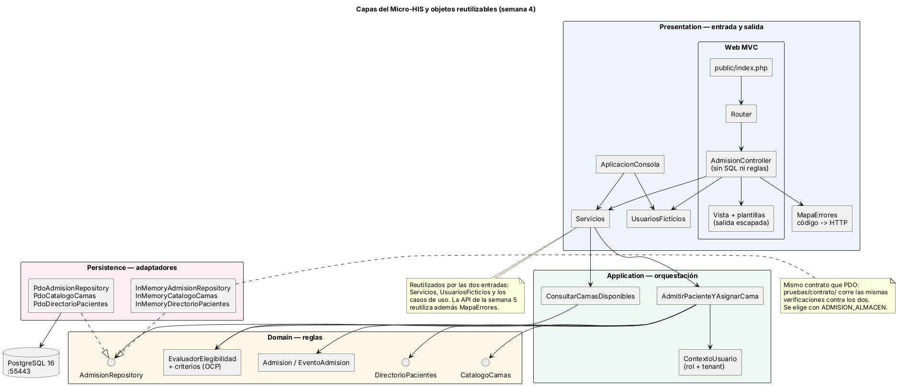
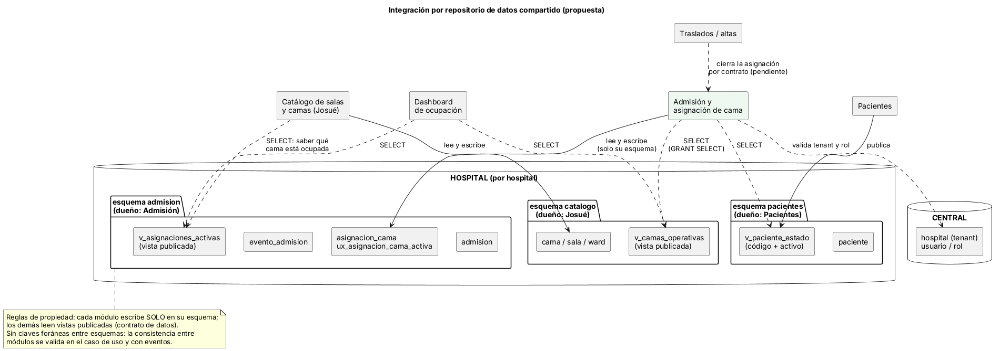

# Semana 4 — Arquitectura en capas y patrón repositorio

Módulo: **Admisión hospitalaria y asignación de cama** · Flujo: **admisión de paciente y asignación de una cama disponible**

Se continúa el **mismo** Micro-HIS de la semana 3 (`../micro-his/`). El código va en las partes A a C y esta parte D documenta.

| Parte | Contenido |
|---|---|
| A | Adaptadores **InMemory** con el mismo contrato que los PDO, **prueba de contrato** contra los dos y selección del almacén en `bootstrap.php` (`ADMISION_ALMACEN`) |
| B | Núcleo MVC: `Peticion`, `Respuesta`, `Router`, `Vista` (salida escapada) y `MapaErrores` |
| C | `AdmisionController`, plantillas y `public/index.php` |
| D | Este README, diagramas y evidencia |

## 1. Capas y responsabilidades



| Capa | Responsabilidad | No hace |
|---|---|---|
| Presentation (web y consola) | Leer la entrada, llamar al caso de uso, elegir la vista y el estado HTTP, escapar la salida | SQL, reglas de negocio, decidir permisos |
| Application | Orquestar CU-01 y CU-03; exigir rol (RN-06); tomar el hospital del contexto | Saber cómo se guarda ni cómo se muestra |
| Domain | Reglas RN-03, RN-04 y RN-05; criterios OCP; **interfaces Repository** | Depender de cualquier otra capa |
| Persistence | Implementar las interfaces: transacción, RN-01 y RN-02 con índices únicos, traducción de errores | Decidir reglas de negocio |

**El controlador no tiene SQL ni reglas.** `AdmisionController` solo arma una `SolicitudAdmision`, llama a `AdmitirPacienteYAsignarCama` y elige la plantilla. Ante un error usa `MapaErrores` para el estado HTTP. Esto se verifica con `pruebas/unitarias/prueba-dependencias.php`: fuera de Persistence nadie usa PDO ni escribe `SELECT`/`INSERT`.

## 2. El límite del Repository

Las interfaces `AdmisionRepository`, `CatalogoCamas` y `DirectorioPacientes` están en **Domain**: es el dominio el que dice qué necesita, no la base de datos. Hay dos adaptadores por interfaz.

| Interfaz | PDO | InMemory |
|---|---|---|
| `AdmisionRepository` | `PdoAdmisionRepository`: transacción, índices únicos, `lock_timeout` | `InMemoryAdmisionRepository`: valida RN-01 y RN-02 **antes** de modificar el estado (todo o nada) |
| `CatalogoCamas` | `PdoCatalogoCamas` (solo `SELECT`) | `InMemoryCatalogoCamas` (datos ficticios) |
| `DirectorioPacientes` | `PdoDirectorioPacientes` (solo `SELECT`) | `InMemoryDirectorioPacientes` |

**Prueba de contrato** (`pruebas/contrato/prueba-contrato-repositorio.php`): las mismas cinco verificaciones corren contra los dos adaptadores.
1. Registra y relee la admisión, sus eventos y la cama ocupada.
2. RN-01: la misma cama no se asigna dos veces y no queda nada de la segunda admisión.
3. RN-02: el mismo paciente no tiene dos admisiones activas.
4. Otro hospital no ve la admisión, y un id mal formado no existe.
5. El catálogo y el directorio responden igual en los dos adaptadores.

Lo que **no** cubre InMemory, y por eso queda solo en PDO: la espera por bloqueo entre dos transacciones (`CONFLICTO_CONCURRENCIA`) y los errores reales de la base. Ambos se prueban en `pruebas/integracion/`.

## 3. Objetos reutilizables

| Objeto | Lo reutilizan |
|---|---|
| `AdmitirPacienteYAsignarCama`, `ConsultarCamasDisponibles` | Consola, web y API (semana 5) |
| `Servicios` (casos de uso armados) y `UsuariosFicticios` | Consola y web |
| `MapaErrores` (código → HTTP) | Web y API (semana 5) |
| `EvaluadorElegibilidad` + criterios | Los dos casos de uso |
| Interfaces Repository | Los dos adaptadores y los dobles de prueba |
| `datos-ficticios.php` | Esquema, InMemory y pruebas |

## 4. Repositorio de datos compartido (análisis y propuesta)



El HIS usa PostgreSQL federado con las bases CENTRAL y HOSPITAL. Integrar este módulo con un **repositorio de datos compartido** significa que varios módulos leen y escriben la misma base. Propuesta:

- **Un esquema por módulo dueño:** `admision` (este módulo), `catalogo` (Josué) y `pacientes`. Cada módulo escribe **solo** en el suyo.
- **Vistas publicadas como contrato:** Admisión lee `catalogo.v_camas_operativas` y `pacientes.v_paciente_estado` con `GRANT SELECT`, y publica `admision.v_asignaciones_activas` para el catálogo y el dashboard. Los nombres son propuesta.
- **CENTRAL:** hospitales (tenant), usuarios y roles.
- **Sin claves foráneas entre esquemas:** evitan que un cambio de Josué rompa Admisión. La cama se valida en el caso de uso (RN-04) y RN-01 sigue garantizada por el índice del esquema `admision`.

Cómo encaja con el código: el dominio y los casos de uso **no cambian**. Solo se escriben adaptadores nuevos de `CatalogoCamas` y `DirectorioPacientes` que lean esas vistas, y se eligen en `bootstrap.php`. Es la ventaja directa del patrón Repository.

| A favor | En contra | Mitigación |
|---|---|---|
| Datos consistentes y consultas simples | Acoplamiento por el esquema | Vistas versionadas como contrato |
| Una sola tecnología y una sola copia de respaldo | Migraciones que hay que coordinar entre equipos | Cada equipo migra solo su esquema |
| El catálogo ve la ocupación al instante | Riesgo de escribir en tablas ajenas | `GRANT` solo de lectura sobre esquemas ajenos |

**Pendiente de confirmar con Josué:** si su módulo leerá `v_asignaciones_activas` o si prefiere un evento `CamaAsignada`. Ver la semana 5.

## 5. Cómo probar

Desde `micro-his/`:

```powershell
php pruebas/ejecutar.php --evidencia=../semana-04/evidencia/salida-pruebas.txt
php -S 127.0.0.1:8085 public/index.php
```

Después abre `http://127.0.0.1:8085/`. Con `$env:ADMISION_ALMACEN = "memoria"` la web funciona sin Docker, pero el estado se pierde en cada petición, porque cada una es un proceso nuevo.

En mi entorno (PHP 8.3 y PostgreSQL 16) la última línea fue `Total: 60 · OK: 60 · Fallas: 0 · Omitidas: 0 · Defectos abiertos: 0`.
