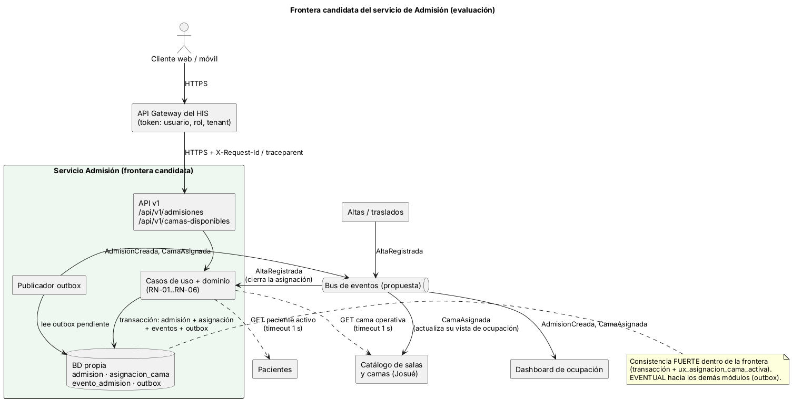
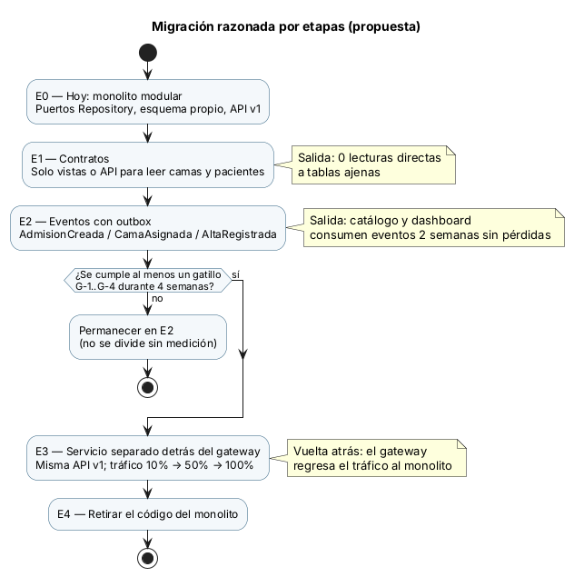

# Frontera de microservicio — evaluación y migración razonada

**Decisión: hoy NO se separa** Admisión como microservicio. El Micro-HIS queda como **monolito modular**: capas, puertos Repository, esquema propio y API v1. Separarlo hoy no tiene una justificación medible: abajo están los gatillos que lo justificarían y cómo se medirían. Todo lo de este archivo es **diseño y propuesta**; no se construye infraestructura de producción.

## 1. Frontera candidata

La frontera natural es la **transacción de RN-01**: la admisión, la asignación de cama y sus eventos se guardan juntas o no se guardan. Partir esa transacción entre servicios obligaría a usar sagas para una regla que hoy resuelve un índice único. Por eso la frontera incluye exactamente `admision`, `asignacion_cama` y `evento_admision`, y nada del catálogo ni de pacientes.

## 2. Aspectos evaluados

| Aspecto | Diseño propuesto |
|---|---|
| **Propiedad de datos** | Admisión es dueña de `admision`, `asignacion_cama`, `evento_admision` y, en E2, `outbox`. El catálogo de camas es de Josué y los datos del paciente son de Pacientes. Nadie escribe en datos ajenos. |
| **Comunicación** | Síncrona (REST): Admisión pregunta al catálogo si la cama está operativa y a Pacientes si el código está activo, porque debe saberlo **antes** de confirmar. Asíncrona (eventos): `AdmisionCreada` y `CamaAsignada` hacia el catálogo y el dashboard; `AltaRegistrada` desde Altas para cerrar la asignación. |
| **Seguridad** | El token del gateway trae usuario, rol y hospital (RNF-02); entre servicios, TLS mutuo y permisos mínimos. Los eventos llevan ids (admisión, cama, hospital) y el código de paciente solo si el consumidor lo necesita; nunca nombres (RNF-03). |
| **Resiliencia** | Tiempo máximo de 1 s por llamada síncrona y un reintento solo en lecturas. Corte (circuit breaker) hacia el catálogo. Si el catálogo no responde, **no se asigna** (se responde 503 reintentable), porque asignar una cama sin verificar que esté operativa es un riesgo para el paciente. Tener una copia de las camas con antigüedad máxima conocida es una **decisión pendiente con Josué**. |
| **Observabilidad** | `X-Request-Id` (y `traceparent` del W3C en el HIS) en cada salto, registro JSON por solicitud sin datos clínicos (ya implementado en `ApiKernel`) y métricas: admisiones por minuto, 409 por minuto, p95 de `POST /admisiones` y eventos pendientes en el outbox. |
| **Consistencia** | **Fuerte** dentro de la frontera: transacción más `ux_asignacion_cama_activa`. **Eventual** hacia afuera: el outbox se escribe en la misma transacción y un publicador lo envía; los consumidores deben ser idempotentes (id de evento). Aunque el catálogo vea la ocupación con retraso, RN-01 no se rompe, porque la garantía vive en Admisión. |

## 3. Gatillos medibles para separar

| ID | Gatillo | Umbral | Fuente |
|---|---|---|---|
| G-1 | Carga | p95 de `POST /api/v1/admisiones` > 800 ms, o más de 30 admisiones por minuto sostenidas en hora pico, durante 2 semanas, mientras el resto del HIS está bien | Registro JSON (`duracion_ms`) y métricas |
| G-2 | Ritmo de cambio | Admisión necesita desplegarse 2 o más veces por semana y el despliegue conjunto bloquea a otros módulos 2 o más veces al mes | Historial de despliegues y PR |
| G-3 | Disponibilidad | Admisión (24/7 por emergencias) requiere 99.9 % y fallas de otros módulos la tiran más de 1 vez al mes | Incidentes |
| G-4 | Equipo | Hay un equipo dedicado de 2 o más personas que puede operar el servicio | Organización del proyecto |
| G-5 | Precondición | Cero lecturas directas a tablas ajenas y eventos estables (E1 y E2 cumplidas) | Revisión técnica (semana 13) |

Hoy no hay mediciones de G-1 a G-3 y G-4 no se cumple: el módulo tiene un solo estudiante. Separar ahora sumaría red, despliegues y consistencia eventual sin ningún beneficio medible.

## 4. Migración por etapas

| Etapa | Qué cambia | Condición de salida | Vuelta atrás |
|---|---|---|---|
| E0 (hoy) | Monolito modular, puertos y API v1 | — | — |
| E1 | Adaptadores de `CatalogoCamas` y `DirectorioPacientes` que leen solo vistas o API | Cero lecturas directas a tablas ajenas | Volver al adaptador anterior en `bootstrap.php` |
| E2 | Tabla `outbox` y publicador de eventos | Catálogo y dashboard consumen 2 semanas sin pérdidas | Apagar el publicador; el catálogo vuelve a leer la vista |
| E3 | Admisión desplegada aparte, detrás del gateway, con la **misma API v1** | Tráfico 10 % → 50 % → 100 % sin subir errores ni p95 | El gateway regresa el tráfico al monolito |
| E4 | Retirar el código del monolito | 4 semanas en E3 al 100 % | — |

Solo se pasa a E3 si algún gatillo de G-1 a G-4 se cumple durante 4 semanas **y** se cumple G-5.

## 5. Pendientes
- Con **Josué**: si el catálogo consumirá `CamaAsignada` o leerá `v_asignaciones_activas`, y si se permite trabajar con una copia de camas.
- Con **Altas y traslados**: el contrato `AltaRegistrada` para cerrar la asignación (`liberada_en`).
- Con el líder: el proveedor de identidad y los claims del token en el HIS real.
