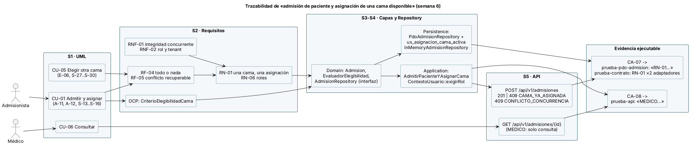

# Semana 6 — Primera evaluación parcial

Módulo: **Admisión hospitalaria y asignación de cama** · Flujo: **admisión de paciente y asignación de una cama disponible**

| Entregable | Archivo |
|---|---|
| Presentación (Marp): **7 diapositivas más la portada** | `presentacion.md` |
| Diagrama trazable: actor → CU → RF/RNF → RN → capas → API → prueba | `diagramas/semana-06-trazabilidad.puml` / `.png` |
| Matriz decisión → evidencia (DEC-01 a DEC-13) | `matriz-decision-evidencia.md` |
| Registro del cambio práctico: casos preparados y espacio para lo que se pida en la defensa | `cambio-practico.md` |

## Cómo se conecta lo defendido
- **Actores y UML** (semana 1) → **RF/RNF, CA y OCP** (semana 2) → **capas y Repository** (semanas 3 y 4) → **contrato API** (semana 5).
- Cada decisión de la matriz apunta a un archivo o a una prueba ejecutable del Micro-HIS.

## Notas
- El número de diapositivas se contó separando `presentacion.md` por `---`, sin la cabecera de Marp: 8 en total, es decir 7 más la portada.
- **Por verificar:** cómo se ve con la extensión *Marp for VS Code* (Vista previa o exportación a PDF). En mi entorno no pude instalar Marp para renderizarla.
- El cambio práctico real lo decide el ingeniero en la defensa; los casos A, B y C son **casos preparados**.
