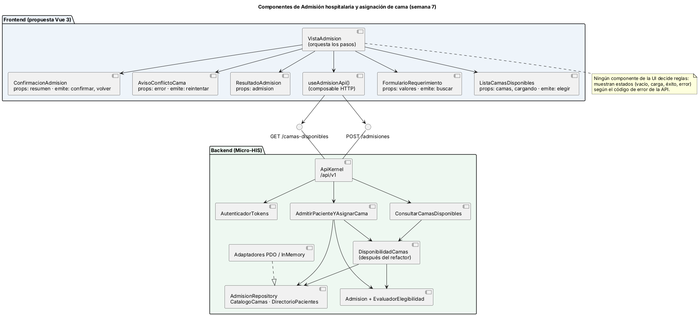
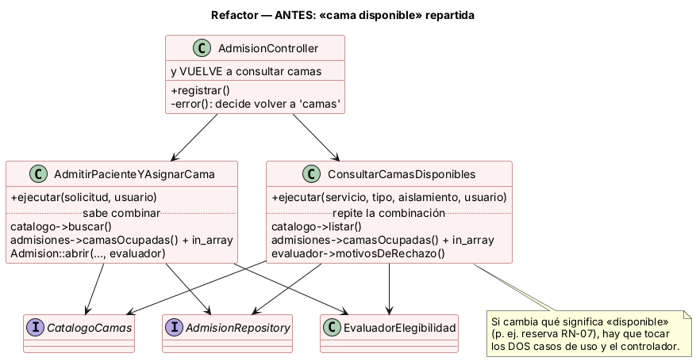
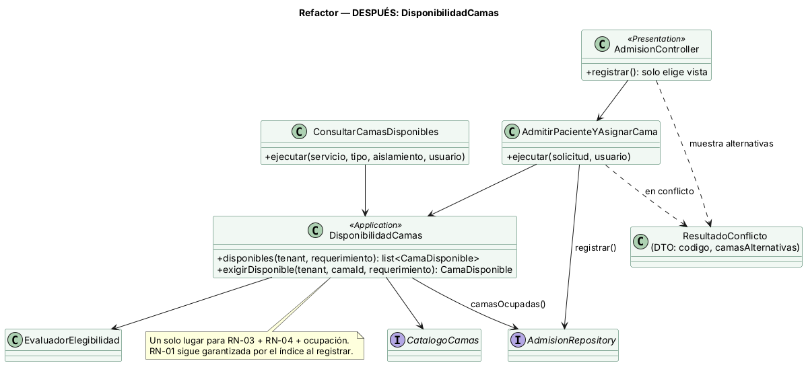

# Semana 7 — Diseño de componentes y refactorización

Módulo: **Admisión hospitalaria y asignación de cama** · Flujo: **admisión de paciente y asignación de una cama disponible**

## 1. Componentes backend y frontend



El backend es el del Micro-HIS (semanas 3 a 5). El frontend es una **propuesta** de componentes Vue 3 para el HIS real; el Micro-HIS usa HTML del lado del servidor. **No se amplía el módulo:** los componentes cubren solo CU-01, CU-03, CU-05 y CU-06.

## 2. Contratos de entrada y salida

### Frontend (propuesta)

| Componente | Entrada (props) | Salida (eventos) | Estados que muestra |
|---|---|---|---|
| `VistaAdmision` | rol y hospital (de la sesión) | — | Orquesta los pasos 1 a 3 |
| `FormularioRequerimiento` | `valores {codigoPaciente, servicio, tipoCama, requiereAislamiento, origen}` | `buscar(valores)` | Error de formato junto al campo (E-02) |
| `ListaCamasDisponibles` | `camas[] {id, codigo, servicio, tipo_cama, aislamiento}`, `cargando` | `elegir(camaId)` | Carga · vacío (E-05) · lista |
| `ConfirmacionAdmision` | `resumen {codigoPaciente, cama, servicio, origen}` | `confirmar()`, `volver()` | Resumen antes de confirmar |
| `AvisoConflictoCama` | `error {codigo, mensaje, reintentable}` | `reintentar()` | 409 CAMA_YA_ASIGNADA (otra cama) · 409 CONFLICTO_CONCURRENCIA (reintentar) |
| `ResultadoAdmision` | `admision {id, codigo_paciente, cama, estado, creada_en}` | — | Éxito |
| `useAdmisionApi()` | token, `X-Request-Id` | promesas con `datos` o `error` (formato de `contrato-api.md`) | — |

### Backend

| Componente | Entrada | Salida | Errores |
|---|---|---|---|
| `ApiKernel` | `Peticion` (método, ruta, cabeceras, cuerpo) | `Respuesta` JSON + `X-Request-Id` | Formato único (semana 5) |
| `AdmitirPacienteYAsignarCama` | `SolicitudAdmision`, `ContextoUsuario` | `ResultadoAdmision` | `ACCESO_DENEGADO`, `VALIDACION`, `PACIENTE_*`, `CAMA_*`, `CONFLICTO_CONCURRENCIA`, `ERROR_PERSISTENCIA` |
| `ConsultarCamasDisponibles` | servicio, tipo, aislamiento, `ContextoUsuario` | `list<CamaDisponible>` ordenada por código | `ACCESO_DENEGADO`, `VALIDACION` |
| `DisponibilidadCamas` (después del refactor) | `TenantId`, `Requerimiento`, `camaId` | `list<CamaDisponible>` / `CamaDisponible` | `CAMA_NO_ENCONTRADA`, `CAMA_YA_ASIGNADA`, `CAMA_NO_ELEGIBLE` |
| `AdmisionRepository` | `Admision` | — / consultas | `CamaYaAsignada`, `PacienteConAdmisionActiva`, `ConflictoConcurrencia`, `ErrorPersistencia` |

## 3. Refactor: el punto con mayor acoplamiento

**Punto elegido:** la noción de **«cama disponible»**. Hoy se arma en tres lugares con las mismas piezas: catálogo (operativa, RN-04), ocupación (`camasOcupadas`) y compatibilidad (RN-03).



**Antes** (código actual del Micro-HIS):
- `AdmitirPacienteYAsignarCama::ejecutar()` llama a `catalogo->buscar()`, después a `in_array($cama->id, $this->admisiones->camasOcupadas(...))` y luego deja la compatibilidad a `Admision::abrir(..., $this->evaluador, ...)`.
- `ConsultarCamasDisponibles::ejecutar()` repite la combinación: `catalogo->listar()`, `camasOcupadas()`, `in_array` y `motivosDeRechazo()`.
- `AdmisionController::error()` decide si vuelve a la lista según el código de error y **vuelve a llamar** a `camasDisponibles`.

Un cambio en el significado de «disponible», como la reserva RN-07 del cambio preparado de la semana 6, obliga a tocar los dos casos de uso y el controlador. Es acoplamiento entre admisión, camas disponibles, asignación y UI.



**Después (refactor conceptual, sin ampliar el módulo):**

```php
// Application — un solo lugar decide qué es «disponible»
final class DisponibilidadCamas
{
    public function disponibles(TenantId $t, Requerimiento $r): array;               // RN-03 + RN-04 + ocupación
    public function exigirDisponible(TenantId $t, string $camaId, Requerimiento $r): CamaDisponible; // lanza CamaNoEncontrada / CamaYaAsignada / CamaNoElegible
}
// AdmitirPacienteYAsignarCama: $cama = $this->disponibilidad->exigirDisponible(...); luego Admision::abrir(...) y registrar()
// ConsultarCamasDisponibles:   return $this->disponibilidad->disponibles(...);
// En conflicto, el caso de uso devuelve ResultadoConflicto {codigo, camasAlternativas}; el controlador solo lo muestra.
```

| Criterio | Antes | Después |
|---|---|---|
| Lugares que definen «disponible» | 3 (dos casos de uso y el controlador) | 1 (`DisponibilidadCamas`) |
| Dependencias de cada caso de uso | `CatalogoCamas`, `AdmisionRepository`, `EvaluadorElegibilidad` | `DisponibilidadCamas` (+ `AdmisionRepository` para registrar) |
| El controlador consulta camas tras un conflicto | Sí | No: recibe `camasAlternativas` |
| Archivos a tocar para RN-07 | 3 o más | 1 criterio nuevo + `DisponibilidadCamas` |

### Separación de responsabilidades resultante
- **UI:** solo muestra `camasAlternativas` y estados; no decide reglas.
- **Aplicación:** `DisponibilidadCamas` combina los puertos y los casos de uso orquestan.
- **Dominio:** `Admision` y `EvaluadorElegibilidad` no cambian.
- **Persistencia:** no cambia; **RN-01 sigue garantizada por `ux_asignacion_cama_activa`**, porque la verificación previa nunca es la garantía.

### Justificación y cómo se verificaría
- Elimina la duplicación de RN-03 y RN-04 más la ocupación, y reduce dependencias.
- Las pruebas actuales (`prueba-caso-de-uso.php`, `prueba-mvc-controlador.php`, `prueba-api.php`) deben seguir pasando **sin cambiar sus expectativas**: es un refactor, no un cambio de comportamiento. Se agregaría `prueba-disponibilidad.php` con los casos CA-05, CA-06 y CA-09.
- **Estado:** el refactor queda **diseñado (conceptual)**, como pide la tarea; no se aplicó al código del Micro-HIS.
