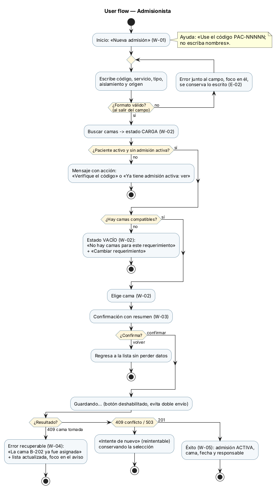
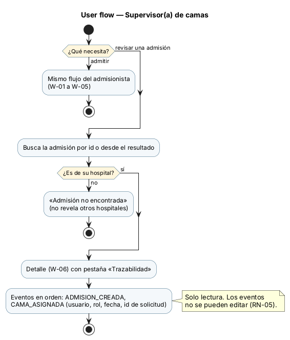
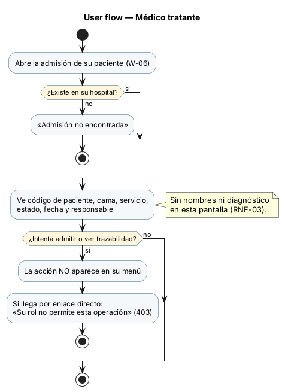

# Semana 8 — Diseño de experiencia de usuario

Módulo: **Admisión hospitalaria y asignación de cama** · Flujo: **admisión de paciente y asignación de una cama disponible**

- **Este archivo y `diagramas/semana-08-flujo-*`:** user flow por rol, estados, mensajes y protección de datos.
- **`wireframes/`:** 6 wireframes anotados, W-01 a W-06.

## 1. Roles autorizados y lo que ve cada uno

| Rol | Puede | No ve | Pantallas |
|---|---|---|---|
| `ADMISIONISTA` | Admitir y asignar cama (CU-01, CU-03, CU-05) | Trazabilidad completa | W-01 a W-05 |
| `SUPERVISOR_CAMAS` | Lo mismo, más trazabilidad (CU-06) | — | W-01 a W-06 |
| `MEDICO` | Consultar la admisión (CU-06) | Acciones de admitir y trazabilidad (RN-06) | W-06, sin pestaña de trazabilidad |

**Ninguna pantalla muestra nombres ni diagnóstico:** el paciente aparece solo con su código (RNF-03). El hospital lo fija la sesión; ninguna pantalla deja elegirlo (RNF-02).

## 2. User flow por rol

## 3. Estados del flujo

| Estado | Dónde | Mensaje / comportamiento |
|---|---|---|
| Inicio | W-01 | Título «Nueva admisión» y ayuda «Use el código PAC-NNNNN; no escriba nombres» |
| Carga | W-02 | «Buscando camas disponibles…» con `aria-busy`; el botón queda deshabilitado |
| Vacío | W-02 | «No hay camas disponibles para Medicina interna / General» + botón «Cambiar requerimiento» (E-05) |
| Decisión | W-02 | Lista de camas con radio; la primera queda seleccionada; se ve si es de aislamiento |
| Confirmación | W-03 | Resumen (código, cama, servicio, origen) + «Confirmar admisión» y «Volver» |
| Éxito | W-05 | «Admisión ACTIVA: PAC-00451 en cama B-201» con fecha y responsable |
| Error recuperable | W-01, W-04 | Formato (E-02), cama tomada (CU-05), conflicto o base no disponible (reintentable) |
| Error no recuperable | W-01 | «Paciente no encontrado o inactivo», «ya tiene una admisión activa», «Su rol no permite…» |

## 4. Errores recuperables y reglas de interacción
- **Validación temprana del formato:** al salir del campo de código, el error queda junto al campo y asociado con `aria-describedby`, con el foco en él. Nunca se borra lo escrito.
- **Doble envío:** «Confirmar» se deshabilita mientras se guarda. RN-02 protege también en el servidor.
- **Cama tomada (409 `CAMA_YA_ASIGNADA`):** aviso con `role="alert"` que nombra la cama, lista actualizada sin esa cama y foco en el aviso. Los datos del paciente y del requerimiento se conservan.
- **409 `CONFLICTO_CONCURRENCIA` / 503:** botón «Intentar de nuevo» con la selección conservada; no se reenvía solo.
- **Volver** desde la confirmación no pierde datos.

## 5. Ayuda contextual
- Campo de código: el formato esperado, un ejemplo ficticio y la advertencia de no escribir nombres.
- Aislamiento: «Marque solo si el paciente requiere aislamiento; las camas de aislamiento se reservan».
- Lista vacía: sugerencia de revisar el servicio o el tipo, o de avisar al supervisor.

## 6. Protección de datos
- Solo el código de paciente en pantallas, URL, títulos de pestaña y mensajes.
- En móvil o en una pantalla compartida, el resultado no muestra más que el código y la cama.
- Los mensajes de «no encontrado» no revelan si el dato existe en otro hospital.
- El médico no ve acciones que no puede usar. Si llega por enlace directo, recibe 403 con un mensaje claro.
