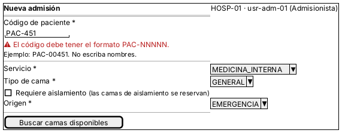
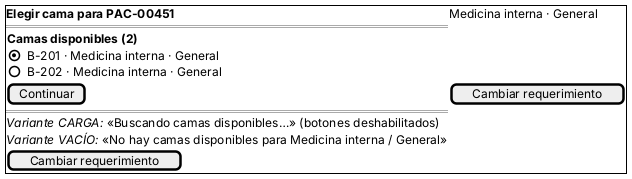
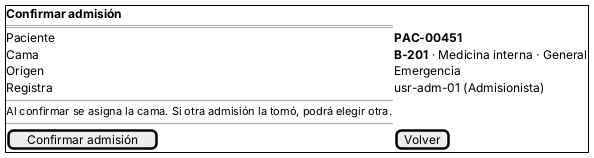
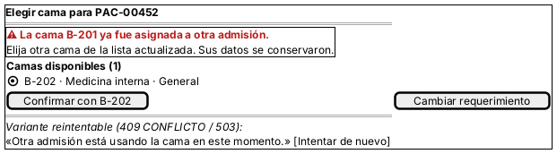
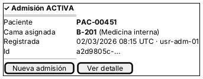
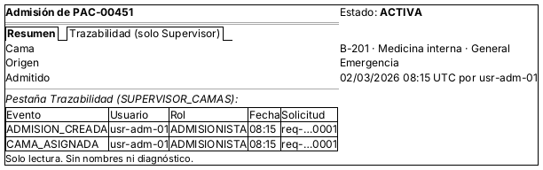

# Wireframes anotados (semana 8)

Seis wireframes en PlantUML Salt (`.puml` + `.png`). Todos usan datos ficticios y el paciente aparece solo con su código.

## W-01 Nueva admisión

| Anotación | Detalle |
|---|---|
| Estado | Inicio; aquí se muestra con un error de formato (E-02) |
| Validaciones | Código `PAC-NNNNN` al salir del campo; servicio, tipo y origen obligatorios |
| Mensajes | «El código debe tener el formato PAC-NNNNN.» junto al campo (`aria-describedby`), con el foco en el campo |
| Reglas de interacción | Lo escrito nunca se borra; «Buscar» se deshabilita mientras carga |
| Ayuda contextual | «Ejemplo: PAC-00451. No escriba nombres.» y la nota de aislamiento |
| Protección de datos | Hospital y usuario fijos (vienen de la sesión); no hay campo de nombre |

## W-02 Camas disponibles

| Anotación | Detalle |
|---|---|
| Estados | Carga («Buscando camas disponibles…», `aria-busy`), vacío (E-05) y decisión |
| Reglas | La primera cama queda seleccionada; la lista viene ordenada por código; solo aparecen camas operativas, libres y compatibles (RN-03, RN-04) |
| Mensajes | Vacío: «No hay camas disponibles para Medicina interna / General» + «Cambiar requerimiento» |
| Accesibilidad | Radios dentro de `fieldset` con `legend` «Camas disponibles (N)»; se navega con flechas |

## W-03 Confirmación

| Anotación | Detalle |
|---|---|
| Estado | Confirmación previa al guardado |
| Reglas | «Confirmar» se deshabilita al pulsarlo (evita doble envío); «Volver» conserva todo |
| Mensaje preventivo | «Si otra admisión la tomó, podrá elegir otra»: prepara al usuario para CU-05 |
| Datos | Código, cama, servicio, origen y responsable; nada más |

## W-04 Conflicto de cama (error recuperable)

| Anotación | Detalle |
|---|---|
| Disparador | `409 CAMA_YA_ASIGNADA` (RN-01): otra admisión confirmó primero |
| Mensaje | «La cama B-201 ya fue asignada a otra admisión.» en `role="alert"`, con el foco en el aviso |
| Recuperación | Lista actualizada sin la cama tomada y botón «Confirmar con B-202»; los datos se conservan |
| Variante reintentable | `409 CONFLICTO_CONCURRENCIA` o `503`: «Intentar de nuevo» sin reenviar solo |
| Implementado en el Micro-HIS | Sí: el controlador devuelve 409 y vuelve a la lista (prueba «Web: cama tomada responde 409…») |

## W-05 Resultado

| Anotación | Detalle |
|---|---|
| Estado | Éxito (`201`) |
| Mensaje | «Admisión ACTIVA» con código, cama, fecha UTC y responsable (`role="status"`) |
| Acciones | «Nueva admisión» y «Ver detalle» |

## W-06 Detalle de la admisión

| Anotación | Detalle |
|---|---|
| Roles | Médico: solo la pestaña Resumen. Supervisor(a): además, Trazabilidad |
| Reglas | Solo lectura; los eventos no se pueden editar (RN-05) |
| Protección | «Admisión no encontrada» si es de otro hospital; sin nombres ni diagnóstico |
| API | `GET /api/v1/admisiones/{id}` y `GET /api/v1/admisiones/{id}/eventos` |

Los `.png` se generaron desde sus `.puml` con PlantUML (Salt).
