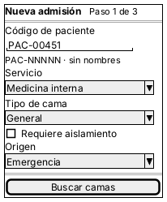
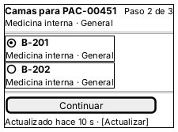
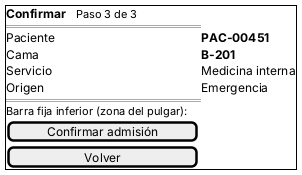
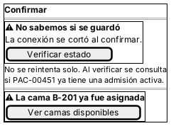

# Semana 10 — Diseño para movilidad

Módulo: **Admisión hospitalaria y asignación de cama** · Flujo: **admisión de paciente y asignación de una cama disponible**

Adaptación del flujo a teléfonos de **320 a 430 px** de ancho. Uso típico: un admisionista o supervisor(a) que se mueve entre emergencia y los servicios, con Wi-Fi del hospital irregular.

## 1. Jerarquía de datos y acciones

| Prioridad | En móvil se muestra | Se oculta o se pospone |
|---|---|---|
| 1 | Código de paciente, cama elegida y paso actual (1 de 3) | — |
| 2 | Servicio, tipo de cama, aislamiento y origen | Ayudas largas (detrás de «?») |
| 3 | Responsable y fecha (en el resultado) | Id de la admisión (en «Ver detalle») |
| — | — | Trazabilidad completa: solo en escritorio o en el detalle del supervisor |

**Menos carga cognitiva:** tres pasos (datos → cama → confirmar), **una sola decisión por pantalla**, valores por defecto (origen Emergencia, tipo General) y etiquetas legibles, no códigos técnicos (B-07 de la semana 9).

## 2. Pantallas (wireframes en Salt)

| Pantalla | Archivo | Decisión de contenido |
|---|---|---|
| M-01 Datos (paso 1 de 3) | `wireframes/m01-datos.puml` / `.png` | Una columna; el código va primero, con teclado de texto en mayúsculas (`autocapitalize="characters"`) |
| M-02 Camas (paso 2 de 3) | `wireframes/m02-camas.puml` / `.png` | Tarjetas en lugar de tabla; toda la tarjeta es el área táctil (≥ 44×44 px); «Actualizado hace N s» |
| M-03 Confirmar (paso 3 de 3) | `wireframes/m03-confirmar.puml` / `.png` | Resumen de 4 filas; barra inferior fija con «Confirmar» al alcance del pulgar |
| M-04 Conexión limitada / conflicto | `wireframes/m04-sin-conexion.puml` / `.png` | Mensaje honesto «No sabemos si se guardó» y acción «Verificar estado» |

   

## 3. Reglas de breakpoint

| Ancho | Disposición | Navegación | Tablas y formularios |
|---|---|---|---|
| 320 a 430 px | Una columna, margen de 16 px, sin desplazamiento horizontal | Paso actual arriba; «Volver» en la barra inferior; sin menú lateral | Las tablas pasan a tarjetas; un campo por fila; botones a todo el ancho |
| 431 a 767 px | Una columna con ancho máximo de 40 rem | Igual que en móvil | Tarjetas de 2 en 2 si caben |
| 768 px o más | Diseño de escritorio (semana 8) | Pasos en una sola página | La lista de camas puede ser una tabla |

Reglas comunes: texto base de 16 px (evita el zoom automático de iOS al enfocar un campo), áreas táctiles de 44 px o más, contraste AA (el mismo de la semana 9) y nada que dependa de pasar el cursor por encima.

## 4. Escenarios móviles

### E-M1 — Conexión limitada al confirmar
**Situación:** el admisionista confirma PAC-00451 en B-201 y la red se corta; no llega la respuesta.

| Decisión | Por qué |
|---|---|
| **No reintentar el POST solo** | Si la admisión sí se guardó, el reintento respondería 409 y confundiría (contrato API §4) |
| Mostrar «No sabemos si se guardó» + «Verificar estado» | Es honesto: el cliente no sabe el resultado |
| «Verificar estado» consulta si el paciente ya tiene una admisión activa | RN-02 hace que esa consulta diga la verdad, haya llegado o no el POST |
| Conservar los datos del formulario **solo en memoria** de la pestaña | No guardar datos del paciente en el teléfono (RNF-03); si se cierra la app, se vuelven a escribir |
| Tiempo máximo de espera visible: 10 s, después «Sin respuesta del servidor» | Evitar un spinner infinito |

### E-M2 — La cama se ocupa mientras el usuario confirma
**Situación:** en M-03, otro usuario confirmó B-201 un segundo antes.

| Decisión | Por qué |
|---|---|
| `409 CAMA_YA_ASIGNADA` → aviso «La cama B-201 ya fue asignada» que **nombra la cama** | Corrige H-06 de la semana 9 |
| Botón único «Ver camas disponibles», que vuelve a M-02 con la lista actualizada y conserva el paso 1 | Un solo toque para recuperarse |
| La lista de M-02 muestra «Actualizado hace N s» y un botón «Actualizar» | Mientras menos tiempo pasa, menos conflictos; la garantía sigue siendo RN-01 en el servidor |
| `409 CONFLICTO_CONCURRENCIA` → «Intentar de nuevo» manual | Es reintentable, pero no en bucle |

## 5. Pendientes
- Medir en dispositivos reales (320, 360, 390 y 430 px): el prototipo de la semana 11 genera capturas de 375×760.
- Confirmar con el líder si el HIS tendrá una app instalable o solo web.
