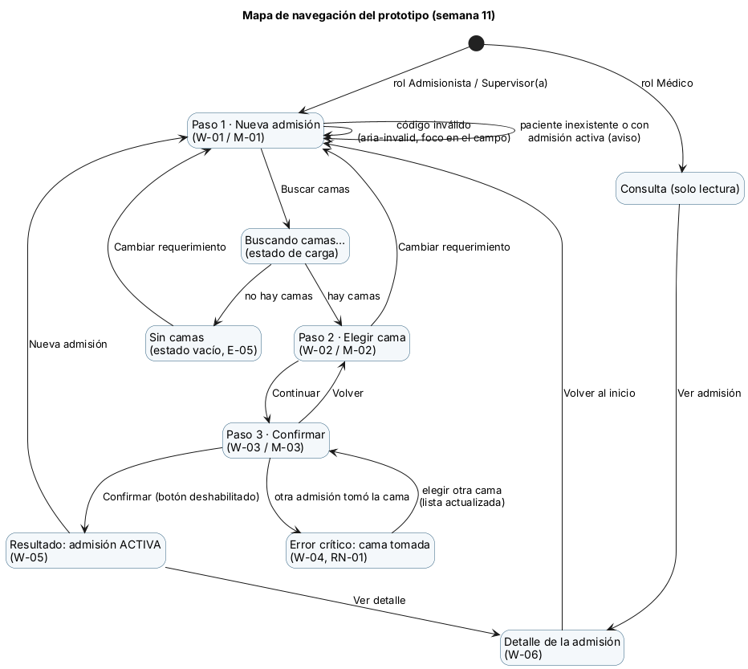
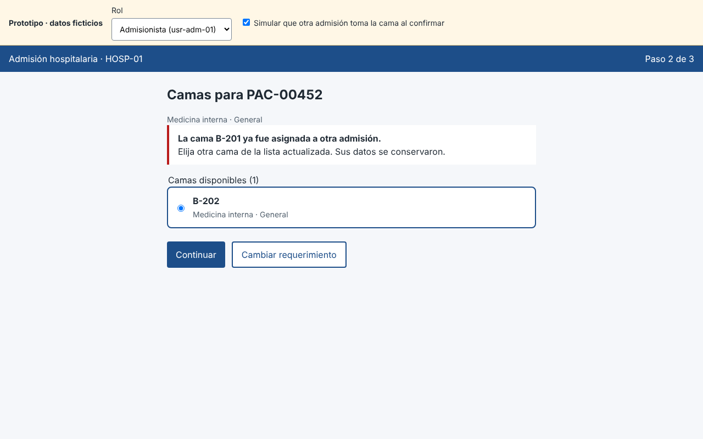

# Semana 11 — Mejores prácticas para diseño móvil/web

Módulo: **Admisión hospitalaria y asignación de cama** · Flujo: **admisión de paciente y asignación de una cama disponible**

## 1. Prototipo navegable

**Archivo:** `prototipo/index.html`. Se abre con doble clic en Chrome; no necesita servidor ni dependencias. Usa los mismos datos ficticios del Micro-HIS. La franja amarilla de arriba trae los **controles de demostración**:
- **Rol:** Admisionista, Supervisor(a) o Médico, para comprobar que los roles se respetan (RN-06).
- **«Simular que otra admisión toma la cama al confirmar»:** provoca el **error crítico** (RN-01, `409 CAMA_YA_ASIGNADA`).

| Recorrido | Pasos |
|---|---|
| Camino feliz | PAC-00451 → Buscar camas → B-201 → Continuar → Confirmar → «Admisión ACTIVA» |
| Error crítico | Marcar la simulación → PAC-00452 → B-201 → Confirmar → aviso «La cama B-201 ya fue asignada…» con la lista actualizada (B-202) → desmarcar → Confirmar con B-202 → éxito |
| Roles | Médico: sin acción de admitir, solo consulta. Supervisor(a): en el detalle ve la tabla de trazabilidad |

## 2. Mapa de navegación

## 3. Capturas (escritorio 1280×800 y móvil 375×760)

| Paso | Escritorio | Móvil |
|---|---|---|
| 1 Datos | `capturas/desktop-01-datos.png` | `capturas/movil-01-datos.png` |
| 2 Camas | `capturas/desktop-02-camas.png` | `capturas/movil-02-camas.png` |
| 3 Confirmar | `capturas/desktop-03-confirmar.png` | `capturas/movil-03-confirmar.png` |
| 4 Resultado (camino feliz) | `capturas/desktop-04-resultado.png` | `capturas/movil-04-resultado.png` |
| 5 **Error crítico** | `capturas/desktop-05-error-critico.png` | `capturas/movil-05-error-critico.png` |
| 6 Recuperado con otra cama | `capturas/desktop-06-recuperado.png` | `capturas/movil-06-recuperado.png` |

Las capturas las generó el recorrido automático `capturas/recorrido.py` (Python + Playwright). La salida que obtuve en mi entorno está en `capturas/recorrido.txt`:
- **0 errores** de JavaScript o de consola en los dos tamaños.
- **Sin desplazamiento horizontal** (ancho del documento igual al de la ventana: 1280/1280 y 375/375).
- El foco va al título en cada paso y al aviso en el error crítico; nunca queda en `BODY`.
- El código inválido deja el campo con `aria-invalid="true"` y `aria-describedby="error-paciente ayuda-paciente"`.
- Tras el primer clic, «Confirmar» queda deshabilitado y muestra «Guardando…».

## 4. Prácticas aplicadas y su relación con la semana 9

| Práctica | Backlog | Dónde |
|---|---|---|
| Paso de confirmación antes de registrar | B-01 | Paso 3 |
| Validación del código al salir del campo y antes de buscar camas | B-02 | Paso 1 |
| Error asociado al campo (`aria-invalid`, `aria-describedby`) | B-03 | Paso 1 |
| Foco gestionado: título o aviso | B-04 | Todos los pasos |
| El conflicto nombra la cama, sin código técnico | B-05 | Error crítico |
| Sin doble envío | B-06 | Confirmar |
| Etiquetas legibles («Medicina interna», «General») | B-07 | Selects y tarjetas |
| Controles de demostración separados del flujo | B-08 | Franja amarilla |
| Móvil: tarjetas, áreas táctiles de 44 px o más, barra fija solo en Confirmar | Semana 10 | `estilos.css` |
| Mismos colores AA verificados | Semana 9 | `estilos.css` (`:root`) |

## 5. Defecto encontrado y corregido
**D-03:** en 375 px la barra de acciones fija tapaba el campo «Origen» del paso 1. Lo detecté en la captura `movil-01-datos`. Se corrigió dejando la barra fija solo en «Confirmar». Se registra en la semana 15.

## 6. Límites del prototipo
- Es un prototipo de interacción: no llama a la API, los datos viven en memoria y se reinician al recargar.
- El conflicto se **simula** con el control de demostración. En el Micro-HIS real lo produce `ux_asignacion_cama_activa` (semana 3).
