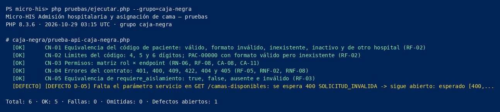

# Semana 15 — Pruebas unitarias, caja blanca y caja negra

Módulo: **Admisión hospitalaria y asignación de cama** · Flujo: **admisión de paciente y asignación de una cama disponible**

Las pruebas se escribieron en el Micro-HIS (parte A) y se ejecutan con su ejecutor propio. **No prueban módulos ajenos:** el catálogo y Pacientes se simulan con dobles, InMemory o las tablas simuladas.

| Tipo | Mínimo | Entregadas | Archivo |
|---|---|---|---|
| Unitarias (reglas) | 3 | 4 nuevas (U-01 a U-04) y 53 de semanas anteriores (grupo `unitarias`: 57) | `micro-his/pruebas/unitarias/prueba-limites-dominio.php` |
| Caja blanca | 2 | 14 (CB-01 a CB-14) | `micro-his/pruebas/caja-blanca/prueba-ramas-admitir.php` |
| Caja negra | 4 | 5 (CN-01 a CN-05) + 1 que documenta D-05 | `micro-his/pruebas/caja-negra/prueba-api-caja-negra.php` |

## 1. Matriz RF/RNF → prueba

| Requisito | Pruebas que lo verifican |
|---|---|
| RF-01 Registrar admisión | «Camino feliz: PAC-00451 queda admitido en B-201 (CA-01)», CN-01 |
| RF-02 Validar paciente | U-02, CB-02, CB-05, CB-06, CN-01, CN-02 |
| RF-03 Camas disponibles y compatibles | U-01, U-03, CN-05, «Medicina interna general: solo B-201 y B-202 (CA-05)», «Con aislamiento: solo B-210 (CA-06)» |
| RF-04 Todo o nada | «Error de persistencia a mitad de la transacción revierte todo (CA-12, RNF-08)», CB-10 |
| RF-05 Conflicto recuperable | «RN-01: dos admisiones que pasaron la verificación previa…», «RN-01 simultáneo…», CB-08, CN-04 |
| RF-06 Eventos de trazabilidad | «Admision::abrir deja la admisión ACTIVA con dos eventos de trazabilidad (RN-05)», «Camino feliz con PostgreSQL…» |
| RF-07 Consultar admisión | «El médico consulta la admisión…», CN-03 |
| RF-08 Trazabilidad (supervisor) | «Trazabilidad por API…», CN-03 |
| RNF-01 Integridad concurrente | «RN-01 simultáneo…» (dos conexiones), contrato «[InMemory] RN-01: la misma cama no se asigna dos veces…» y «[PDO] RN-01: la misma cama no se asigna dos veces…» |
| RNF-02 Rol y tenant | U-04, CB-01, CB-07, CN-03, «Tenant del token…» |
| RNF-03 Privacidad | «POST /admisiones: 201, Location, X-Request-Id y solo datos mínimos…», «X-Request-Id inválido…» |
| RNF-04 Rendimiento | Sin prueba automática: se mide con M-03 (`semana-14/metricas-sqa.php`) |
| RNF-05 Observabilidad | «X-Request-Id inválido se reemplaza…» |
| RNF-06 Mantenibilidad (OCP) | «OCP: un criterio nuevo se agrega sin modificar el evaluador (RNF-06)», `prueba-dependencias.php` |
| RNF-07 Accesibilidad | Fuera del ejecutor PHP: `semana-09/evidencia/auditoria-navegador.py` y `semana-11/capturas/recorrido.py` |
| RNF-08 Resiliencia | «Error de persistencia a mitad…», «Error de persistencia: 503 reintentable…», «RN-01 simultáneo…» (`lock_timeout`) |

## 2. Unitarias (reglas, valores límite)

| ID | Regla | Valores |
|---|---|---|
| U-01 | Servicio del requerimiento | 3 y 40 letras válidos; 2 y 41 no |
| U-02 | Formato `PAC-NNNNN` | `PAC-00000` y `PAC-99999` válidos; 4 y 6 dígitos no |
| U-03 | RN-04: cama no operativa | `B-203` → `CamaNoElegible` «La cama no está operativa.» |
| U-04 | Formato del hospital | `HOSP-00` y `HOSP-99` válidos; `HOSP-100` y `HOSP-1` no |

## 3. Caja blanca

**Objeto:** `AdmitirPacienteYAsignarCama::ejecutar()`. Tiene 9 decisiones; cada una lanza una excepción o deja continuar.

| Decisión | Condición en el código | Rama verdadera (error) | Rama falsa (continúa) |
|---|---|---|---|
| D1 | `exigirRol(ADMISIONISTA, SUPERVISOR_CAMAS)` | CB-01 (MEDICO) | CB-02 a CB-10 (ADMISIONISTA), CB-10 (SUPERVISOR) |
| D2 | `CodigoPaciente::desde` | CB-02 | CB-03 en adelante |
| D3 | `Requerimiento::desde` | CB-03 | CB-04 en adelante |
| D4 | `OrigenAdmision::tryFrom` | CB-04 | CB-05 en adelante |
| D5 | `!existeActivo` | CB-05 | CB-06 en adelante |
| D6 | `tieneAdmisionActiva` | CB-06 | CB-07 en adelante |
| D7 | `catalogo->buscar === null` | CB-07 | CB-08 en adelante |
| D8 | `in_array(cama, camasOcupadas)` | CB-08 | CB-09, CB-10 |
| D9 | `motivosDeRechazo !== []` (en `Admision::abrir`) | CB-09 | CB-10 |

**Cobertura de decisiones:** las 9 decisiones se ejercitan en sus dos resultados, y cada rama de error verifica además que **no** se llegó a `registrar()`. La condición múltiple de D1 se cubre con los tres roles. Para `CriterioAislamiento`, CB-11 a CB-14 cubren las **4 combinaciones** de (requiere aislamiento, cama de aislamiento). **La cobertura se razonó a mano:** no hay Xdebug ni PCOV en mi entorno para medirla con una herramienta.

## 4. Caja negra (solo contrato de la API v1)

| ID | Técnica | Casos |
|---|---|---|
| CN-01 | Clases de equivalencia del código | Válido → 201; formato inválido → 422; inexistente, inactivo o de otro hospital → 404 |
| CN-02 | Valores límite | `PAC-0045` → 422; `PAC-00451` → 201; `PAC-004510` → 422; `PAC-00000` → 404 |
| CN-03 | Permisos (rol × endpoint) | ADMISIONISTA, SUPERVISOR_CAMAS y MEDICO contra los 4 endpoints (matriz esperada dentro de la prueba) |
| CN-04 | Errores | 401, 400, 409 `CAMA_YA_ASIGNADA`, 422 `CAMA_NO_ELEGIBLE`, 404 `RECURSO_NO_ENCONTRADO` y 405 |
| CN-05 | Equivalencia de `requiere_aislamiento` | `true`, `false`, ausente y `1` (inválido → 400) |
| D-05 | Error: parámetro obligatorio ausente | Se espera 400 y se obtiene 422 (**defecto abierto**) |

## 5. Comandos y resultados

Desde `micro-his/`, con la base arriba:

```powershell
php pruebas/ejecutar.php --grupo=unitarias
php pruebas/ejecutar.php --grupo=caja-blanca
php pruebas/ejecutar.php --grupo=caja-negra
php pruebas/ejecutar.php --evidencia=../semana-15/evidencia/salida-pruebas.txt
```

Resultados en mi entorno (PHP 8.3, PostgreSQL 16):

| Comando | Última línea |
|---|---|
| `--grupo=caja-blanca` | `Total: 14 · OK: 14 · Fallas: 0 · Omitidas: 0 · Defectos abiertos: 0` |
| `--grupo=caja-negra` | `Total: 6 · OK: 5 · Fallas: 0 · Omitidas: 0 · Defectos abiertos: 1` |
| Todas | `Total: 101 · OK: 100 · Fallas: 0 · Omitidas: 0 · Defectos abiertos: 1` |

**Capturas:** `capturas/salida-caja-blanca.png` y `capturas/salida-caja-negra.png` son **imágenes generadas a partir de la salida real** de esos comandos en mi entorno, no capturas de pantalla de tu terminal. Si el ingeniero pide una captura de tu PowerShell, tómala tú después de correr los comandos.



## 6. Defectos

Registro completo en `defectos.md`. Hay 5 defectos reales: **D-01 a D-04 cerrados** (cada uno con su prueba de regresión) y **D-05 abierto**, con la prueba marcada `[DEFECTO D-05]`.
