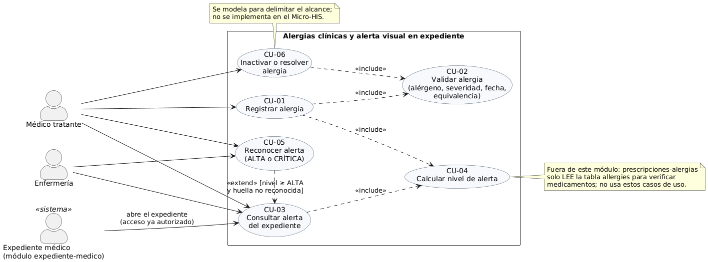
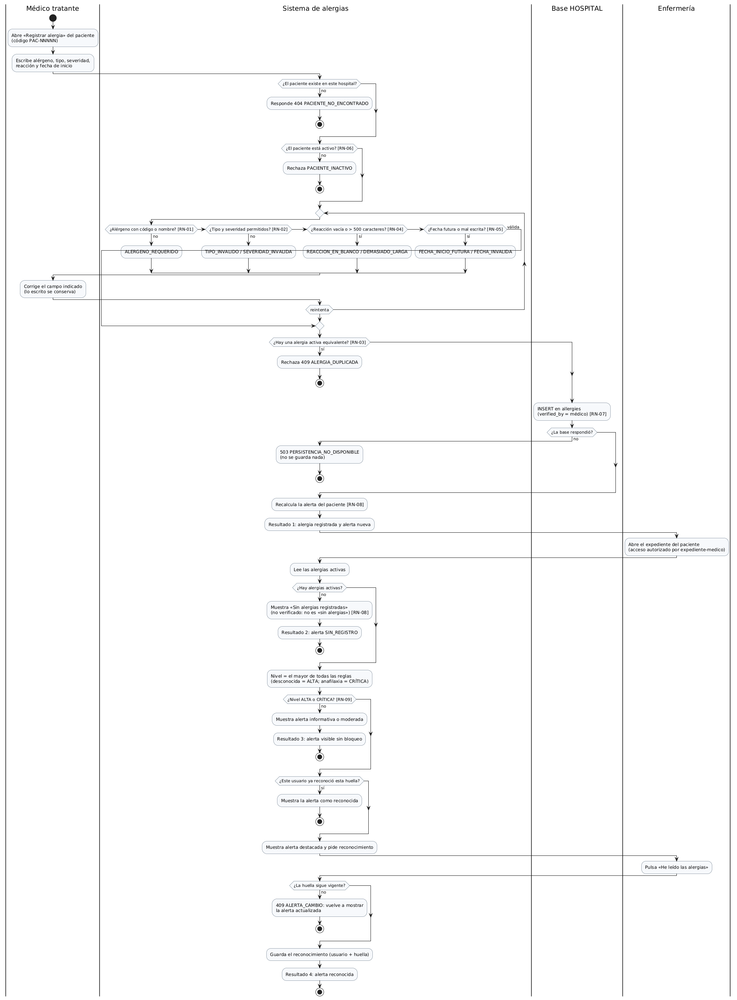
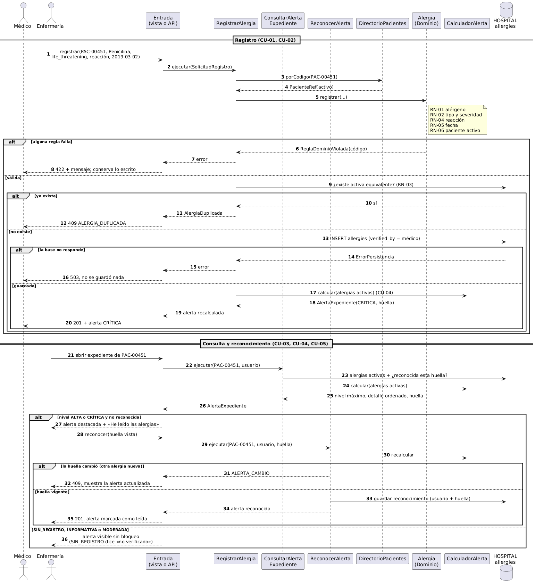

# Semana 1 — UML del proceso «registro de alergia y emisión de alerta al consultar el expediente»

Módulo: **Alergias clínicas y alerta visual en expediente** · Estudiante: Erick Rolando Ramazzini Muralles

## 1. Narrativa de alcance

**Objetivo del módulo.** Que toda persona autorizada que abra el expediente de un paciente vea, antes de cualquier otra cosa, las alergias activas con su severidad, y que una alerta grave quede reconocida por quien la leyó. El módulo también es el único que **registra** alergias en la tabla `allergies` de la base HOSPITAL.

**Problema que resuelve.** Una alergia escrita en una nota libre se pierde. Una alergia guardada pero mostrada igual que cualquier otro dato tampoco protege al paciente. Este módulo:

- convierte la alergia en un dato estructurado (alérgeno, tipo, severidad, reacción y fecha de inicio);
- calcula un nivel de alerta;
- exige un reconocimiento explícito cuando el riesgo es alto.

### Actores

| Actor | Tipo | Objetivo en este módulo |
|---|---|---|
| Médico tratante | Principal | Registrar alergias verificadas (queda como `verified_by_user_ref_id`), consultar y reconocer la alerta |
| Enfermería | Principal | Consultar la alerta antes de administrar y reconocerla |
| Expediente médico (módulo `expediente-medico`) | Sistema | Autoriza el acceso al expediente y dispara la consulta de la alerta |

### Frontera con otros módulos

| Tema | Dueño | Qué hace este módulo |
|---|---|---|
| Escritura en `allergies` (alta; inactivar o resolver) | **Este módulo** | Valida y guarda. Ningún otro módulo escribe en la tabla |
| Alerta visual y reconocimiento | **Este módulo** | Calcula el nivel y guarda quién reconoció qué versión de la alerta |
| Verificar alergias contra un medicamento | `prescripciones-alergias` | Nada: ese módulo **lee** `allergies` por su cuenta |
| Acceso al expediente, consentimiento y auditoría del acceso | `expediente-medico` | Se ejecuta solo después de ese acceso; igual repite el control de rol y tenant |
| Identidad del paciente (`local_patients`) | `pacientes` | Solo lee `local_patient_id`, `code` y `status` |

### Dentro y fuera del alcance

- **Dentro:** CU-01 a CU-05, y CU-06 solo como modelo.
- **Fuera:**
  - la interacción alergia–medicamento y la reactividad cruzada, que son de prescripciones;
  - la codificación de alérgenos con un catálogo externo;
  - las alergias de otro hospital, para las que el acceso entre hospitales lo decide expediente-medico.

### Datos reales usados

La tabla `allergies` existe en HOSPITAL (`database/migrations/hospital/2026_08_11_000401_create_allergy_and_vital_sign_tables.php`). Sus columnas son:

- `allergy_id`, `local_patient_id`, `verified_by_user_ref_id` (obligatorio);
- `allergen_code` y `allergen_name` (al menos uno de los dos);
- `reaction`, `allergy_type` (`allergy|intolerance|unknown`) y `severity` (`mild|moderate|severe|life_threatening|unknown`);
- `status` (`active|inactive|resolved`), `onset_date`, `resolved_at` y `recorded_at`.

La tabla tiene además un índice único de alergia activa equivalente y un trigger que impide borrar filas. **No existe** una tabla para guardar reconocimientos de alertas: la que se use será una **propuesta** de este módulo.

**Datos ficticios** usados en todo el módulo:

- **PAC-00451:** tiene alergia a Ibuprofeno, moderada, con urticaria. En los ejemplos se le registra Penicilina con severidad `life_threatening`.
- **PAC-00452:** activo y sin alergias registradas.
- **PAC-00453:** fallecido (`deceased`).
- **Hospital:** H-01.

## 2. Casos de uso

| CU | Actor | Objetivo | Precondición | Resultado |
|---|---|---|---|---|
| CU-01 Registrar alergia | Médico | Dejar una alergia verificada en el expediente | Paciente activo del hospital; usuario con permiso de registro | Fila en `allergies` y alerta recalculada |
| CU-02 Validar alergia | (incluido) | Aplicar RN-01 a RN-06 antes de guardar | — | Alergia válida o error con código |
| CU-03 Consultar alerta | Médico, Enfermería, Expediente | Ver las alergias activas y el nivel al abrir el expediente | Acceso al expediente autorizado | Alerta con nivel, detalle y huella |
| CU-04 Calcular nivel | (incluido) | Decidir el nivel con RN-08 | — | `SIN_REGISTRO`, `INFORMATIVA`, `MODERADA`, `ALTA` o `CRITICA` |
| CU-05 Reconocer alerta | Médico, Enfermería | Confirmar que leyó una alerta ALTA o CRÍTICA | Alerta pendiente para ese usuario | Reconocimiento ligado a la huella vigente |
| CU-06 Inactivar o resolver | Médico | Cerrar una alergia sin borrarla | Alergia activa | `status` y `resolved_at` (solo modelado) |

## 3. Reglas de negocio

| ID | Regla |
|---|---|
| RN-01 | El alérgeno se identifica por código o por nombre; al menos uno con texto |
| RN-02 | Tipo ∈ {allergy, intolerance, unknown}; severidad ∈ {mild, moderate, severe, life_threatening, unknown} |
| RN-03 | No puede haber dos alergias **activas** equivalentes: mismo paciente, tipo y alérgeno sin distinguir mayúsculas ni espacios |
| RN-04 | La reacción es opcional; si viene, no puede estar en blanco ni pasar de 500 caracteres |
| RN-05 | La fecha de inicio no puede ser futura y debe tener formato AAAA-MM-DD |
| RN-06 | Solo se registran alergias de pacientes con `status = active` |
| RN-07 | Solo un rol con permiso de registro (médico) registra; queda como `verified_by_user_ref_id` |
| RN-08 | Nivel = el mayor entre las reglas aplicadas a cada alergia activa. `unknown` cuenta como ALTA. Sin alergias el nivel es `SIN_REGISTRO`, que **no** significa «sin alergias» |
| RN-09 | ALTA y CRÍTICA exigen un reconocimiento por usuario; el reconocimiento vale solo para la huella vigente (si cambian las alergias activas, se vuelve a pedir) |
| RN-10 | Las alergias no se borran; se inactivan o resuelven con fecha |
| RN-11 | Solo se ven y escriben datos del hospital (tenant) del usuario |

## 4. Actividad y secuencia

El diagrama de actividad tiene:

- **Decisiones:** paciente existe; activo; cuatro validaciones; equivalente activa; base disponible; hay alergias; nivel ≥ ALTA; ya reconocida; huella vigente.
- **Excepciones:** 404, 409 de duplicado, 422 por regla y 503 sin guardar nada.
- **Resultados:**
  1. alergia registrada;
  2. `SIN_REGISTRO`;
  3. alerta sin bloqueo;
  4. alerta reconocida.

La secuencia muestra los participantes por capa, las validaciones (nota RN-01 a RN-06, RN-03 en la base) y las respuestas 201, 409, 422 y 503 del registro, y 409 `ALERTA_CAMBIO` y 201 del reconocimiento.

## 5. Trazabilidad entre los tres diagramas

| CU | Actividad (nodo) | Secuencia (mensajes) | Reglas |
|---|---|---|---|
| CU-01 | «Abre Registrar alergia» → «INSERT en allergies» → Resultado 1 | 1–5, 9, 13, 20 | RN-07 |
| CU-02 | Decisiones paciente existe/activo y bucle de 4 validaciones | 3–8 | RN-01, RN-02, RN-04, RN-05, RN-06 |
| CU-02 (equivalencia) | «¿Hay una alergia activa equivalente?» | 9–12 | RN-03 |
| CU-01 (error de persistencia) | «¿La base respondió?» → 503 | 13–16 | — |
| CU-04 | «Recalcula la alerta» y «Nivel = el mayor…» | 17–18, 24–25 | RN-08 |
| CU-03 | «Abre el expediente» → «Lee las alergias activas» → Resultados 2 y 3 | 21–26, 36 | RN-08, RN-11 |
| CU-05 | «Pulsa He leído» → «¿La huella sigue vigente?» → Resultado 4 | 27–35 | RN-09 |
| CU-06 | No aparece: solo modelado en casos de uso | — | RN-10 |

## 6. Decisiones de esta semana

- **DEC-01:** El reconocimiento se guarda por usuario y por huella. Si se registra una alergia nueva, la alerta vuelve a pedir reconocimiento. Reconocer una vez «para siempre» ocultaría el cambio.
- **DEC-02:** `SIN_REGISTRO` se muestra en gris neutro, nunca en verde. La tabla no puede expresar «sin alergias conocidas», y mostrar verde daría una falsa seguridad.
- **DEC-03:** La severidad `unknown` se trata como ALTA (propuesta de seguridad clínica, por verificar con el docente).
