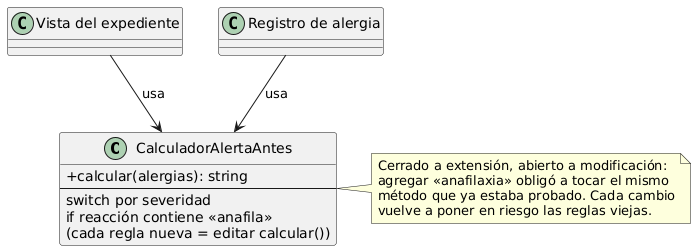
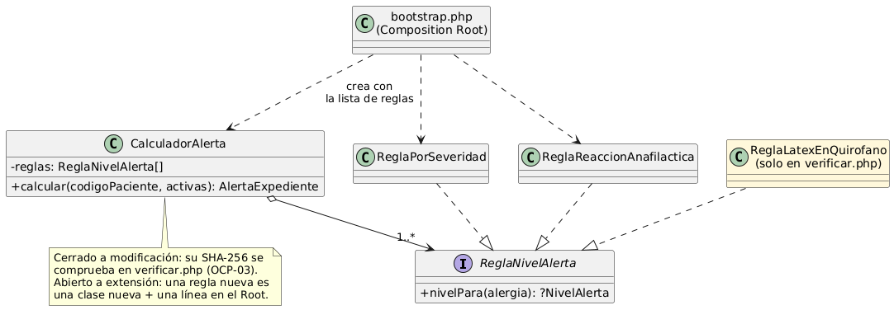

# Semana 2 — Principio abierto/cerrado (OCP) en el cálculo de la alerta

## 1. Dónde aplica y por qué

El nivel de alerta (CU-04, RN-08) es la parte del flujo que **más va a cambiar**. Hoy depende de la severidad, y ya llegó un cambio clínico: «una reacción anafiláctica siempre es CRÍTICA». Es previsible que lleguen más reglas, por ejemplo por alérgeno, por servicio o por embarazo. Si cada regla nueva obliga a editar el mismo método, cada cambio pone en riesgo las reglas que ya funcionaban.

OCP pide que el calculador quede **cerrado a modificación** y **abierto a extensión**.

## 2. Antes



[`ejemplo-ocp/antes/CalculadorAlertaAntes.php`](ejemplo-ocp/antes/CalculadorAlertaAntes.php) tiene un `switch` por severidad y un `if` para la anafilaxia en el mismo método. Para agregar la regla de anafilaxia hubo que editar `calcular()`:

```diff
             default: $propuesto = 'INFORMATIVA';
         }
+        // Cambio pedido después: «una reacción anafiláctica siempre es CRÍTICA».
+        if (str_contains(mb_strtolower($a['reaccion'] ?? ''), 'anafila')) {
+            $propuesto = 'CRITICA';
+        }
```

## 3. Después



| Elemento | Responsabilidad | Depende de |
|---|---|---|
| `ReglaNivelAlerta` (interfaz) | Contrato: dada una alergia, propone un nivel o `null` si no aplica | — |
| `ReglaPorSeveridad` | `life_threatening` → CRÍTICA; `severe` y `unknown` → ALTA; `moderate` → MODERADA; `mild` → INFORMATIVA | La interfaz |
| `ReglaReaccionAnafilactica` | Reacción con «anafila» → CRÍTICA | La interfaz |
| `CalculadorAlerta` | Toma el **mayor** nivel propuesto por todas las reglas para todas las alergias activas | Solo la interfaz |
| `bootstrap.php` (Composition Root, desde la semana 3) | Decide qué reglas existen y en qué orden se pasan | Las clases concretas |

**Por qué estas dependencias.** El calculador es la política estable («el mayor gana»), y las reglas son el detalle que cambia. La dependencia va del calculador hacia la abstracción y nunca hacia una regla concreta. Solo el Composition Root conoce las clases concretas.

## 4. Evidencia verificable

[`ejemplo-ocp/verificar.php`](ejemplo-ocp/verificar.php) hace 10 verificaciones:

| ID | Qué comprueba |
|---|---|
| OCP-01 (×6) | Antes y después dan el mismo nivel en los 6 casos: sin alergias, leve, moderada + grave, desconocida, riesgo vital y moderada con anafilaxia. El refactor no cambió el comportamiento |
| OCP-02 | Una regla **nueva** (`ReglaLatexEnQuirofano`), escrita solo dentro de `verificar.php`, se aplica sin editar ningún archivo existente |
| OCP-03 | `despues/CalculadorAlerta.php` conserva el SHA-256 registrado. Si alguien lo edita, la verificación falla (lo comprobé editando una línea: OCP-03 pasó a FALLA) |
| OCP-04 | El código del calculador, sin comentarios, no menciona severidad ni anafilaxia: no conoce reglas concretas |
| ANT-01 | En el «antes», severidad y anafilaxia viven en el mismo método |

Comando, desde la raíz del repositorio:

```powershell
php docs/modulos/alergias-clinicas-alerta-visual-expediente/semana-02/ejemplo-ocp/verificar.php --evidencia=docs/modulos/alergias-clinicas-alerta-visual-expediente/semana-02/evidencia/salida-ocp.txt
```

El resultado esperado es `RESULTADO: 10 verificaciones, 0 fallas` y código de salida 0. La salida queda en `semana-02/evidencia/salida-ocp.txt`, en UTF-8.

