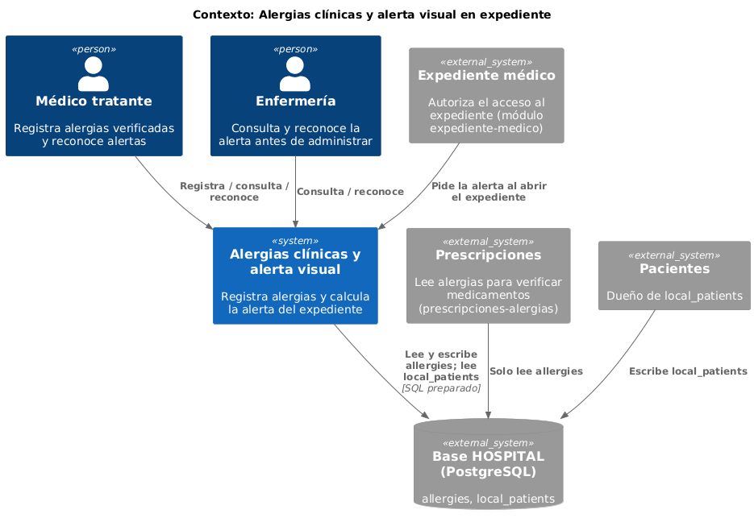
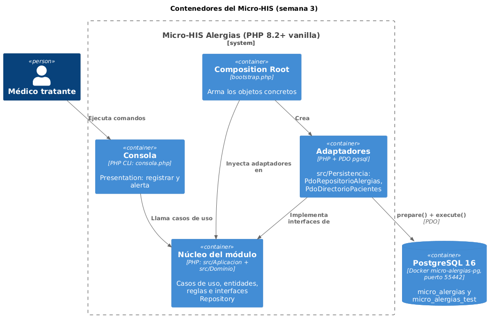
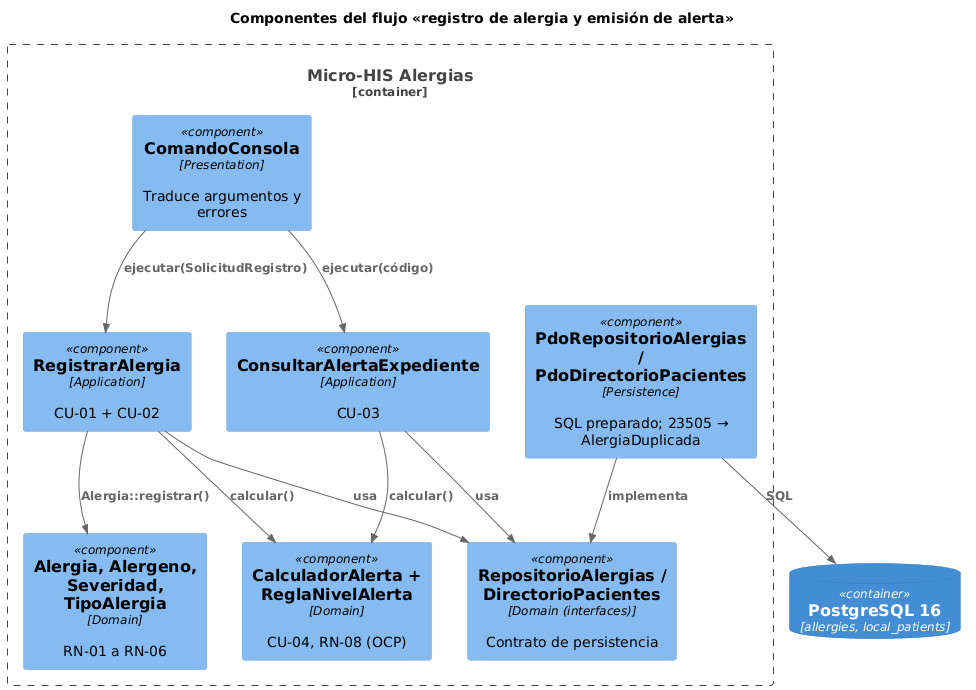
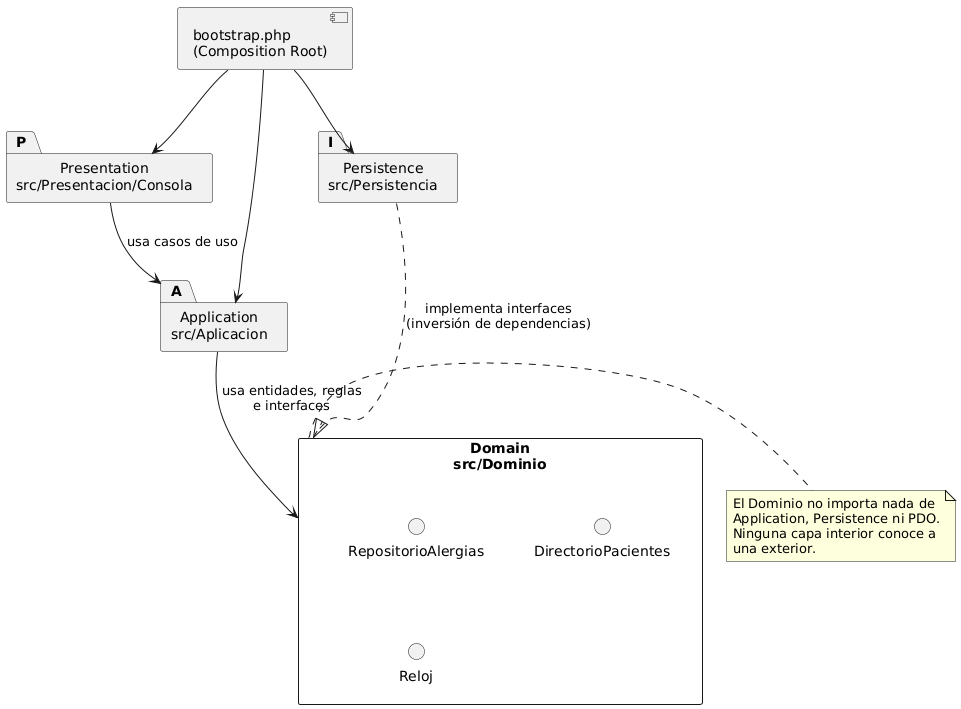

# Semana 3 — Diseño arquitectónico: Micro-HIS en cuatro capas

Módulo: **Alergias clínicas y alerta visual en expediente** · Flujo: «registro de alergia y emisión de alerta al consultar el expediente»

El código vive en [`../micro-his/`](../micro-his/README.md), fuera de las carpetas de semana, porque las semanas 4 y 5 lo hacen evolucionar. Es PHP 8.2+ vanilla, sin framework ni Composer, con PDO pgsql y sentencias preparadas.

## 1. Capas y responsabilidades

| Capa | Carpeta | Contiene | No puede |
|---|---|---|---|
| Presentation | `src/Presentacion/Consola`, `consola.php` | `ComandoConsola`: lee `--clave=valor`, llama al caso de uso y traduce el resultado o el error a texto y código de salida | Tener reglas o SQL |
| Application | `src/Aplicacion` | `RegistrarAlergia` (CU-01 y CU-02), `ConsultarAlertaExpediente` (CU-03), `SolicitudRegistro`, `PacienteNoEncontrado` | Conocer PDO o la consola |
| Domain | `src/Dominio` | `Alergia`, `Alergeno`, `Severidad`, `TipoAlergia`, `PacienteRef`, `NivelAlerta`, `AlertaExpediente`, `CalculadorAlerta` y sus reglas (OCP de la semana 2); **interfaces** `RepositorioAlergias`, `DirectorioPacientes` y `Reloj`; excepciones con código | Importar nada de las otras capas |
| Persistence | `src/Persistencia` | `PdoRepositorioAlergias` y `PdoDirectorioPacientes` (implementan las interfaces del Dominio), `FabricaConexion` y `RelojSistema` | Decidir reglas: solo traduce SQL y errores |
| Composition Root | `bootstrap.php` | Único lugar que hace `new` de clases concretas | — |

## 2. Vistas arquitectónicas (C4 y dependencias)









Las dependencias apuntan hacia el Dominio. Se puede comprobar desde `micro-his/`; los dos comandos deben responder `0`:

```powershell
(Select-String -Path src\Dominio\*.php, src\Dominio\Reglas\*.php -Pattern 'use Alergias\\(Aplicacion|Persistencia|Presentacion)|\bPDO\b').Count
(Select-String -Path src\Aplicacion\*.php -Pattern 'use Alergias\\(Persistencia|Presentacion)|\bPDO\b').Count
```

## 3. Persistencia sobre las tablas reales

- `allergies` replica las columnas, los CHECK, el índice único `allergies_active_equivalent_unique` y la prohibición de borrar de la migración real de HOSPITAL. El cuerpo del trigger real no se copió; aquí se imita su comportamiento con el mismo mensaje.
- `local_patients` y `local_user_refs` solo llevan las columnas que usa este módulo.
- El esquema se crea con `scripts/crear-esquema.php`, un script PHP y no un `.sh`, para evitar el problema de los saltos de línea en Windows.
- Todas las consultas usan `prepare()` + `execute()`, sin repetir el mismo parámetro con nombre en una consulta.
- SQLSTATE `23505` (dos registros equivalentes a la vez) se traduce a `AlergiaDuplicada`. Cualquier otra falla de PDO se traduce a `ErrorPersistencia`.

## 4. Pruebas

Las pruebas usan el ejecutor propio `pruebas/ejecutar.php`, que carga cada archivo en su propio ámbito.

| ID | Tipo | Qué prueba | CA / RN |
|---|---|---|---|
| T-01 | Camino feliz (dobles) | Registrar Penicilina → CRÍTICA, pendiente de reconocer, `verified_by` = médico | CA-01 |
| T-02 | Regla de dominio | Duplicado con mayúsculas y espacios → `ALERGIA_DUPLICADA` | CA-05, RN-03 |
| T-03 | Regla de dominio | Fecha futura → `FECHA_INICIO_FUTURA`, nada guardado | CA-03, RN-05 |
| T-04 | Regla de dominio | Paciente `deceased` → `PACIENTE_INACTIVO` | CA-04, RN-06 |
| T-05 | Regla de dominio | `unknown` → ALTA | RN-08 |
| T-06 | Regla de dominio | Sin alergias → `SIN_REGISTRO`, sin reconocimiento | CA-07 |
| T-07 | Error de persistencia (doble) | El caso de uso no oculta `ErrorPersistencia` | RNF-05 |
| T-08 | Error | Paciente inexistente → `PacienteNoEncontrado` | RF-02 |
| T-09 | Regla (OCP) | Reacción «Anafilaxia» sube MODERADA a CRÍTICA | RN-08 |
| T-10 | Camino feliz (PostgreSQL) | Guarda en `allergies` y la consulta devuelve CRÍTICA con 2 alergias | CA-01, CA-06 |
| T-11 | Regla en la base | Dos inserciones equivalentes → SQLSTATE 23505 → `AlergiaDuplicada` | RN-03 |
| T-12 | Error de persistencia (base de prueba) | Escritura rechazada (`read_only`) → `ErrorPersistencia` y 0 filas nuevas | CA-11 |
| T-13 | Error de persistencia | Base caída al conectar → `ErrorPersistencia`, no `PDOException` | RNF-05 |
| T-14 | Defensa en profundidad | La base rechaza reacción en blanco y `DELETE` | RN-04, RN-10 |

Sin PostgreSQL, T-10, T-11, T-12 y T-14 aparecen como **OMITIDA**, no como falla.

## 5. Cómo ejecutar (Windows, PowerShell, desde `micro-his/`)

```powershell
docker compose up -d
docker compose ps                       # esperar STATUS = healthy
php scripts/crear-esquema.php --datos   # crea micro_alergias_test y el esquema en las dos bases
php pruebas/ejecutar.php --evidencia=../semana-03/evidencia/salida-pruebas-base.txt
php consola.php alerta --paciente=PAC-00451
```

## 6. Decisiones

- **DEC-04:** La interfaz Repository vive en el Dominio, y la Persistencia la implementa (inversión de dependencias). Así, las pruebas T-01 a T-09 corren sin base usando dobles.
- **DEC-05:** La alerta se recalcula al registrar y se devuelve. Quien registra ve de inmediato el nivel nuevo.
- **DEC-06:** El duplicado se revisa dos veces: en la Aplicación, para dar un mensaje claro, y en el índice único, para cubrir dos registros simultáneos (T-11).
