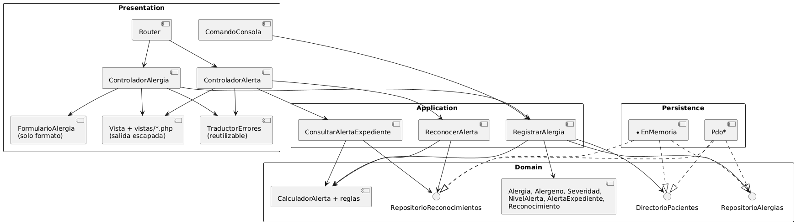
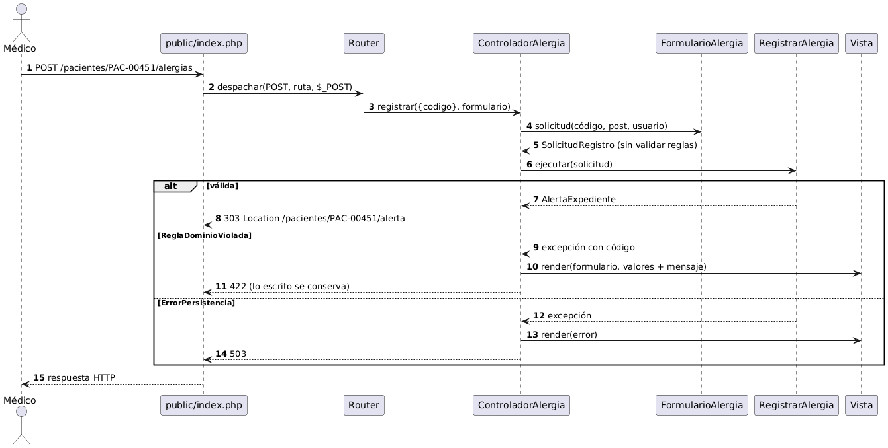
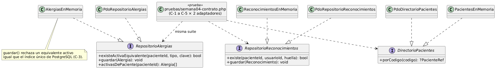
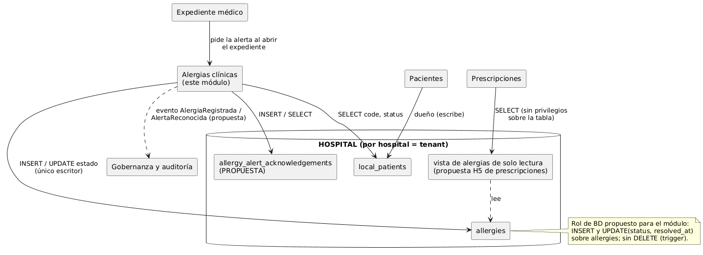

# Semana 4 — Arquitectura en capas, MVC y patrón Repository

Módulo: **Alergias clínicas y alerta visual en expediente** · Continúa el **mismo** Micro-HIS de la semana 3 ([`../micro-his/`](../micro-his/README.md)) y el mismo flujo.

## 1. Qué cambió en el Micro-HIS

| Parte | Archivos | Para qué |
|---|---|---|
| A — Reconocimiento (CU-05) | `Dominio/Reconocimiento`, `Dominio/RepositorioReconocimientos`, `Aplicacion/ReconocerAlerta`, `Persistencia/PdoRepositorioReconocimientos`, tabla **propuesta** `allergy_alert_acknowledgements` | Completar el flujo: la alerta ALTA o CRÍTICA se reconoce por usuario y por huella (RN-09) |
| B — Entrada MVC | `Presentacion/Web/{Router, ControladorAlerta, ControladorAlergia, FormularioAlergia, Vista, Respuesta}`, `vistas/*.php`, `public/index.php`, `Presentacion/TraductorErrores` | Organizar la entrada web con MVC |
| C — Adaptadores InMemory | `Persistencia/EnMemoria/{AlergiasEnMemoria, PacientesEnMemoria, ReconocimientosEnMemoria}`, opción `ALERGIAS_PERSISTENCIA=memoria` | Segunda implementación del mismo contrato |

## 2. Capas y responsabilidades



| Elemento MVC | Responsabilidad | Lo que **no** hace |
|---|---|---|
| `Router` | Relaciona método y ruta (`/pacientes/{codigo}/…`) con una acción | Saber de alergias |
| `ControladorAlerta` / `ControladorAlergia` (C) | Recibir, llamar al caso de uso, elegir vista y estado HTTP (303, 422, 404, 409, 503) | SQL o reglas: lo comprueba T-22 revisando el código fuente |
| `FormularioAlergia` | Convertir el POST en `SolicitudRegistro` (solo formato) | Validar severidad, fechas o duplicados: eso es del Dominio |
| Modelo (M) | Casos de uso + Dominio de las semanas 2 y 3 | — |
| `Vista` + `vistas/*.php` (V) | HTML con **toda** la salida escapada con `$e()` (T-20) | Calcular el nivel |



## 3. Repository: interfaz en el límite y dos adaptadores



Las interfaces están en el **Dominio**, que es el límite apropiado: los casos de uso dependen de ellas y la Persistencia las implementa. Hay dos adaptadores por interfaz: PDO (PostgreSQL) e InMemory.

La suite de contrato [`pruebas/semana04-contrato.php`](../micro-his/pruebas/semana04-contrato.php) ejecuta **las mismas cinco verificaciones** (C-1 a C-5) contra los dos adaptadores, en las pruebas T-25 a T-34. El punto delicado es C-3: el InMemory tiene que rechazar un equivalente activo igual que el índice único `allergies_active_equivalent_unique`. Si no lo hiciera, una prueba con memoria aceptaría un duplicado que la base real rechaza.

En la corrida de preparación las 10 pasaron. No apareció ninguna diferencia entre adaptadores; si aparece en tu equipo, se anota aquí.

## 4. Objetos reutilizables

| Objeto | Dónde se reutiliza |
|---|---|
| `TraductorErrores` | Un solo mapa de excepción → estado y código, para el MVC y para la API de la semana 5 |
| `Alergeno::clave()` | Usa la misma normalización que el índice único (minúsculas, sin espacios al borde) en la Aplicación, en InMemory y en la consulta PDO |
| `CalculadorAlerta` + `ReglaNivelAlerta` | Lo usan Registrar, Consultar y Reconocer; la regla OCP de la semana 2 sin cambios |
| `Vista` con `$e()` | Toda plantilla escapa del mismo modo |
| `FabricaConexion` | Traduce la falla de conexión a `ErrorPersistencia` para todas las entradas |
| Suite de contrato | Sirve para cualquier adaptador futuro (por ejemplo, uno remoto de la semana 5) |

## 5. Repositorio de datos compartido



**Análisis.** En el HIS, los módulos comparten la base HOSPITAL de cada hospital, y cada hospital es un tenant. Integrar este módulo ahí significa:

1. **Propiedad de datos.** Este módulo es el **único escritor** de `allergies`. `pacientes` es dueño de `local_patients`, y aquí solo se lee `code` y `status`. `prescripciones-alergias` lee las alergias por una vista de solo lectura, según su propia propuesta H5.
2. **Permisos en la base (propuesta).** Un rol de base de datos para el módulo con `INSERT` y `UPDATE(status, resolved_at)` sobre `allergies`, sin `DELETE` (el trigger ya lo impide), y con `INSERT`/`SELECT` sobre la tabla de reconocimientos.
3. **Tabla nueva (propuesta).** `allergy_alert_acknowledgements` no existe en HOSPITAL. Se tendría que proponer como migración Laravel en `database/migrations/hospital/`, con revisión del líder.
4. **Riesgo de acoplamiento.** Compartir la tabla hace que un cambio de columna en `allergies` rompa a prescripciones. Para mitigarlo, los cambios de esquema van por migración revisada, y prescripciones lee por vista, no por la tabla.
5. **Eventos (propuesta).** `AlergiaRegistrada` y `AlertaReconocida` hacia auditoría, sin datos clínicos en el evento (solo ids y nivel).

## 6. Pruebas nuevas

| ID | Qué prueba |
|---|---|
| T-15 a T-18 | Reconocimiento: por usuario, invalidado por alergia nueva (CA-09), idempotente, no aplica a MODERADA |
| T-19 a T-24 | MVC: 200 con nivel en texto, salida escapada, 422 conservando lo escrito, controladores sin SQL ni reglas, 303 al reconocer, 404 |
| T-25 a T-34 | Contrato C-1 a C-5 contra PDO e InMemory |

```powershell
php pruebas/ejecutar.php --solo=semana04
php -S 127.0.0.1:8042 -t public   # http://127.0.0.1:8042/pacientes/PAC-00451/alerta
$env:ALERGIAS_PERSISTENCIA="memoria"; php consola.php alerta --paciente=PAC-00451; Remove-Item Env:ALERGIAS_PERSISTENCIA
```

## 7. Decisiones

- **DEC-07:** En la web, el usuario es fijo y ficticio (`ALERGIAS_USUARIO_DEMO`) hasta que la semana 5 agrega tokens. Es una limitación conocida de la demo.
- **DEC-08:** InMemory es un adaptador de producción del mismo contrato, no un doble de prueba. Los dobles de la semana 3 siguen existiendo para simular fallas.
