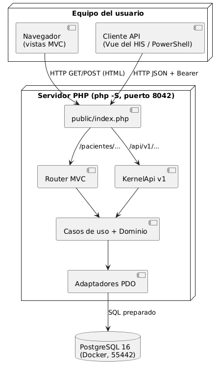
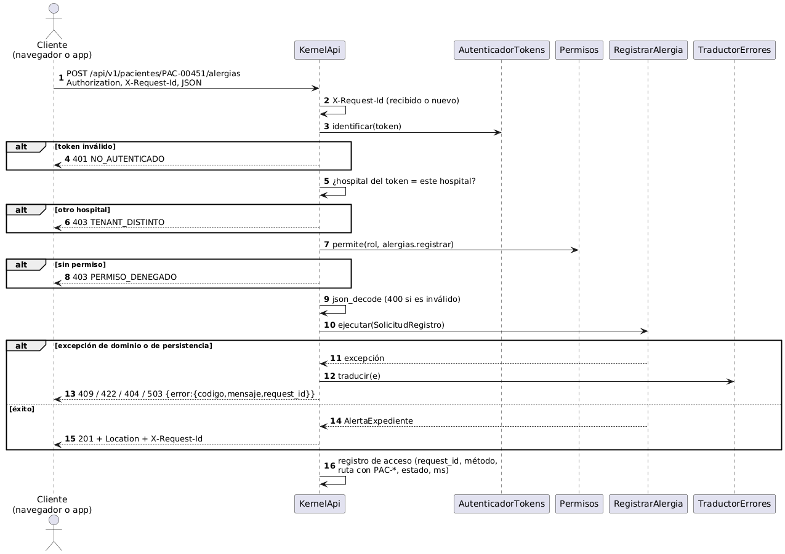
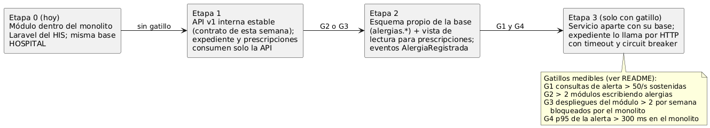

# Semana 5 — Cliente-servidor, API REST y frontera de microservicio

Módulo: **Alergias clínicas y alerta visual en expediente** · El **mismo** Micro-HIS de las semanas 3 y 4 ([`../micro-his/`](../micro-his/README.md)) evoluciona a cliente-servidor con una API REST JSON sobre los mismos casos de uso.

- Contrato completo: [contrato-api.md](contrato-api.md).
- Plan de trabajo: [plan-issue-rama-worktree-pr.md](plan-issue-rama-worktree-pr.md).

Esta semana se entrega diseño y prototipo. No se construye infraestructura de producción ni se divide el sistema.

## 1. Diseño cliente-servidor





`public/index.php` envía `/api/v1/…` a `KernelApi` y el resto al Router MVC. Las dos entradas llaman a los mismos `RegistrarAlergia`, `ConsultarAlertaExpediente` y `ReconocerAlerta`, así que ninguna regla se duplicó.

## 2. Aspectos pedidos

| Aspecto | Decisión en el prototipo | Evidencia |
|---|---|---|
| **Contrato API** | 3 operaciones, formato único de error, códigos estables | [contrato-api.md](contrato-api.md), T-35 a T-44 |
| **Propiedad de datos** | El módulo es el único escritor de `allergies` y de la tabla propuesta de reconocimientos. `local_patients` solo se lee (dueño: pacientes) | Semana 4, sección 5 |
| **Comunicación** | Síncrona HTTP/JSON para consultar (el expediente necesita la alerta al abrir). Eventos asíncronos **propuestos** para auditoría | Diagramas de esta semana |
| **Seguridad** | Bearer (ficticio en el prototipo), tenant tomado del token (403 aunque el encabezado diga otro hospital), permisos por rol, salida JSON sin HTML, SQL preparado | T-36, T-37, T-38 |
| **Resiliencia** | Base caída → 503 sin datos a medias. Duplicado simultáneo → 409 por el índice único. Al reintentar un POST tras un corte, se recibe 409 `ALERGIA_DUPLICADA`, nunca dos filas | T-44, T-11 |
| **Observabilidad** | `X-Request-Id` en toda respuesta (se respeta el recibido). Registro de acceso en JSON con request_id, método, ruta con `PAC-*`, estado y ms; **sin** alérgenos, reacciones ni códigos de paciente | T-43 |
| **Consistencia** | Fuerte dentro de HOSPITAL (una transacción por escritura e índice único). La huella hace que un reconocimiento viejo no valga para una alerta nueva (`ALERTA_CAMBIO`) | T-16, T-42 |

## 3. ¿Separar el módulo como microservicio?

**Medición.** Se usó `scripts/medir-frontera.php`, con 200 consultas de la alerta de PAC-00451:

| Forma | p50 | p95 | Fallidas |
|---|---|---|---|
| En proceso (caso de uso + PDO) | 0.41 ms | 0.67 ms | 0 |
| Por HTTP (`php -S` local) | 12.99 ms | 19.68 ms | 0 |

Estos números son **del entorno de preparación** (Linux, PHP 8.3, PostgreSQL 16 local), no de tu equipo. Repite la medición y anota tus resultados:

```powershell
php -S 127.0.0.1:8042 -t public          # terminal 1
php scripts/medir-frontera.php --n=200 --url=http://127.0.0.1:8042   # terminal 2
```

Resultado en el equipo del estudiante: En proceso (PDO, 200 consultas): p50 7.34 ms | p95 7.96 ms | máx 14.43 ms Por HTTP (200 peticiones, 0 fallidas): p50 65.06 ms | p95 82.97 ms | máx 182.07 ms.

**Decisión: no separar ahora.**

- El salto a la red multiplica la latencia por unas 30 veces y agrega un modo de falla nuevo: el expediente se abriría **sin alerta** si el servicio cae.
- El módulo comparte `local_patients` con una FK real (`allergies.local_patient_id`).
- Por ahora tiene un solo escritor.

Dividir el sistema hoy agregaría riesgo clínico sin una ganancia medible.

**Gatillos medibles para reconsiderar:**
- **G1:** más de 50 consultas de alerta por segundo sostenidas.
- **G2:** más de dos módulos necesitan escribir alergias.
- **G3:** más de dos despliegues por semana del módulo bloqueados por el monolito.
- **G4:** p95 de la alerta mayor que 300 ms (RNF-02) dentro del monolito.

## 4. Migración razonada por etapas



| Etapa | Qué cambia | Cómo se vuelve atrás |
|---|---|---|
| 0 (hoy) | Módulo dentro del monolito y la misma base | — |
| 1 | Los otros módulos usan solo la API v1, y nadie más escribe en `allergies` | Seguir llamando a la clase en proceso |
| 2 (G2 o G3) | Esquema propio y vista de lectura para prescripciones; eventos `AlergiaRegistrada` | La vista apunta otra vez a la tabla original |
| 3 (G1 y G4) | Servicio aparte. El expediente lo llama con un timeout de 2 s y un circuit breaker. Si el servicio no responde, el expediente muestra «Alergias no disponibles: verifique antes de indicar», **nunca** «sin alergias» | Volver a la llamada en proceso detrás de la misma interfaz |

## 5. Pruebas nuevas (T-35 a T-44)

| ID | Qué prueba | CA / RNF |
|---|---|---|
| T-35 | Enfermería consulta → 200, nivel y `X-Request-Id` | CA-06 |
| T-36 | Sin token → 401 con el formato único | RNF-04 |
| T-37 | Enfermería intenta registrar → 403 y nada guardado | CA-10 |
| T-38 | Token de H-02 con `X-Tenant-ID: H-01` → 403 `TENANT_DISTINTO`; admisión → 403 | RNF-01 |
| T-39 | Médico registra → 201, `Location`, CRÍTICA | CA-01 |
| T-40 | JSON roto → 400; severidad inválida → 422 | RF-01 |
| T-41 | Duplicado → 409 | CA-05 |
| T-42 | Huella vieja → 409 `ALERTA_CAMBIO`; vigente → 201 | CA-09 |
| T-43 | `X-Request-Id` respetado; registro sin datos clínicos | RNF-04, RNF-06 |
| T-44 | Base que rechaza escrituras → 503 y 0 filas | CA-11 |
