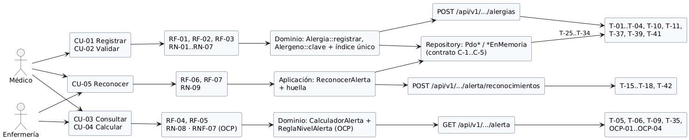

# Semana 6 — Primera evaluación parcial

Módulo: **Alergias clínicas y alerta visual en expediente** · Flujo: «registro de alergia y emisión de alerta al consultar el expediente»

| Entregable | Archivo |
|---|---|
| Presentación (Marp): **7 diapositivas más la portada** | [presentacion.md](presentacion.md) |
| Diagrama trazable de actor a prueba | [diagramas/semana-06-diagrama-trazable.png](diagramas/semana-06-diagrama-trazable.png) |
| Matriz decisión → evidencia (DEC-01 a DEC-13) | [matriz-decision-evidencia.md](matriz-decision-evidencia.md) |
| Registro del cambio práctico (**caso preparado**) | [registro-cambio-practico.md](registro-cambio-practico.md) |

## Cadena que se defiende

| Pieza | Dónde está |
|---|---|
| Actores | Médico, Enfermería, Expediente médico (semana 1) |
| UML | Casos de uso, actividad y secuencia, con matriz de trazabilidad (semana 1) |
| RF/RNF | RF-01 a RF-09, RNF-01 a RNF-07 y CA-01 a CA-12 (semana 2) |
| Principio SOLID | OCP en `CalculadorAlerta` (semana 2) |
| Capas | Consola, MVC y API → Aplicación → Dominio ← Persistencia (semanas 3 y 4) |
| Repository | Adaptadores PDO e InMemory con contrato (semana 4) |
| Contrato API | API v1 (semana 5) |

## Cómo ver la presentación

Con la extensión **Marp for VS Code**, abre `presentacion.md` y usa «Open Preview». Las imágenes se leen de las carpetas de semana con rutas relativas.
