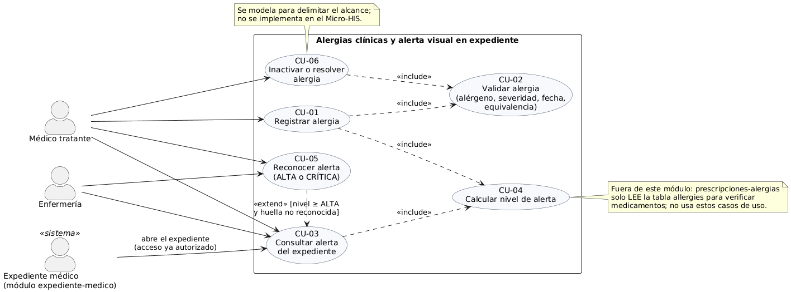
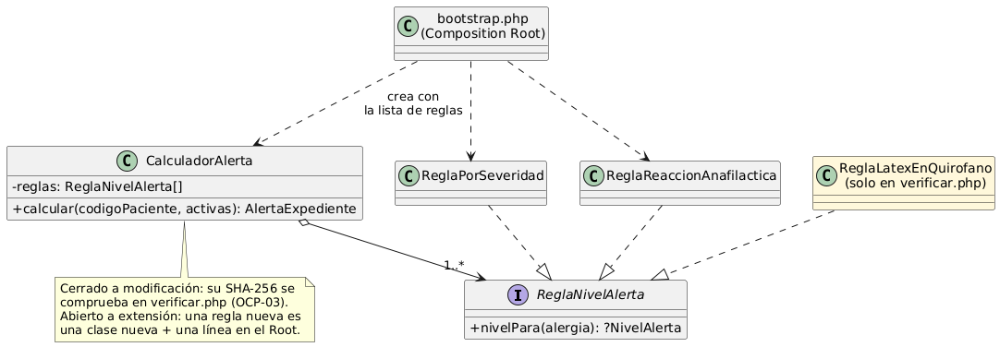
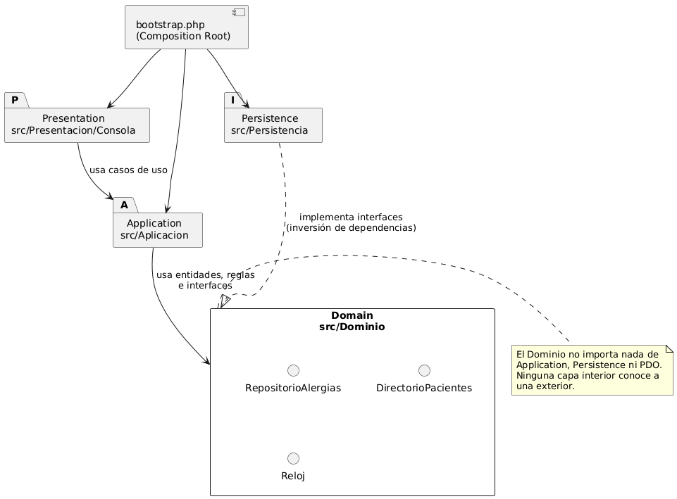

# Alergias clínicas y alerta visual en expediente

**Primera evaluación parcial · ASII 2026**

Erick Rolando Ramazzini Muralles · @ErickRamazzini

Flujo: «registro de alergia y emisión de alerta al consultar el expediente»

---

## 1. Problema y actores

- El problema: una alergia que no se **ve** al abrir el expediente no protege al paciente.
- **Médico tratante:** registra alergias verificadas y queda como `verified_by_user_ref_id`.
- **Enfermería:** consulta y reconoce la alerta antes de administrar.
- **Expediente médico:** autoriza el acceso y pide la alerta.
- **Frontera:** este módulo es el único que escribe en `allergies`; prescripciones solo lee.

---

## 2. Requerimientos que guían el diseño

- **RF-03:** no hay dos alergias activas equivalentes (RN-03, índice único real).
- **RF-05:** «Sin alergias registradas» **no** se muestra en verde: no es «sin alergias».
- **RF-06 y RF-07:** reconocimiento por usuario, que se anula si cambian las alergias (huella).
- **RNF-01:** el tenant sale del token. **RNF-05:** si la base falla, no queda nada a medias.
- 12 criterios Dado/Cuando/Entonces (CA-01 a CA-12), cada uno con su prueba.

---

## 3. SOLID: OCP en el cálculo de la alerta

- **Antes:** un `switch` por severidad y la anafilaxia agregada **editando** el mismo método.
- **Después:** `CalculadorAlerta` depende de `ReglaNivelAlerta`; cada regla es una clase.
- **Evidencia:** `verificar.php` → 10/10.
  - Mismo resultado antes y después en los 6 casos.
  - Una regla nueva funciona sin editar archivos.
  - El SHA-256 del calculador no cambió.

---

## 4. Capas y Repository

- Presentation (consola, MVC y API) → Application → **Domain** ← Persistence.
- Interfaces Repository en el Dominio, con adaptadores **PDO** e **InMemory**.
- **Suite de contrato:** las mismas 5 verificaciones × 2 adaptadores.
- Controladores sin SQL ni reglas, verificado por T-22.

---

## 5. Contrato API y frontera

- 3 operaciones v1, formato único de error y `X-Request-Id`.
- Permisos por rol (enfermería → 403 al registrar) y tenant del token (H-02 → 403).
- **Frontera medida (equipo del estudiante):** en proceso, p95 7.96 ms; por HTTP, p95 82.97 ms (≈ 10×).
- **Decisión: no separar.** Hay 4 gatillos medibles (G1 a G4) para reconsiderar.
- 44/44 pruebas con PostgreSQL 16.

---

## 6. Seguridad clínica en el diseño

| Riesgo | Respuesta del diseño |
|---|---|
| Creer que no hay alergias | `SIN_REGISTRO` gris + «no verificado» |
| Severidad desconocida | Se trata como ALTA |
| Reconocer y no ver una alergia nueva | Huella: `ALERTA_CAMBIO` (409) |
| Dos médicos registran a la vez | Índice único → 409, nunca dos filas |
| Fuga en registros | Registro de acceso sin alérgenos ni códigos |

---

## 7. Cambio práctico (caso preparado)

**«Cambiar la severidad de una alergia ya registrada»**

- El cambio sería una alergia `moderate` que pasa a `life_threatening` tras una nueva reacción.
- La huella ya incluye la severidad, así que **todos** los reconocimientos se anulan solos.
- **Lo nuevo:**
  - CU-07;
  - `Alergia::cambiarSeveridad()` con motivo obligatorio si baja;
  - `PATCH /alergias/{id}`;
  - UPDATE preparado;
  - 6 pruebas primero.

Detalle: `registro-cambio-practico.md`.
