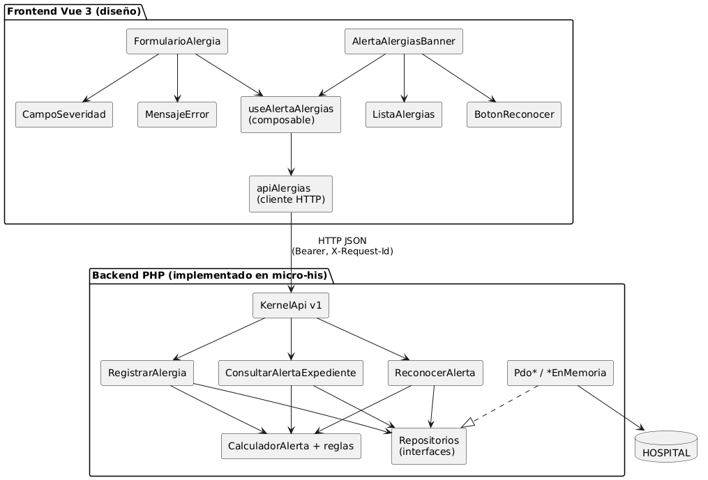
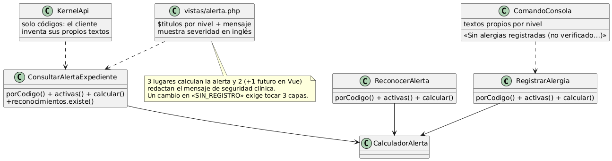
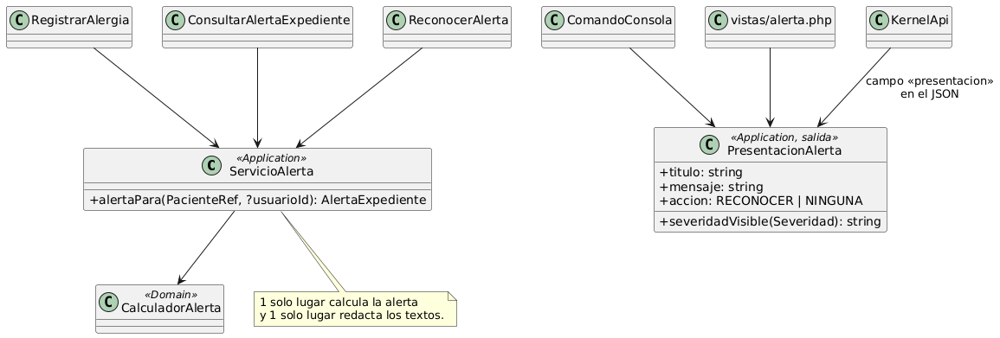

# Semana 7 — Diseño de componentes y refactorización

Módulo: **Alergias clínicas y alerta visual en expediente** · Flujo: «registro de alergia y emisión de alerta al consultar el expediente»

## 1. Componentes propios

El backend está **implementado** en `micro-his`. El frontend Vue 3 está **diseñado**, porque el repositorio del grupo usa Laravel 12 + Vue 3. Todos los componentes son propios del módulo: no se incluyen componentes del expediente ni de prescripciones.

## 2. Contratos de entrada y salida

### Backend

| Componente | Entrada | Salida | Errores |
|---|---|---|---|
| `KernelApi` | método, ruta, encabezados (`authorization`, `x-tenant-id`, `x-request-id`), cuerpo JSON | `Respuesta` (estado, JSON, `X-Request-Id`) | Formato único `{error:{codigo,mensaje,request_id}}` |
| `RegistrarAlergia` | `SolicitudRegistro` (código de paciente, alérgeno, tipo, severidad, reacción, fecha, usuario) | `AlertaExpediente` recalculada | `PacienteNoEncontrado`, `ReglaDominioViolada`, `AlergiaDuplicada`, `ErrorPersistencia` |
| `ConsultarAlertaExpediente` | código de paciente y, opcionalmente, usuario | `AlertaExpediente` (con `reconocida` si hay usuario) | `PacienteNoEncontrado`, `ErrorPersistencia` |
| `ReconocerAlerta` | código, usuario, huella vista | `AlertaExpediente` reconocida | `ALERTA_CAMBIO`, `RECONOCIMIENTO_NO_REQUERIDO` |
| `CalculadorAlerta` | código de paciente y lista de `Alergia` activas | `AlertaExpediente` (nivel, detalle ordenado, huella) | — (función pura) |
| `RepositorioAlergias` y los demás | ids y objetos del Dominio | objetos del Dominio | `ErrorPersistencia`, `AlergiaDuplicada` |

### Frontend (diseño)

| Componente | Props / entrada | Eventos / salida | Estados |
|---|---|---|---|
| `AlertaAlergiasBanner` | `alerta: Alerta`, `cargando`, `error` | `reconocer(huella)` | carga, SIN_REGISTRO, nivel 1–4, pendiente, reconocida, «no disponible» |
| `ListaAlergias` | `alergias[]` ordenadas | — | vacío |
| `BotonReconocer` | `huella`, `ocupado` | `confirmar` | deshabilitado mientras se envía |
| `FormularioAlergia` | `codigoPaciente`, `valoresIniciales` | `guardado(alerta)`, `cancelado` | edición, enviando, error por campo, éxito |
| `CampoSeveridad` | `modelValue` | `update:modelValue` | cinco opciones con texto en español |
| `MensajeError` | `codigo`, `mensaje`, `requestId` | `reintentar` | recuperable o no recuperable |
| `useAlertaAlergias` | código de paciente | `alerta`, `cargar()`, `reconocer()`, `registrar()` | un solo origen de verdad por pantalla |
| `apiAlergias` | operaciones del contrato v1 | promesas con `Alerta` o `ErrorApi` | mapea 401, 403, 409, 422 y 503 |

## 3. Punto de mayor acoplamiento

Se midió sobre el código de la semana 5 con `grep`, desde `micro-his/`:

| Medida | Comando | Valor |
|---|---|---|
| Casos de uso que buscan al paciente, leen las alergias activas y calculan la alerta por su cuenta | `grep -rn -- "->calculador->calcular(" src` | **3** (Registrar, Consultar, Reconocer) |
| Lugares que redactan el texto que ve el usuario para cada nivel | `grep -rln "Sin alergias registradas" src/Presentacion` | **2** (consola y `vistas/alerta.php`), y la API no da textos, así que el Vue tendría que escribir un **3.º** |
| Presentaciones que deciden si se pide el reconocimiento | `grep -rn "requiereReconocimiento()" src/Presentacion` | **4** llamadas en 3 archivos |

**Por qué es el punto con más acoplamiento.** Aquí se cruzan los seis aspectos: alergias, severidad, paciente, alerta visible, reconocimiento y seguridad clínica. El mensaje de seguridad clínica más importante («Sin alergias registradas **no** es sin alergias») está escrito dos veces con palabras distintas. Además, la vista web muestra la severidad en inglés (`life_threatening`). Si el docente pide cambiar ese mensaje, hay que tocar Presentación en tres entradas y sería fácil que quedaran distintas.

## 4. Refactor antes / después (conceptual)

| Pieza nueva | Capa | Responsabilidad |
|---|---|---|
| `ServicioAlerta::alertaPara(PacienteRef, ?usuario)` | Aplicación | El único lugar que lee las alergias activas, calcula y marca el reconocimiento |
| `PresentacionAlerta` | Aplicación (modelo de salida) | Título, mensaje y acción por nivel, y severidad en español; la usan consola, vista y API (campo `presentacion`) |

| Medida | Antes | Después (objetivo) |
|---|---|---|
| Llamadas a `calcular()` en casos de uso | 3 | 1 |
| Lugares que redactan textos de nivel | 2 (+1 en Vue) | 1 |
| Presentaciones que deciden «pedir reconocimiento» | 3 archivos | 0: leen `accion` |
| Severidad visible en inglés | sí (vista web) | no |

**Por qué no amplía el módulo.** No hay casos de uso, rutas ni tablas nuevas. Las pruebas T-01 a T-44 siguen siendo la red de seguridad, y el refactor está bien hecho si pasan sin cambios, salvo las que leen textos.

**Cómo se verificaría al implementarlo.** Se repiten los tres `grep` de la tabla y se espera ver los valores de la columna «Después». También se corre `php pruebas/ejecutar.php` y se espera 44/44.

Este refactor es **conceptual**: la tarea lo pide así, y el código del Micro-HIS no cambia en esta semana.
