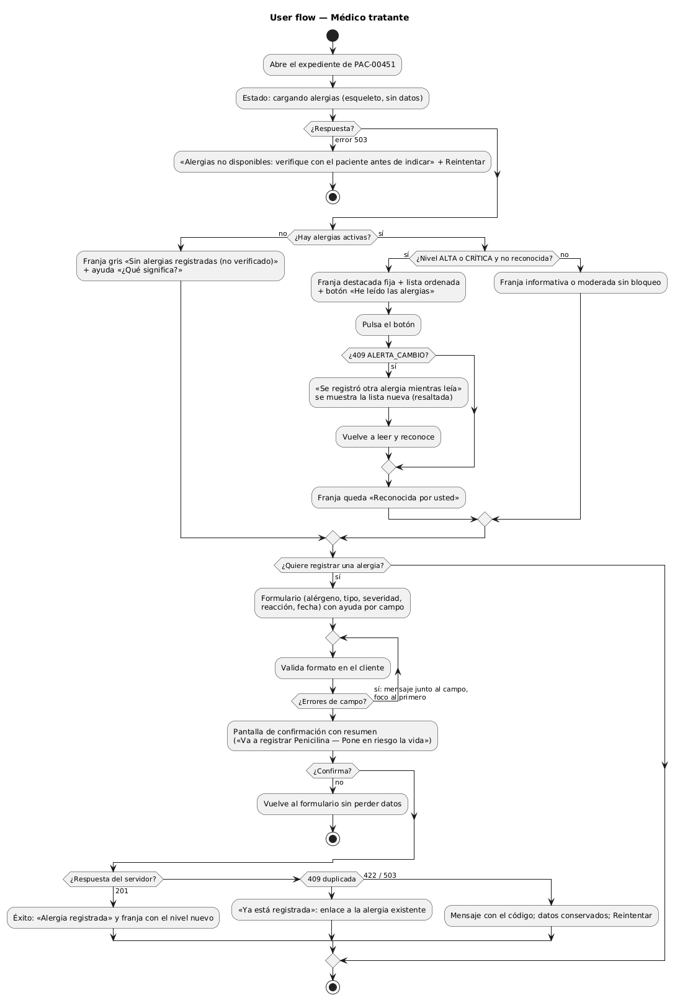
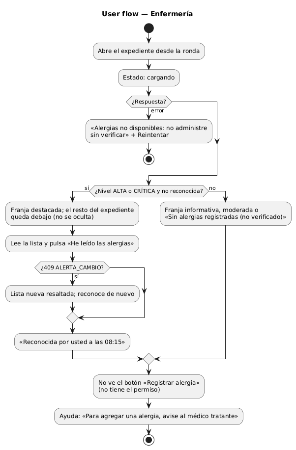
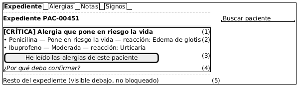
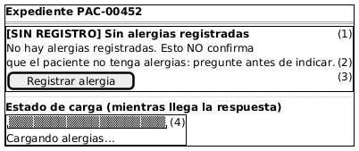
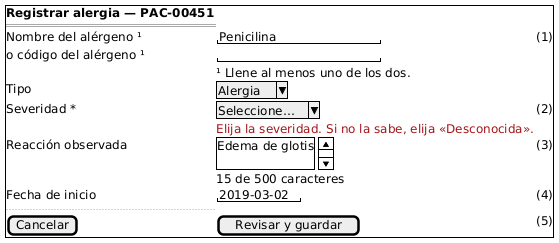
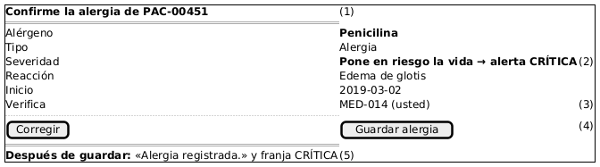
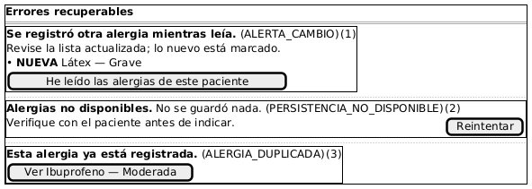

# Semana 8 — Diseño de experiencia de usuario

Módulo: **Alergias clínicas y alerta visual en expediente** · Flujo: «registro de alergia y emisión de alerta al consultar el expediente»

Roles autorizados: **Médico tratante** (consulta, reconoce y registra) y **Enfermería** (consulta y reconoce). Admisión no tiene acceso: la API le responde 403.

## 1. User flow por rol

| Elemento pedido | Dónde aparece |
|---|---|
| Inicio | «Abre el expediente» en los dos flujos |
| Decisión | ¿Respuesta?, ¿hay alergias?, ¿nivel ALTA o CRÍTICA?, ¿confirma?, ¿409? |
| Confirmación | W4 antes de guardar; «He leído las alergias» en W1 |
| Estados vacío, carga y éxito | W2 (vacío y carga), W4 (éxito) |
| Errores recuperables | W5: `ALERTA_CAMBIO`, 503, duplicado; 422 junto al campo en W3 |
| Ayuda contextual | «¿Por qué debo confirmar?» (W1), «¿Qué significa?» (W2), ayuda por campo (W3), aviso de permiso a enfermería |
| Protección de datos | Paciente solo por código; enfermería no ve el formulario; nada clínico en la URL |

## 2. Wireframes anotados

### W1 — Alerta CRÍTICA pendiente de reconocer

1. La franja va primero y fija bajo el encabezado. El nivel va con **texto** «[CRÍTICA]» además del color (RNF-03). Tiene `role="alert"` solo mientras está pendiente.
2. La lista va ordenada de mayor a menor nivel, con severidad **en español** (corrige lo visto en la semana 7).
3. El botón dice exactamente lo que el usuario declara. Envía la huella que vio; mientras envía se deshabilita para evitar doble clic.
4. La ayuda en línea explica que el reconocimiento queda a su nombre y que se vuelve a pedir si cambian las alergias.
5. **Regla de interacción:** el resto del expediente no se bloquea con un modal. Bloquear empuja a pulsar sin leer.

### W2 — Estado vacío y estado de carga

1. Usa gris neutro y nunca verde ni un ✓ (DEC-02).
2. El mensaje dice qué hacer: preguntar antes de indicar.
3. «Registrar alergia» solo aparece para el médico.
4. Mientras carga se muestra un esqueleto sin datos **y nunca** el estado vacío: un «sin alergias» falso mientras carga sería peligroso.

### W3 — Formulario de registro

1. **Validación:** nombre **o** código (RN-01); la nota ¹ lo dice antes de que el usuario se equivoque.
2. La severidad es obligatoria y no tiene valor por defecto. La opción «Desconocida» aclara que se mostrará como alta (RN-08). El error aparece **junto al campo** y el foco va al primer error.
3. La reacción lleva un contador de 500 caracteres (RN-04).
4. La fecha no puede ser futura (RN-05); el selector bloquea los días posteriores a hoy.
5. «Revisar y guardar» lleva a la confirmación W4; no guarda directamente.

### W4 — Confirmación y éxito

1. Es una pantalla de resumen, no un diálogo: se puede leer con calma.
2. Muestra la consecuencia visible: qué nivel tendrá la alerta.
3. Indica quién verifica la alergia (usuario ficticio MED-014), que queda como `verified_by_user_ref_id`.
4. «Corregir» vuelve sin perder nada; «Guardar alergia» envía el POST.
5. El éxito usa el mismo verbo: «Alergia registrada.»

### W5 — Errores recuperables

1. `ALERTA_CAMBIO` (409): la lista nueva aparece con la alergia nueva marcada y se reconoce otra vez.
2. 503: «No se guardó nada» y un botón «Reintentar». **Nunca** se muestra la franja vacía.
3. Duplicado (409): enlaza a la alergia existente en lugar de un error genérico.

## 3. Catálogo de mensajes

| ID | Código del backend | Texto | Dónde |
|---|---|---|---|
| M-01 | `SIN_REGISTRO` | Sin alergias registradas. Esto no confirma que el paciente no tenga alergias. | W2 |
| M-02 | `ALERTA_CAMBIO` | Se registró otra alergia mientras leía. Revise la lista actualizada. | W5 |
| M-03 | `PERSISTENCIA_NO_DISPONIBLE` | Alergias no disponibles. No se guardó nada. Verifique con el paciente antes de indicar. | W5 |
| M-04 | `ALERGIA_DUPLICADA` | Esta alergia ya está registrada. | W5 |
| M-05 | `ALERGENO_REQUERIDO` | Escriba el nombre o el código del alérgeno. | W3 |
| M-06 | `SEVERIDAD_INVALIDA` | Elija la severidad. Si no la sabe, elija «Desconocida». | W3 |
| M-07 | `FECHA_INICIO_FUTURA` | La fecha de inicio no puede ser posterior a hoy. | W3 |
| M-08 | `REACCION_DEMASIADO_LARGA` | La reacción admite hasta 500 caracteres. | W3 |
| M-09 | `PERMISO_DENEGADO` | Su rol no puede registrar alergias. Avise al médico tratante. | Enfermería |
| M-10 | `PACIENTE_INACTIVO` | No se pueden registrar alergias de un paciente que no está activo. | W3 |

## 4. Protección de datos vinculados

- El paciente se identifica solo por código en pantallas, mensajes y URL; el nombre lo muestra el expediente, no este módulo.
- Los mensajes de error no repiten el alérgeno ni la reacción.
- El botón de registro no existe para enfermería: no se oculta con CSS, simplemente no se dibuja. Además, la API responde 403 aunque alguien lo fuerce.
- Si la sesión vence en W3, lo escrito se conserva en memoria de la pestaña y nunca en `localStorage` (son datos clínicos).
