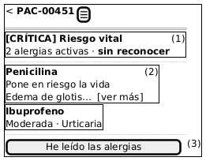
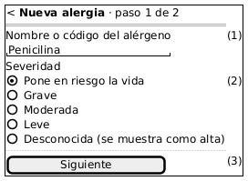
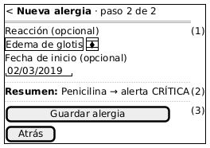
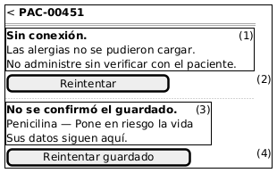

# Semana 10 — Diseño para movilidad (320–430 px)

Módulo: **Alergias clínicas y alerta visual en expediente** · Flujo: «registro de alergia y emisión de alerta al consultar el expediente»

## 1. Jerarquía en pantalla pequeña

En el teléfono cabe poco. Por eso el orden lo decide el riesgo clínico, no la estructura de la base:

1. El **nivel de alerta y si falta reconocerla**, en la franja fija.
2. Las alergias, ordenadas de mayor a menor nivel. Por cada una: alérgeno, severidad en español y reacción recortada.
3. La única acción primaria de la pantalla: **reconocer** o **guardar**.
4. Lo secundario (fecha de inicio, tipo, código del alérgeno) va detrás de «ver más».

## 2. Propuesta responsive: 4 pantallas

### M1 — Alerta del expediente

1. La franja queda fija (`position: sticky`) bajo la barra al desplazarse: la alerta nunca sale de la vista.
2. Cada alergia es una tarjeta, no una fila de tabla: a 320 px una tabla de 5 columnas obliga a desplazarse de lado. La reacción se recorta a 2 líneas con «ver más».
3. El botón de reconocer ocupa todo el ancho, mide ≥ 48 px de alto y queda abajo, al alcance del pulgar. Envía la huella mostrada; si responde 409 `ALERTA_CAMBIO`, la lista se recarga con lo nuevo marcado.

### M2 y M3 — Registro en dos pasos

- **M2-1:** un solo campo para nombre o código. En el teléfono se elimina la duda de «cuál de los dos» (corrige H-04).
- **M2-2:** la severidad se elige con botones de opción visibles, no con un `select`, para ver las 5 opciones sin abrir nada. No hay valor por defecto; la imagen muestra una opción ya elegida.
- **M2-3 y M3-3:** un botón primario por paso.
- **M3-1:** la reacción y la fecha son opcionales y van en el segundo paso. Se usa el teclado de fecha nativo.
- **M3-2:** el resumen de la consecuencia hace de confirmación (B-03 de la semana 9) sin agregar una tercera pantalla.

### M4 — Conexión limitada

1. Si la alerta no carga, el mensaje dice qué hacer («No administre sin verificar»). **Nunca** se muestra la franja vacía como si no hubiera alergias.
2. «Reintentar» repite el GET, que no tiene efectos.
3. Si el POST de registro no recibió respuesta, se informa «no se confirmó» y los datos se conservan en memoria de la pestaña, no en `localStorage`.
4. «Reintentar guardado» repite el POST. Es seguro: si el primero sí llegó, el servidor responde **409 `ALERGIA_DUPLICADA`** (índice único, probado en T-11 y T-41), y la app lo traduce a «La alergia ya quedó registrada» y recarga la alerta. Nunca quedan dos filas.

**Decisión: no se registran alergias sin conexión.** No hay cola local para guardar después. Una alergia «pendiente» que el resto del equipo no ve es peor que un error claro: alguien podría prescribir confiando en una alerta incompleta.

## 3. Reglas de breakpoint (mobile first)

| Rango | Regla |
|---|---|
| 320–359 px | Una columna; tarjetas sin sangría; franja con el texto del nivel en dos líneas; «ver más» para la reacción |
| 360–429 px | Una columna; la tarjeta muestra severidad y reacción en la misma línea; registro en 2 pasos |
| ≥ 430 px | Lista con dos columnas por tarjeta (alérgeno · severidad / reacción · inicio); registro en una sola pantalla con confirmación |
| ≥ 768 px | Vista de escritorio (W1 a W5 de la semana 8): lista tipo tabla y formulario a la izquierda con la alerta a la derecha |
| Todos | Sin desplazamiento horizontal del `body`; objetivos táctiles ≥ 44×44 px; texto base ≥ 16 px; foco visible; la franja nunca se oculta |

## 4. Dos escenarios móviles

### E1 — Ronda de enfermería con señal débil (360 px)

**Contexto.** Una enfermera abre PAC-00451 en el pasillo, con una sola barra de señal.

| Paso | Contenido mostrado | Decisión de contenido | Error y recuperación |
|---|---|---|---|
| 1 | Esqueleto de la franja y «Cargando alergias» | No se muestra nada que pueda leerse como «sin alergias» | Tras 8 s sin respuesta pasa a M4-1 |
| 2 | M4-1 «Sin conexión» | Instrucción clínica concreta | «Reintentar» (GET) |
| 3 | M1 con CRÍTICA | Franja fija, Penicilina primero | — |
| 4 | Pulsa «He leído» | Botón deshabilitado mientras envía | Si el POST no responde: «No se confirmó, reintente». Repetirlo es idempotente (T-17) |

### E2 — Médico en urgencias registra una alergia grave con conexión intermitente (320 px)

**Contexto.** El médico recién vio edema de glotis con Penicilina y lo registra en PAC-00451.

| Paso | Contenido mostrado | Decisión de contenido | Error y recuperación |
|---|---|---|---|
| 1 | M2: nombre y severidad | Solo lo indispensable en el paso 1 | Si no hay severidad: «Elija la severidad…» junto al campo, con el foco ahí |
| 2 | M3: reacción y resumen «→ alerta CRÍTICA» | La consecuencia visible hace de confirmación | — |
| 3 | «Guardar alergia» sin respuesta | M4-3 «No se confirmó el guardado»; los datos siguen | «Reintentar guardado» |
| 4 | El reintento responde 409 `ALERGIA_DUPLICADA` | Se muestra «La alergia ya quedó registrada» y no «error» | Recarga M1 con CRÍTICA. No se crean dos filas |
