# Semana 11 — Prototipo navegable desktop y móvil

Módulo: **Alergias clínicas y alerta visual en expediente** · Flujo principal: «registro de alergia y emisión de alerta al consultar el expediente»

## 1. El prototipo

**Archivo:** [prototipo/index.html](prototipo/index.html). Es un solo archivo sin dependencias externas: se abre con doble clic en Chrome.

La API está **simulada** en el navegador con las mismas reglas y los mismos códigos del contrato v1 de la semana 5 (`ALERGIA_DUPLICADA`, `ALERTA_CAMBIO`, `PERMISO_DENEGADO`, `PERSISTENCIA_NO_DISPONIBLE`). Los datos son ficticios: PAC-00451 con Ibuprofeno moderado, y PAC-00452 sin alergias.

- **Sesión:** el selector cambia entre MED-014 (médico) y ENF-022 (enfermería), igual que los tokens ficticios de la API.
- **Controles de la demostración:** van en un recuadro punteado y no forman parte del producto. Sirven para provocar el error crítico («Otro médico registra Látex»), la falta de conexión o el estado vacío.

## 2. Mapa de navegación

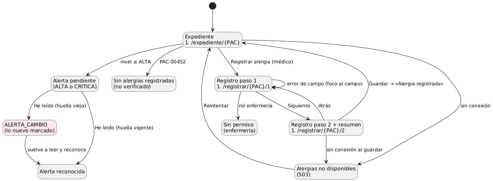

## 3. Recorridos

### Camino feliz (médico)

1. Abrir `#/expediente/PAC-00451`: nivel MODERADA con Ibuprofeno.
2. «Registrar alergia» → paso 1: Penicilina y «Pone en riesgo la vida» → «Siguiente».
3. Paso 2: reacción «Edema de glotis»; el resumen dice que la alerta quedará **CRÍTICA** (captura 01).
4. «Guardar alergia» → «Alergia registrada.»; franja CRÍTICA **sin reconocer** (captura 02).
5. «He leído las alergias de este paciente» → «reconocida por usted» (captura 04).

### Error crítico: la alerta cambia mientras se lee (enfermería)

1. Con la alerta CRÍTICA pendiente, cambiar la sesión a ENF-022.
2. En los controles de la demostración: «Otro médico registra Látex — Grave». La pantalla de la enfermera sigue mostrando la lista anterior.
3. «He leído…» → el servidor simulado responde **409 `ALERTA_CAMBIO`**. Aparece «Se registró otra alergia mientras leía» dentro de la franja, y Látex marcado como **NUEVA** (captura 03).
4. Leer y volver a reconocer → reconocida (captura 04).

Por qué este error es el crítico: si se aceptara el reconocimiento viejo, la enfermera quedaría registrada como enterada de una lista que **no** incluía el Látex.

## 4. Capturas

Las generé con Chromium sin interfaz, en 1280×800 y 375×760:

| # | Desktop | Móvil |
|---|---|---|
| 01 Confirmación (paso 2) | 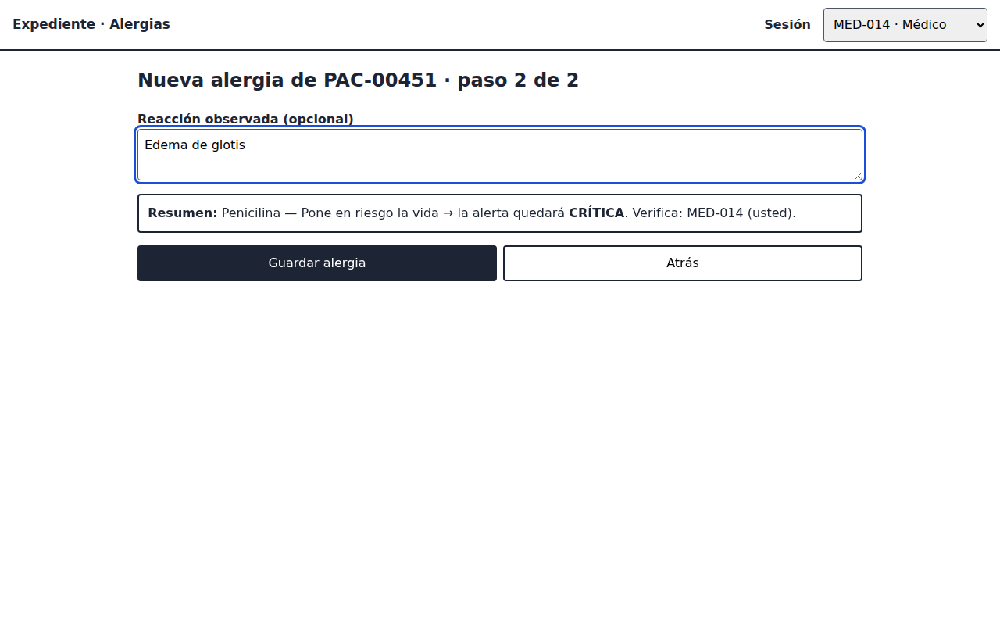 | 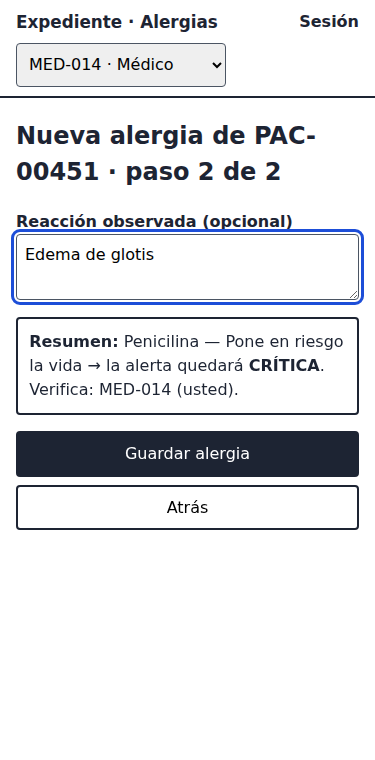 |
| 02 Camino feliz: CRÍTICA pendiente | 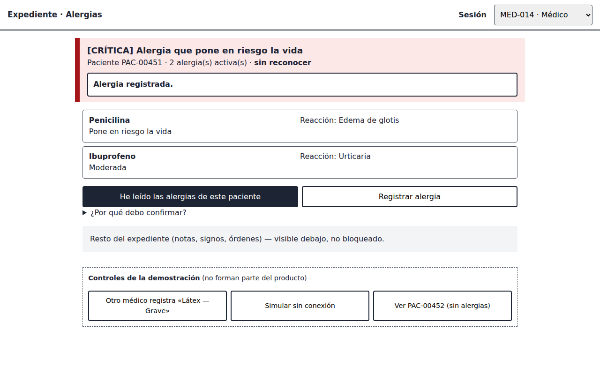 | 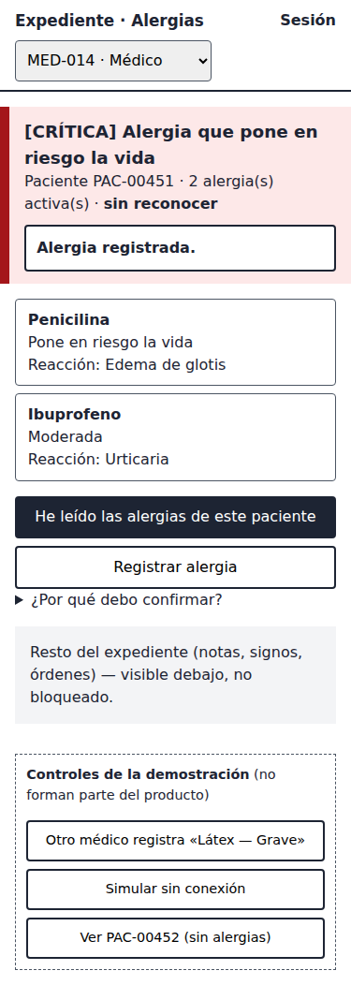 |
| 03 Error crítico: `ALERTA_CAMBIO` | 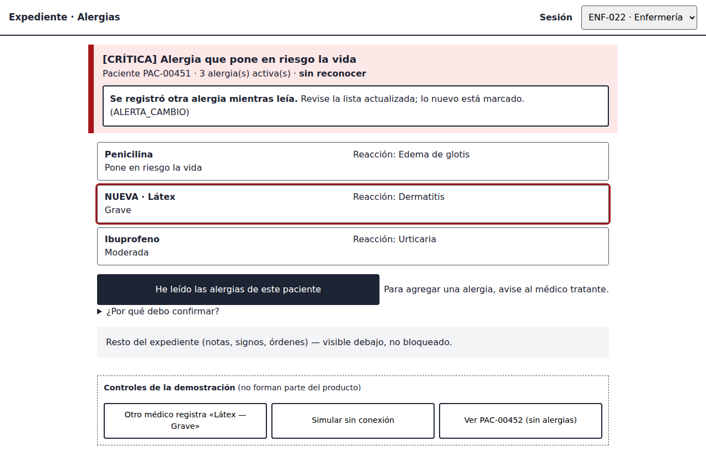 | 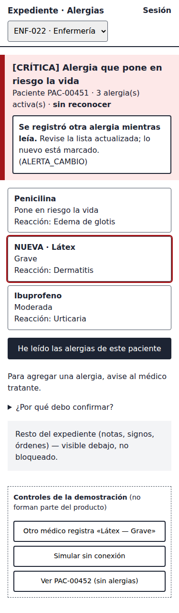 |
| 04 Reconocida | 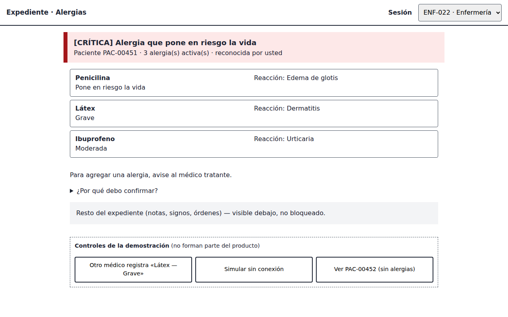 | 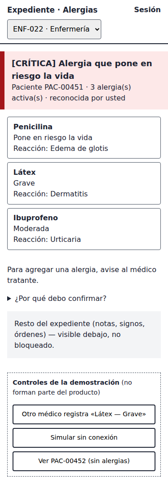 |
| 05 Sin conexión | 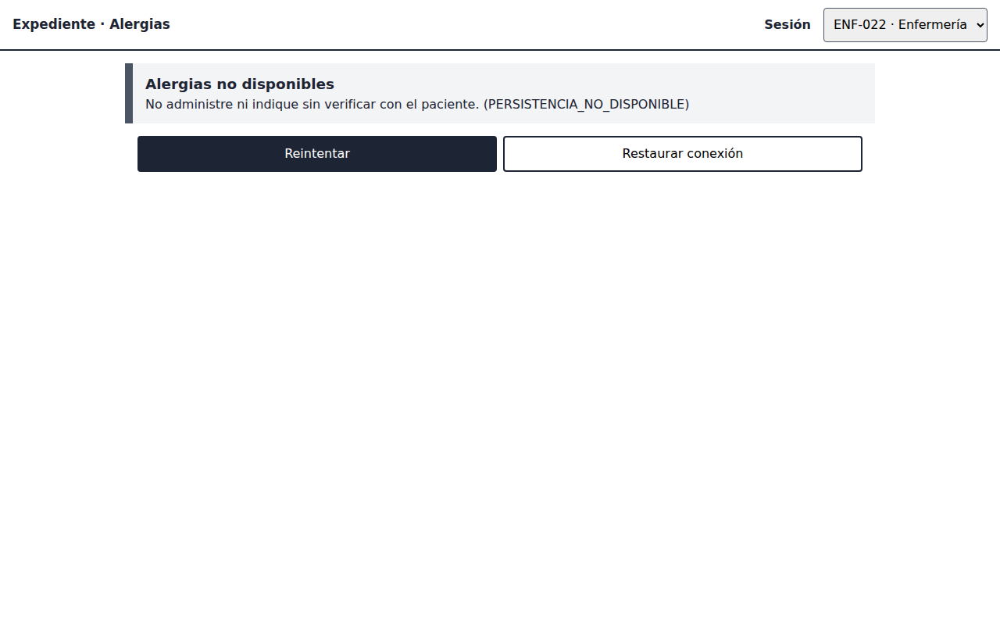 | 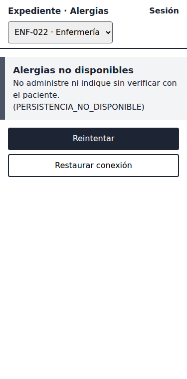 |

**Verificaciones hechas al generarlas**, en los dos tamaños:

- 0 errores de JavaScript.
- Sin desplazamiento horizontal en 7 estados: inicio, paso 1, paso 2, crítica, cambio, reconocida y sin conexión.
- axe-core 4.10 (wcag2a/aa, 21aa, 22aa): 0 violaciones en esos 7 estados.
- Al enviar el paso 1 vacío, el foco va a `#alergeno` con `aria-invalid="true"`.
- Tras guardar, el foco va al mensaje.

Al revisar la primera versión de las capturas encontré un problema real: el mensaje `ALERTA_CAMBIO` quedaba **tapado** por la franja fija cuando el foco desplazaba la página. Lo corregí moviendo el mensaje dentro de la franja, y por eso siempre está a la vista.

## 5. Consistencia con las semanas anteriores

| Aspecto | Cómo se mantiene |
|---|---|
| Roles | Enfermería no ve «Registrar alergia» y, si entra a la ruta, recibe «Su rol no puede registrar alergias» (`PERMISO_DENEGADO`) |
| Estados | Carga, vacío «no verificado», pendiente, reconocida, cambio y sin conexión (W1 a W5 y M1 a M4) |
| Accesibilidad | Corrige los P1 de la semana 9: severidad en español (B-01), error ligado al campo con foco (B-02), resumen antes de guardar (B-03) y sesión por rol (B-04, simulada). `role="alert"` solo en el título (B-05) |
| Móvil | Tarjetas en lugar de tabla, botones ≥ 44 px, registro en 2 pasos (semana 10) |

**Limitación.** La sesión es un selector, no una autenticación real, y los datos viven en memoria: al recargar la página vuelven al inicio.
