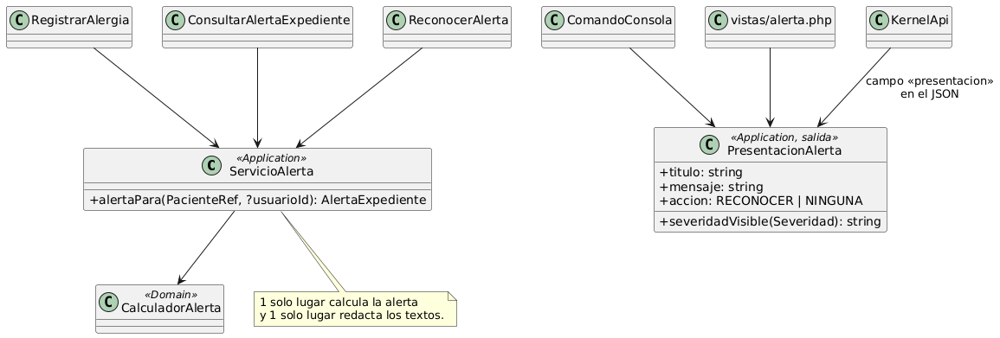
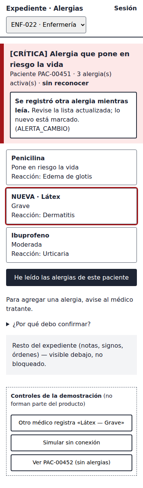

# Alergias clínicas y alerta visual en expediente

**Segunda evaluación parcial · ASII 2026**

Erick Rolando Ramazzini Muralles · @ErickRamazzini

Componentes · UX · accesibilidad · movilidad

---

## 1. Componentes y el refactor

- Backend implementado; frontend Vue 3 diseñado: 6 componentes, un composable y el cliente HTTP.
- **Punto más acoplado (medido con grep):**
  - 3 casos de uso calculan la alerta por su cuenta;
  - 2 lugares redactan el mensaje de «sin registro».
- **Refactor:** `ServicioAlerta` + `PresentacionAlerta` → 1 lugar calcula y 1 lugar redacta.

---

## 2. UX por rol

- **Médico:** consulta → registro en 2 pasos → resumen de la consecuencia («→ CRÍTICA») → reconoce.
- **Enfermería:** consulta → reconoce; no ve el formulario («avise al médico tratante»).
- **Estados:** carga (nunca muestra «vacío» mientras carga), vacío «no verificado», pendiente, reconocida y error.
- 10 mensajes con su código de backend (M-01 a M-10).

---

## 3. Accesibilidad: lo que se midió y lo que se corrigió

- **Contraste calculado:** 12 pares, 0 fallas (mínimo 6.60:1).
- **axe-core:** 0 violaciones en la vista MVC y en 7 estados del prototipo.
- **10 hallazgos en las vistas reales.** Los P1 se corrigieron en el prototipo:
  - severidad en español;
  - error ligado al campo, con el foco ahí;
  - resumen antes de guardar;
  - sesión por rol.

---

## 4. Movilidad (320–430 px)

- La franja de alerta queda **fija**; las tarjetas reemplazan a la tabla; botones ≥ 44 px.
- **Sin conexión:** «No administre sin verificar», nunca «sin alergias».
- **Reintento seguro del POST:** el índice único responde 409 → «ya quedó registrada».
- **Sin cola local:** una alergia pendiente que nadie más ve es un riesgo clínico.

---

## 5. Demostración del prototipo

- **Camino feliz:** el médico registra Penicilina → CRÍTICA → reconoce.
- **Error crítico:** la enfermera reconoce mientras otro médico agrega Látex → 409 `ALERTA_CAMBIO` → Látex marcado como NUEVA → reconoce de nuevo.
- **Verificado:** desktop 1280×800 y móvil 375×760, sin errores de JavaScript y sin desplazamiento horizontal.

---

## 6. Cambio solicitado (caso preparado)

**«Que enfermería pueda registrar una alergia referida por el paciente»**

- Queda como **referida, no verificada**: cuenta para la alerta (ALTA como mínimo), pero se ve distinta.
- El médico la verifica o la descarta.
- **Impacto:** un estado nuevo (propuesta), permiso nuevo, un componente, un mensaje y 6 pruebas.

Detalle: `registro-cambio-solicitado.md`.
