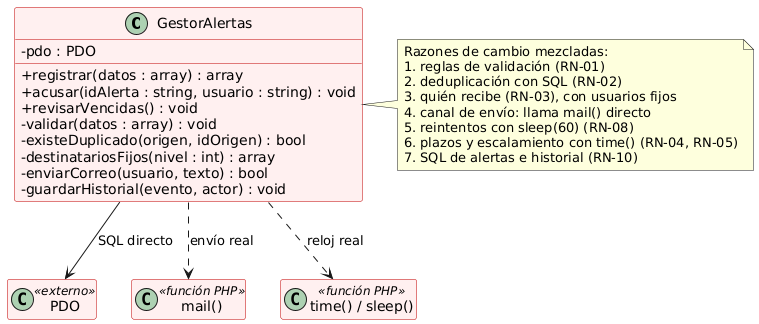
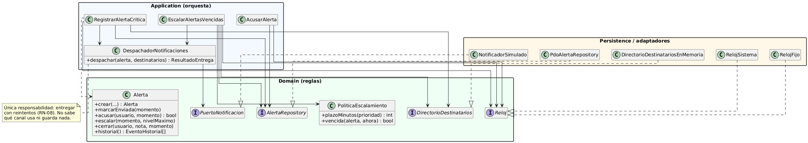

# Semana 2 (parte C) — SRP aplicado al flujo de alerta crítica

**Principio:** Responsabilidad Única (SRP): una clase debe tener **una sola razón para cambiar**.
**Flujo:** detección, envío, acuse y escalamiento de una alerta crítica.

## 1. Diseño antes



Una sola clase, `GestorAlertas`, hace todo: valida, busca duplicados con SQL, decide destinatarios con usuarios fijos, envía con `mail()`, reintenta con `sleep(60)`, calcula plazos con `time()` y guarda el historial.

| # | Razón de cambio | Quién la pide | Ejemplo de cambio |
|---|---|---|---|
| 1 | Reglas de validación (RN-01) | Calidad clínica | Exigir el valor de referencia |
| 2 | Deduplicación (RN-02) | Integración con laboratorio | Cambiar la clave de origen |
| 3 | Destinatarios (RN-03) | Jefatura de enfermería | Nuevo rol de turno |
| 4 | Canal de envío | TI | Pasar de correo a notificación de la app |
| 5 | Reintentos (RN-08) | TI | De 3 a 5 intentos |
| 6 | Plazos y escalamiento (RN-04, RN-05) | Dirección médica | `ALTA` de 30 a 20 minutos |
| 7 | Persistencia e historial (RN-10) | DBA | Esquema de HOSPITAL |

**Problemas concretos:**
- No se puede probar el escalamiento sin esperar 15 minutos reales, porque usa `time()` (incumple RNF-04).
- Probar el envío manda correos de verdad, porque usa `mail()`.
- Un cambio de canal obliga a editar y volver a probar la clase que también decide reglas clínicas.
- `sleep(60)` bloquea el registro de la alerta mientras reintenta.

## 2. Diseño después



| Clase | Capa | Única responsabilidad | Razón de cambio |
|---|---|---|---|
| `Alerta` | Domain | Estado y transiciones de la alerta, con su historial (RN-01, RN-06, RN-07, RN-09, RN-10) | Cambia una regla del ciclo de vida |
| `PoliticaEscalamiento` | Domain | Plazo por prioridad y si la alerta venció (RN-04, RN-05, RN-11) | Cambian plazos o niveles |
| `DespachadorNotificaciones` | Application | Entregar a cada destinatario con reintentos (RN-08) | Cambia la política de reintento |
| `RegistrarAlertaCritica` | Application | Orquestar CU-01, CU-02 y CU-03 | Cambia el orden del caso de uso |
| `AcusarAlerta` | Application | Orquestar CU-04 | Ídem |
| `EscalarAlertasVencidas` | Application | Orquestar CU-05 | Ídem |
| `AlertaRepository` (interfaz) | Domain | Contrato para guardar y buscar alertas | Cambia lo que el dominio necesita leer |
| `PuertoNotificacion` (interfaz) | Domain | Contrato para entregar un mensaje | Cambia lo que se entrega |
| `DirectorioDestinatarios` (interfaz) | Domain | Contrato para saber quién recibe por nivel | Cambia el criterio de destinatario |
| `Reloj` (interfaz) | Domain | Dar la hora actual | — |
| `PdoAlertaRepository` | Persistence | SQL con PDO preparado | Cambia el esquema |
| `NotificadorSimulado` | Persistence | Registrar lo «enviado» sin enviar nada real | Cambia el canal (se reemplaza el adaptador) |
| `RelojSistema` / `RelojFijo` | Persistence | Hora real / hora fija para pruebas | — |

## 3. Dependencias

- Los casos de uso dependen de **interfaces** del dominio, no de PDO, `mail()` ni `time()`.
- Los adaptadores de Persistence implementan esas interfaces y se conectan en un solo lugar (Composition Root, semana 3).
- Las reglas clínicas (`Alerta`, `PoliticaEscalamiento`) no dependen de nada externo.
- El reintento ya no duerme el proceso: el despachador cuenta intentos y el reloj inyectado da la hora.

## 4. Justificación

1. **Testabilidad (RNF-04):** con `RelojFijo` se prueba que a las 10:15 se escala y a las 10:14 no, en milisegundos.
2. **Seguridad del cambio (RNF-06):** cambiar de canal es escribir otro adaptador de `PuertoNotificacion`; `Alerta` y los casos de uso no se tocan.
3. **Confiabilidad (RNF-05):** si el canal falla, el despachador lo informa y el caso de uso guarda la alerta y escala; antes, una excepción de `mail()` podía dejar la alerta sin guardar.
4. **Trazabilidad (RNF-03):** el historial vive en `Alerta`, así que cualquier camino que cambie el estado deja su evento.

## 5. Evidencia verificable

En la **parte B** (`srp/ejemplo/`) hay un ejemplo ejecutable con el antes y el después y un verificador:

```powershell
php docs/modulos/alertas-criticas-notificaciones-internas/semana-02/srp/ejemplo/verificar-srp.php
```

El verificador revisa dos cosas:
- **Estructural:** cuenta en el código fuente qué dependencias externas (`PDO`, `mail`, `time`, `sleep`) usa cada clase. El antes las concentra en una clase; en el después ninguna clase de reglas usa una dependencia externa.
- **Comportamiento:** con `RelojFijo` y un notificador simulado comprueba CA-06 (3 intentos), CA-08 (acuse idempotente), CA-10 y CA-11 (límite de 15 minutos) y CA-12 (acusada no escala).

El resultado lo guarda el propio script en `semana-02/evidencia/verificacion-srp.txt` (UTF-8).
