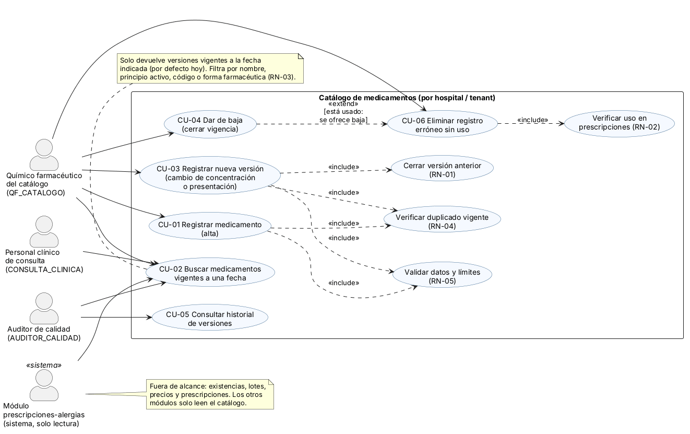
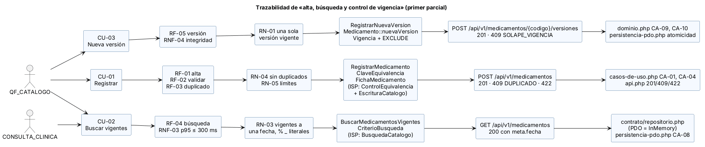
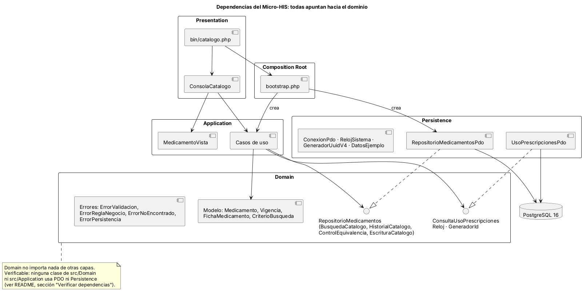

# Catálogo de medicamentos
## Alta, búsqueda y control de vigencia de un medicamento

Primer parcial · ASII 2026 · Sistema Hospitalario Integrado
Erick Rolando Ramazzini Muralles (@ErickRamazzini)

---

## 1. Problema, actores y frontera

- Lista oficial de productos **por hospital** (tenant): se registra una vez, se busca y tiene **vigencia**.
- Actores: QF del catálogo (escribe), personal clínico y `prescripciones-alergias` (leen), auditor (historial).
- **No** son del catálogo: existencias, lotes, precios, prescripciones, dosis.
- CU-01 alta · CU-02 buscar vigentes · CU-03 nueva versión · CU-04 baja · CU-05 historial · CU-06 eliminar sin uso.

---

## 2. Requisitos y reglas que guían el diseño

| Regla | Qué protege | Dónde se garantiza |
|---|---|---|
| RN-01 una sola versión vigente | Qué se podía usar en cada fecha | Dominio + `EXCLUDE` en la base |
| RN-02 no se borra lo usado | Prescripciones históricas | Puerto `ConsultaUsoPrescripciones` |
| RN-03 vigentes a una fecha | Búsqueda clínica segura | `CriterioBusqueda` + SQL con `ESCAPE` |
| RN-04 sin duplicados | Un solo producto equivalente | `ClaveEquivalencia` + `EXCLUDE` |
| RN-05 límites = columnas | 422 y nunca 500 | `Limites` genera el esquema |

RNF medibles: 401/403 por rol, tenant del token, p95 ≤ 300 ms (por medir en S15), 409 y no 500.

---

## 3. Trazabilidad de punta a punta

Cada fila: actor → caso de uso → requisito → regla → clase → endpoint → prueba que lo demuestra.

---

## 4. ISP: interfaces de rol

- Antes: `RepositorioCatalogo` con 12 métodos, incluidos precio y existencias.
- Después: `BusquedaCatalogo`, `HistorialCatalogo`, `ControlEquivalencia`, `EscrituraCatalogo` + puerto `ConsultaUsoPrescripciones`.
- Evidencia medida con *Reflection* (`verificar-isp.php`):

| Medida | Antes | Después |
|---|---|---|
| Métodos visibles no usados | 41 | 8 |
| Métodos ajenos al catálogo | 8 | 0 |
| Métodos de un doble para probar la búsqueda | 12 | 2 |

---

## 5. Capas, MVC y Repository

- Las dependencias apuntan al dominio; `arquitectura.php` lo comprueba sobre el código.
- El controlador MVC no tiene SQL ni reglas: llama a un caso de uso.
- PDO e InMemory pasan **los mismos 7 casos** de `pruebas/contrato/repositorio.php`.

---

## 6. Contrato API y seguridad

| Método | Ruta | Rol | Resultado |
|---|---|---|---|
| GET | `/api/v1/medicamentos?q=&forma=&fecha=` | 4 roles | 200 + `meta.fecha` |
| POST | `/api/v1/medicamentos` | QF_CATALOGO | 201 · 409 · 422 |
| POST | `/api/v1/medicamentos/{codigo}/versiones` | QF_CATALOGO | 201 · 409 `SOLAPE_VIGENCIA` |
| DELETE | `/api/v1/medicamentos/{codigo}` | QF_CATALOGO | 204 · 409 `EN_USO` |

- El hospital sale del token; otro hospital ve 404. Error único con `request_id`.
- 69 pruebas en verde al preparar la entrega; prueba en vivo 9 de 9.

---

## 7. Cambio práctico (caso preparado)

**«Un medicamento puede tener varias presentaciones, cada una con su propia vigencia.»**

- Se separa el **producto** (principio, concentración, forma, vía → clave RN-04) de la **presentación** (envase, registro sanitario).
- RN-01 pasa a aplicarse por presentación; RN-04 sigue a nivel de producto.
- Búsqueda: devuelve presentaciones vigentes agrupadas por producto.
- API v1 compatible: se agrega `presentaciones[]`; el campo `presentacion` se mantiene.
- Detalle y pruebas a agregar: `cambio-practico.md`.

---

## 8. Riesgos y siguientes pasos

- Esquema real de HOSPITAL y acuerdos con `prescripciones-alergias`: **pendientes**.
- Búsqueda sensible a acentos: evaluar en usabilidad (S9).
- RNF-03 aún sin medir: medición con 5 000 versiones en S15.
- Frontera de microservicio: no se separa; gatillos G1–G4 medibles.
- Próximo: componentes (S7) y experiencia de usuario por rol (S8).
