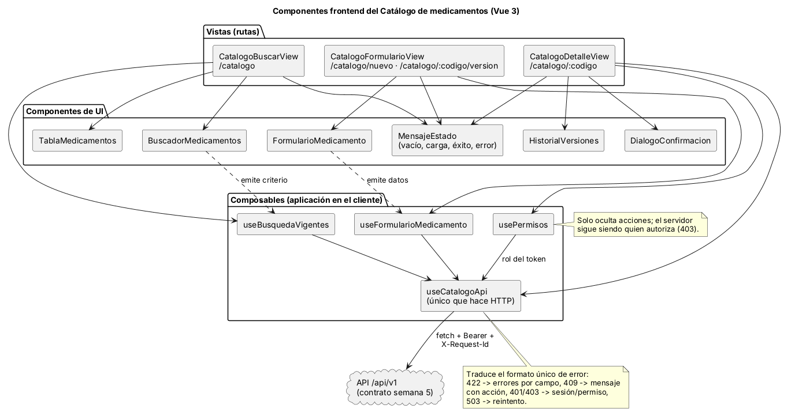
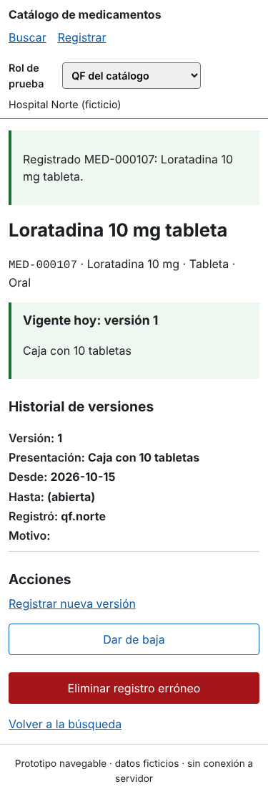
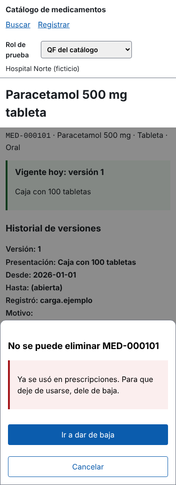

# Catálogo de medicamentos
## Componentes, UX, accesibilidad y movilidad

Segundo parcial · ASII 2026 · Sistema Hospitalario Integrado
Erick Rolando Ramazzini Muralles (@ErickRamazzini)

---

## 1. Componentes y el refactor que los justifica

- Frontend: un solo punto de acceso a la API (`useCatalogoApi`) que traduce el formato único de error.
- Backend: middleware de tenant y `X-Request-Id`, policy por rol, controlador sin reglas.
- Refactor de la nueva versión: 5 responsabilidades en 1 clase → 1 por clase; atómico y probado.

---

## 2. UX por rol

| Rol | Puede | No ve |
|---|---|---|
| QF_CATALOGO | Buscar, registrar, nueva versión, baja, eliminar sin uso | — |
| CONSULTA_CLINICA | Buscar y ver detalle | Historial y acciones |
| AUDITOR_CALIDAD | Buscar a una fecha e historial | Acciones de escritura |

Estados en todas las pantallas: vacío, cargando, éxito (`status`), error (`alert`) con una salida.

---

## 3. Accesibilidad: lo medido y lo corregido

- 11 hallazgos (4 de impacto alto) con heurísticas y WCAG 2.1 AA.
- Foco 1,82:1 → `#1d4ed8` 6,70:1 (fórmula WCAG, `calcular-contraste.php`).
- Errores 422: foco en el resumen y enlaces a cada campo.
- Eliminar exige escribir el código; si fue usado, se bloquea (RN-02).
- «Saltar al contenido», obligatorios con `aria-required`, etiquetas legibles.

---

## 4. Movilidad (320–430 px)

 

- Tarjetas en lugar de tabla; versión vigente primero; confirmaciones en hoja inferior.
- Conexión limitada: muestra la copia guardada con su hora y **consulta antes de reenviar**.

---

## 5. Demostración con el prototipo

1. Buscar «lorat» → vacío → Registrar.
2. Enviar vacío → 7 errores, foco en el resumen.
3. Registrar Loratadina → «Registrado MED-000107».
4. Error crítico: amoxicilina 500 mg cápsula oral → 409 con «Ver MED-000102».
5. Eliminar MED-000101 → bloqueado → «Ir a dar de baja».
6. Cambiar a CONSULTA_CLINICA → sin acciones ni historial.

Guion con tiempos: `recorrido.md`.

---

## 6. Riesgos y cómo se tratan

| Riesgo | Tratamiento | Evidencia |
|---|---|---|
| Usar una versión no vigente | «Vigente al …» siempre visible; búsqueda por fecha | W2, M2, prototipo |
| Duplicar un producto | 409 recuperable con enlace al existente | Captura 07 |
| Borrar lo usado | Bloqueo + baja | Captura 08, RN-02 |
| Reenvío en red mala | Consultar estado antes de reenviar | Semana 10, E2 |
| Ver otro hospital | Tenant del token; 404 | Pruebas de API |

---

## 7. Cambio solicitado (caso preparado)

**«El QF necesita ver qué medicamentos cambian de vigencia en los próximos 30 días.»**

- UX: filtro «Cambios próximos» en Buscar (QF y auditor), con lista de entradas y cierres.
- API v1 compatible: `GET /medicamentos?cambios_desde=&cambios_hasta=`.
- Dominio: consulta nueva en `BusquedaCatalogo`; ninguna regla nueva.
- Detalle y pruebas: `cambio-solicitado.md`.
