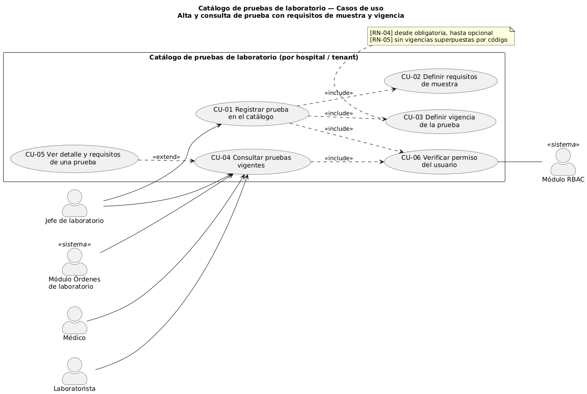
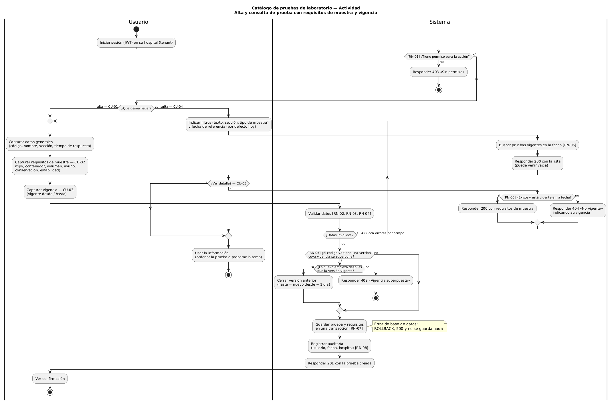
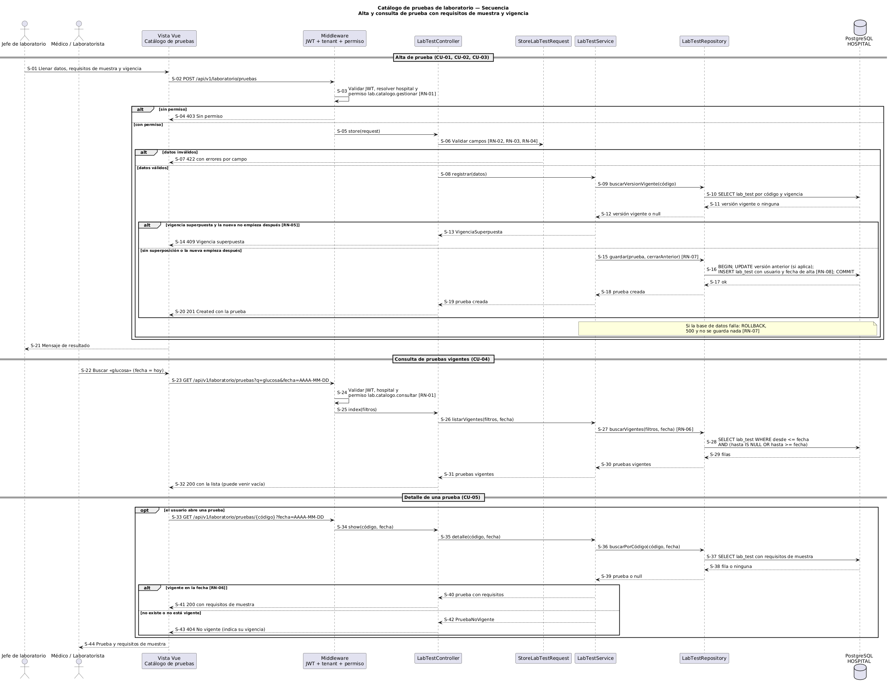

# Catálogo de pruebas de laboratorio — Semana 1

**Proceso:** alta y consulta de prueba con requisitos de muestra y vigencia
**Estudiante:** Erick Rolando Ramazzini Muralles (ErickRamazzini)
**Curso:** Análisis de Sistemas II 2026 — UMG

## 1. Narrativa de alcance

El catálogo es la fuente única de las pruebas de laboratorio que ofrece cada hospital (tenant). Define qué es cada prueba, qué muestra necesita y desde cuándo y hasta cuándo se puede pedir. Los demás procesos de laboratorio (órdenes, muestras y resultados) **consultan** el catálogo; no lo modifican.

### Dentro del alcance

- **Alta de una prueba:** código, nombre, sección del laboratorio y tiempo estimado de respuesta.
- **Requisitos de muestra:** tipo de muestra, contenedor, volumen mínimo, preparación del paciente (horas de ayuno e instrucciones), condición de conservación y estabilidad máxima hasta su procesamiento.
- **Vigencia:** fecha desde y fecha hasta (opcional). Un cambio en una prueba se registra como una versión nueva con su propia vigencia; las versiones anteriores nunca se borran porque las órdenes pasadas las referencian.
- **Consulta:** lista de pruebas vigentes en una fecha, con filtros, y detalle de una prueba con sus requisitos.

### Fuera del alcance

- Crear órdenes de laboratorio (`lab_order`, `lab_order_item`).
- Registrar y rastrear muestras (`specimen`).
- Capturar o validar resultados (`lab_result_version`).
- Valores de referencia, interpretación clínica, precios y facturación.
- Gestión de usuarios y roles: los permisos los da el módulo RBAC; aquí solo se consumen.
- Editar una versión ya registrada o darla de baja antes de su fecha: un cambio se registra como versión nueva (RN-05).

### Actores

| Actor | Tipo | Objetivo |
|---|---|---|
| Jefe de laboratorio | Principal | Registrar pruebas con sus requisitos y vigencia, y consultarlas |
| Médico | Principal | Saber qué pruebas puede pedir hoy y qué preparación necesita el paciente |
| Laboratorista | Principal | Conocer el tipo de muestra, contenedor, volumen, preparación del paciente y conservación |
| Módulo Órdenes de laboratorio | Sistema | Obtener solo las pruebas vigentes al crear una orden |
| Módulo RBAC | Sistema (secundario) | Confirmar si el usuario tiene el permiso de la acción |

## 2. Reglas de negocio

| ID | Regla |
|---|---|
| RN-01 | Solo el Jefe de laboratorio tiene `lab.catalogo.gestionar` (alta). Jefe, Médico, Laboratorista y el módulo Órdenes tienen `lab.catalogo.consultar`. Sin permiso → 403. |
| RN-02 | Obligatorios: código (formato `AAA-000`, en mayúsculas), nombre, sección (hematología, química clínica, microbiología, inmunología, uroanálisis, coprología) y tiempo de respuesta en horas mayor que 0. |
| RN-03 | Requisitos de muestra obligatorios: tipo de muestra de una lista cerrada (sangre total, suero, plasma, orina, heces, hisopado), contenedor, volumen mínimo en mL mayor que 0, horas de ayuno (0 = no requiere), conservación (ambiente, refrigerada 2–8 °C o congelada) y estabilidad en horas mayor que 0. Las instrucciones de preparación del paciente son opcionales. |
| RN-04 | La fecha desde es obligatoria y no puede ser anterior a hoy. La fecha hasta es opcional (vacía = indefinida) y, si se indica, debe ser igual o posterior a la fecha desde. |
| RN-05 | El código es único por hospital, pero puede tener varias versiones sin vigencias superpuestas. Si la nueva versión empieza después de la vigente, la anterior se cierra el día previo; si empieza el mismo día o antes → 409. |
| RN-06 | La consulta solo devuelve pruebas cuya vigencia incluya la fecha de referencia (por defecto, hoy). Una prueba inexistente o no vigente en esa fecha responde 404 indicando su vigencia. |
| RN-07 | La prueba, sus requisitos y el cierre de la versión anterior se guardan en una sola transacción. Si algo falla, no se guarda nada (500). |
| RN-08 | Cada versión guarda usuario, fecha y hora y hospital. Como una versión no se edita (solo se cierra su vigencia), la propia fila sirve de registro de auditoría. |

## 3. Funcionamiento con ejemplos

**Alta correcta.** El Jefe de laboratorio registra `HEM-001` «Hematología completa», sección hematología, tiempo de respuesta 4 h; muestra de sangre total en tubo tapa lila (EDTA), 3 mL, sin ayuno, refrigerada 2–8 °C, estabilidad 24 h; vigente desde 2027-01-04 sin fecha hasta. El sistema valida, guarda, audita y responde **201**.

**Datos inválidos.** Se intenta registrar `GLU-001` con volumen 0 mL y fecha hasta anterior a la fecha desde. Responde **422** con un error por cada campo y el formulario conserva lo capturado.

**Nueva versión.** `GLU-001` «Glucosa en ayunas» (plasma, tubo tapa gris, 2 mL, ayuno 8 h) está vigente desde 2027-01-04 sin fecha hasta. Se registra una versión con volumen mínimo de 1 mL vigente desde 2027-02-01: la versión anterior se cierra el 2027-01-31 y la nueva queda vigente. Si la nueva versión empezara el 2027-01-04 o antes, la respuesta sería **409**.

**Consulta.** Con fecha 2027-01-15 un médico busca «glucosa» y recibe `GLU-001` versión 1 con sus requisitos. Si un laboratorista pide el detalle de `HEM-001` con fecha 2027-01-03, recibe **404 «No vigente»**, indicando que la prueba es vigente desde el 2027-01-04.

## 4. Diagramas

| Diagrama | Fuente | Imagen |
|---|---|---|
| Casos de uso | [casos-de-uso.puml](diagramas/casos-de-uso.puml) |  |
| Actividad | [actividad.puml](diagramas/actividad.puml) |  |
| Secuencia | [secuencia.puml](diagramas/secuencia.puml) |  |

## 5. Trazabilidad entre diagramas

| Caso de uso | Actividad (paso o decisión) | Secuencia (mensajes) | Reglas |
|---|---|---|---|
| CU-01 Registrar prueba | Rama «alta»: capturar datos, guardar, auditar, 201 | S-01 a S-21 | RN-02, RN-07, RN-08 |
| CU-02 Definir requisitos de muestra | «Capturar requisitos de muestra» y validación | S-01, S-06, S-07 | RN-03 |
| CU-03 Definir vigencia | «Capturar vigencia», decisión de vigencia superpuesta, cierre de versión anterior | S-06, S-09 a S-16 | RN-04, RN-05 |
| CU-04 Consultar pruebas vigentes | Rama «consulta»: filtros, búsqueda por fecha, 200 | Bloque «Consulta» | RN-06 |
| CU-05 Ver detalle y requisitos | Decisión «¿Existe y está vigente?», 200 o 404 | Bloque «Detalle» | RN-06 |
| CU-06 Verificar permiso | Decisión inicial de permiso, 403 | S-03, S-04 y su equivalente en la consulta | RN-01 |

### Excepciones cubiertas

| Excepción | Respuesta | Dónde se ve |
|---|---|---|
| Usuario sin permiso | 403 | Actividad (inicio) y secuencia (`alt sin permiso`) |
| Datos incompletos o inválidos | 422 | Actividad (`repeat`) y secuencia (`alt datos inválidos`) |
| Vigencia superpuesta | 409 | Actividad (RN-05) y secuencia (`alt vigencia superpuesta`) |
| Prueba inexistente o no vigente | 404 | Actividad (detalle) y secuencia (bloque «Detalle») |
| Falla de base de datos | 500 sin guardar | Notas en actividad y secuencia |

## 6. Pendientes por confirmar

- Si las unidades y los rangos de referencia pertenecen al catálogo o a la validación de resultados. Por ahora quedan fuera.
- Si `lab_test` vive en la base HOSPITAL (por hospital) o en CENTRAL (compartida). El modelo asume HOSPITAL, con código único por hospital.
