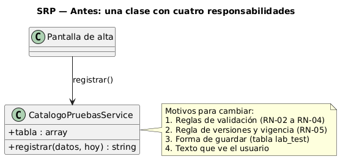
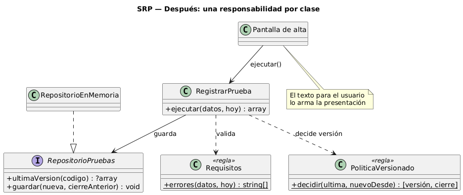

# Semana 2 — Principio SOLID: responsabilidad única (SRP)

**Proceso:** alta de prueba con requisitos de muestra y vigencia (CU-01, CU-03)

## 1. Por qué SRP en este módulo

Según la fuente del curso ([MVP Cluster, «Principios básicos del diseño de software»](https://mvpcluster.com/diseno-de-software-2/)), cada clase debe tener una responsabilidad única: un solo motivo para cambiar. Su ejemplo separa «oferta» y «venta» porque cambian por razones distintas; aquí ocurre lo mismo con validar, versionar y guardar una prueba.


El alta de una prueba junta cuatro cosas que cambian por motivos distintos: las reglas de los datos (RN-02 a RN-04), la regla de versiones y vigencia (RN-05), la forma de guardar en `lab_test` y el texto que ve el usuario. Si viven en la misma clase, un cambio en cualquiera obliga a tocar y volver a probar las otras tres. SRP pide que cada clase tenga un solo motivo para cambiar.

## 2. Antes

[`antes/CatalogoPruebasService.php`](antes/CatalogoPruebasService.php): una sola clase valida, decide la versión, guarda y arma el mensaje.



Problemas concretos:
- Para cambiar la regla de vigencia hay que tocar el mismo método que guarda los datos.
- No se puede probar la regla de versiones sin una tabla.
- El mensaje para la pantalla está pegado a la lógica, así que la API no podría devolver otro formato.

## 3. Después

| Clase | Única responsabilidad | Motivo para cambiar |
|---|---|---|
| `Requisitos` | Validar los datos (RN-02 a RN-04) | Cambia una regla de los datos |
| `PoliticaVersionado` | Decidir la versión nueva y el cierre de la anterior (RN-05) | Cambia la regla de vigencia |
| `RepositorioPruebas` / `RepositorioEnMemoria` | Guardar y leer versiones | Cambia la base de datos |
| `RegistrarPrueba` | Coordinar el caso de uso CU-01 | Cambia el flujo del caso de uso |



El texto para el usuario sale de la clase: lo arma la presentación (web o API). Este mismo reparto es el que sigue el Micro-HIS desde la semana 3: `LabTest::validar`, `RegistrarPrueba` y la interfaz `LabTestRepository`.

## 4. Verificación

[`verificar.php`](verificar.php) ejecuta los mismos cuatro escenarios con las dos versiones y compara los resultados.

```powershell
cd docs/modulos/catalogo-pruebas-laboratorio/semana-02/solid-srp
php verificar.php --evidencia=evidencia/salida-verificar.txt
```

Salida: [`evidencia/salida-verificar.txt`](evidencia/salida-verificar.txt).

## 5. Límites del ejemplo

Es un ejemplo reducido: valida tres campos y guarda en memoria, para que el cambio de diseño se vea completo en pocas líneas. La validación completa y la persistencia en PostgreSQL están en el Micro-HIS (semanas 3 a 5).
