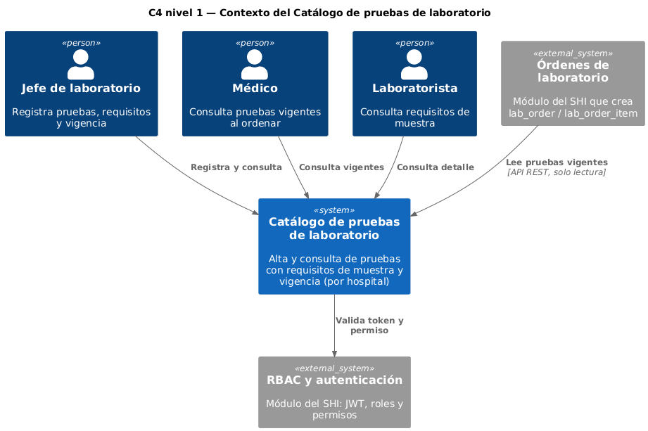
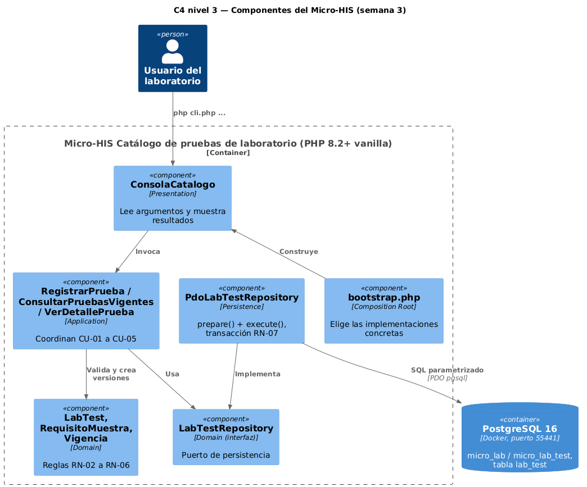
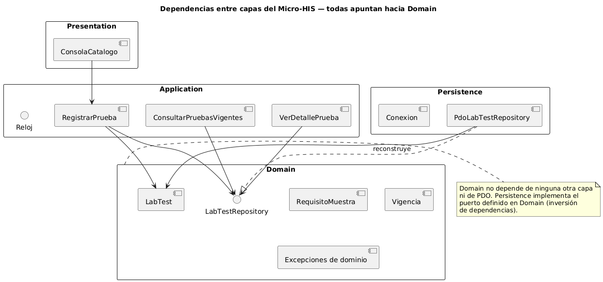

# Catálogo de pruebas de laboratorio — Semana 3

**Tema:** diseño arquitectónico, vistas y patrones
**Tarea:** iniciar el Micro-HIS «Catálogo de pruebas de laboratorio» en PHP 8.2+ vanilla para el proceso «alta y consulta de prueba con requisitos de muestra y vigencia»
**Código:** [`../micro-his/`](../micro-his/) (las semanas 4 y 5 continúan el mismo código)

## 1. Vista arquitectónica

| Vista | Diagrama | Qué muestra |
|---|---|---|
| C4 nivel 1 — Contexto |  | Actores de la semana 1 y los módulos vecinos (Órdenes de laboratorio, RBAC) |
| C4 nivel 3 — Componentes |  | Componentes del Micro-HIS por capa y la base PostgreSQL |
| Dependencias entre capas |  | Todas las dependencias apuntan hacia Domain |

## 2. Capas y archivos

| Capa | Carpeta | Contenido | Depende de |
|---|---|---|---|
| Presentation | `src/Presentation/Cli/` + `cli.php` | `ConsolaCatalogo`: lee argumentos, llama al caso de uso y muestra el resultado | Application |
| Application | `src/Application/` | `RegistrarPrueba` (CU-01 a CU-03), `ConsultarPruebasVigentes` (CU-04), `VerDetallePrueba` (CU-05), interfaz `Reloj` | Domain |
| Domain | `src/Domain/` | `LabTest`, `RequisitoMuestra`, `Vigencia`, interfaz `LabTestRepository` y excepciones de dominio | Nada |
| Persistence | `src/Persistence/` | `PdoLabTestRepository` (PDO pgsql, siempre `prepare()` + `execute()`, transacción RN-07) y `Conexion` | Domain |
| Composition Root | `bootstrap.php` | Autoload y construcción de los objetos concretos | Todas |

Decisiones:
- **La interfaz `LabTestRepository` vive en Domain**, para que los casos de uso no conozcan PDO y se puedan probar con dobles. En la semana 4 se agregan el adaptador InMemory y la entrada MVC.
- **`Reloj` en Application** permite fijar «hoy» en las pruebas, porque RN-04 compara la fecha desde con el día actual.
- **La auditoría (RN-08) va en la propia fila:** `created_by`, `created_at` y `tenant_id`. Las versiones no se editan; solo se cierra `valid_to`.
- **Columnas de `lab_test`:** son las que propone el Micro-HIS ([`sql/esquema.sql`](../micro-his/sql/esquema.sql)); se ajustarán al esquema oficial de HOSPITAL cuando esté publicado. Solo se crea `lab_test` porque las otras tablas de laboratorio no participan en este proceso.

## 3. Cómo ejecutarlo

Requisitos: PHP 8.2 o superior con la extensión `pdo_pgsql` activa en `php.ini`, y Docker Desktop.

```powershell
cd docs/modulos/catalogo-pruebas-laboratorio/micro-his
docker compose up -d
docker compose ps                      # esperar STATUS = healthy
php scripts/crear-esquema.php          # crea lab_test en micro_lab y micro_lab_test
php cli.php alta datos/hem-001.json
php cli.php vigentes "" 2027-01-15
php cli.php detalle HEM-001 2027-01-03 # responde «no vigente» con su vigencia
php pruebas/ejecutar.php --evidencia=../semana-03/evidencia/salida-pruebas.txt
```

La base corre en el puerto **55441**, en el contenedor `micro-lab-postgres`, con las bases `micro_lab` y `micro_lab_test`. Los datos son ficticios.

## 4. Pruebas

| ID | Tipo | Qué prueba | Regla |
|---|---|---|---|
| T-01 | Camino feliz (doble espía) | Alta de `HEM-001` crea la versión 1 con sus requisitos | RN-02, RN-03 |
| T-02 | Regla de dominio | Una versión con la misma fecha desde se rechaza | RN-05 |
| T-03 | Regla de dominio | Una versión que empieza después cierra la anterior el 2027-01-31 | RN-05 |
| T-04 | Regla de dominio | Devuelve un error por cada campo inválido | RN-03, RN-04 |
| T-05 | Error de persistencia (doble que falla) | La falla del repositorio llega como `ErrorPersistencia` | RN-07 |
| T-06 | Regla de dominio | El detalle antes de la vigencia responde «no vigente» con su fecha | RN-06 |
| T-07 | Base de prueba (PDO) | Guarda y consulta solo las pruebas vigentes en la fecha | RN-06 |
| T-08 | Error de persistencia (base de prueba) | Si el INSERT falla, el cierre de la versión anterior se revierte | RN-07 |

Los dobles están en [`micro-his/pruebas/soporte.php`](../micro-his/pruebas/soporte.php): `RelojFijo` (fija el día en 2027-01-02), `RepositorioEspia` y `RepositorioQueFalla`.

Resultado de la ejecución: [`evidencia/salida-pruebas.txt`](evidencia/salida-pruebas.txt).
