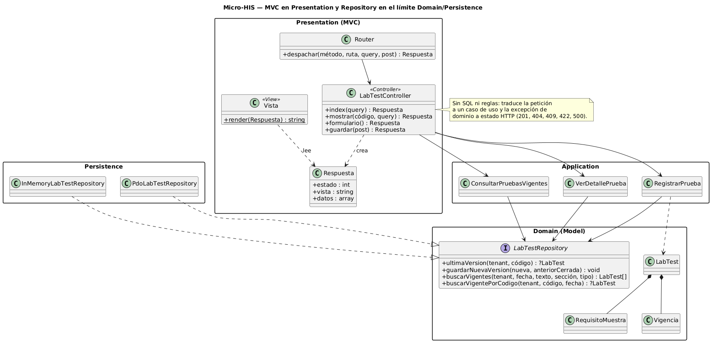
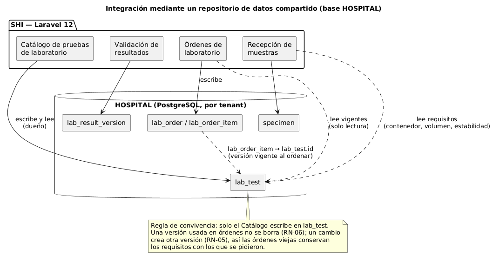

# Catálogo de pruebas de laboratorio — Semana 4

**Tema:** arquitectura en capas y patrón Repository
**Tarea:** continuar el mismo Micro-HIS con entrada MVC, la interfaz Repository en su límite y los adaptadores PDO e InMemory, y analizar la integración mediante un repositorio de datos compartido
**Código:** [`../micro-his/`](../micro-his/)

## 1. Qué cambió respecto a la semana 3

| Pieza | Archivo | Para qué |
|---|---|---|
| Router | `src/Presentation/Http/Router.php` | Asocia `GET /pruebas`, `GET /pruebas/nueva`, `POST /pruebas` y `GET /pruebas/{código}` con el controlador |
| Controller | `src/Presentation/Http/LabTestController.php` | Llama al caso de uso y traduce el resultado a estado y vista |
| View | `src/Presentation/Http/Vista.php` + `src/Presentation/vistas/*.php` | Plantillas HTML (lista, detalle, formulario, mensaje) con salida escapada |
| Front controller | `public/index.php` | Entrada web: `php -S 127.0.0.1:8081 -t public` |
| Adaptador InMemory | `src/Persistence/InMemoryLabTestRepository.php` | Mismo contrato que el PDO, sin base de datos |
| Composition Root | `bootstrap.php`, `config.php` | Elige el adaptador con `LAB_REPOSITORIO=pdo` o `memoria` |

## 2. Capas y responsabilidades



| Capa | Hace | No hace |
|---|---|---|
| Presentation (MVC) | Leer la petición, elegir el caso de uso, traducir excepciones a 201/404/409/422/500 y mostrar la vista escapando el HTML | SQL, reglas de negocio ni decidir versiones |
| Application | Coordinar CU-01 a CU-05: validar, consultar la última versión, decidir el cierre y pedir que se guarde | Conocer HTTP, HTML o PDO |
| Domain | Reglas RN-02 a RN-06 en `LabTest`, `RequisitoMuestra` y `Vigencia`; define la interfaz `LabTestRepository` | Depender de otra capa o de la base de datos |
| Persistence | Implementar `LabTestRepository`: PDO con `prepare()` + `execute()` y transacción (RN-07), o memoria | Validar datos o decidir reglas |

**Límite del Repository.** La interfaz está en Domain porque expresa lo que el dominio necesita («la última versión», «las vigentes a una fecha»), no cómo se guarda. Persistence depende de Domain y no al revés; así los casos de uso funcionan igual con PDO, con InMemory o con un doble.

**Verificación del controlador sin SQL.** La prueba T-12 revisa que `LabTestController.php` no mencione `SELECT`, `INSERT`, `UPDATE`, `PDO` ni `prepare`.

## 3. Objetos reutilizables

| Objeto | Capa | Dónde se reutiliza |
|---|---|---|
| `Vigencia` | Domain | Catálogo (alta y consulta) y, a futuro, cualquier catálogo con vigencia desde/hasta |
| `RequisitoMuestra` | Domain | Detalle del catálogo, recepción de muestras (qué contenedor y volumen esperar) |
| `LabTestRepository` | Domain | Lo usan los tres casos de uso; Órdenes podría usar la misma interfaz de lectura |
| `RegistrarPrueba`, `ConsultarPruebasVigentes`, `VerDetallePrueba` | Application | Los mismos objetos atienden la consola (semana 3), la web MVC (semana 4) y la API (semana 5) |
| `InMemoryLabTestRepository` | Persistence | Pruebas automáticas y demostraciones sin Docker |
| `Respuesta` + `Vista` | Presentation | Todas las pantallas del módulo |

## 4. Integración mediante un repositorio de datos compartido



En el SHI los módulos de laboratorio comparten la base HOSPITAL. Así se integraría este módulo:

- **Propiedad:** el Catálogo es el único que escribe en `lab_test`. Órdenes y Recepción de muestras solo leen.
- **Referencia estable:** `lab_order_item` debe apuntar a `lab_test.id` (la versión), no solo al código; así una orden conserva los requisitos con los que se pidió aunque después exista otra versión.
- **Lectura de vigentes:** Órdenes debe filtrar por la fecha de la orden con la misma condición que `buscarVigentes` (`valid_from <= fecha AND (valid_to IS NULL OR valid_to >= fecha)`). Para no duplicar esa regla, conviene exponerla como vista SQL o como el endpoint de la semana 5.
- **Aislamiento:** todas las consultas filtran por `tenant_id`.

| Ventaja | Riesgo | Mitigación |
|---|---|---|
| Integración simple, sin llamadas entre servicios | Otro módulo puede escribir en `lab_test` por error | Permisos de base: solo el usuario del Catálogo tiene `INSERT/UPDATE` en `lab_test` |
| Consistencia inmediata (misma transacción, misma base) | Un cambio de columnas rompe a los lectores | Lectores usan una vista o el endpoint versionado, no la tabla directa |
| Las órdenes pueden referenciar la versión exacta | Acoplamiento al esquema compartido | Contrato de lectura documentado (semana 5) |

**Pendiente:** confirmar si `lab_test` vive en HOSPITAL o en CENTRAL. Si fuera CENTRAL, el catálogo sería común a todos los hospitales y `tenant_id` dejaría de ser parte de la clave.

## 5. Pruebas nuevas

| ID | Qué prueba |
|---|---|
| T-09 (InMemory y PDO) | El mismo contrato de `LabTestRepository` (versiones, filtros, vigencia y aislamiento por hospital) se cumple con los dos adaptadores |
| T-10 | `POST /pruebas` válido responde 201 y la vista muestra los requisitos |
| T-11 | Datos inválidos → 422 y vigencia superpuesta → 409, de vuelta al formulario con errores |
| T-12 | El controlador no contiene SQL ni acceso a PDO |

```powershell
cd docs/modulos/catalogo-pruebas-laboratorio/micro-his
docker compose up -d
php scripts/crear-esquema.php
php pruebas/ejecutar.php --evidencia=../semana-04/evidencia/salida-pruebas.txt
php -S 127.0.0.1:8081 -t public        # abrir http://127.0.0.1:8081/pruebas
```

Resultado: [`evidencia/salida-pruebas.txt`](evidencia/salida-pruebas.txt).
