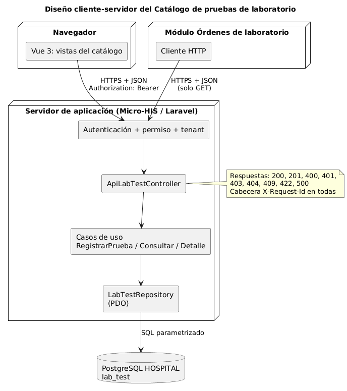

# Catálogo de pruebas de laboratorio — Semana 5

**Tema:** cliente-servidor, API REST, microservicios e integración
**Tarea:** evolucionar el mismo Micro-HIS hacia cliente-servidor y evaluar una frontera de microservicio
**Código:** [`../micro-his/src/Presentation/Api/`](../micro-his/src/Presentation/Api/)

## 1. Diseño cliente-servidor



El servidor expone una API REST JSON; los clientes son la interfaz Vue y el módulo Órdenes de laboratorio. La API reutiliza los mismos casos de uso que la consola (semana 3) y el MVC (semana 4); solo cambia la capa Presentation.

| Pieza | Archivo |
|---|---|
| Controlador de la API | `src/Presentation/Api/ApiLabTestController.php` |
| Permisos (RN-01) con tokens ficticios | `src/Presentation/Api/Autorizacion.php` |
| Error traducido a HTTP | `src/Presentation/Api/ErrorApi.php` |
| Respuesta JSON con `X-Request-Id` | `src/Presentation/Api/RespuestaJson.php` |
| Entrada `/api/...` | `public/index.php` |

## 2. Documentos de la semana

| Documento | Contenido |
|---|---|
| [contrato-api.md](contrato-api.md) | Endpoints, permisos, campos, respuestas, errores y ejemplos |
| [frontera-microservicio.md](frontera-microservicio.md) | Propiedad de datos, comunicación, seguridad, resiliencia, observabilidad, consistencia, gatillos medibles y migración por etapas |
| [plan-issue-rama-pr.md](plan-issue-rama-pr.md) | Plan de tarea, rama, worktree y PR |

## 3. Pruebas nuevas

| ID | Qué prueba |
|---|---|
| T-13 | POST con rol Jefe de laboratorio → 201 con requisitos y vigencia |
| T-14 | Sin token → 401; médico intentando registrar → 403 |
| T-15 | 422 con errores por campo y 409 por vigencia superpuesta |
| T-16 | GET de vigentes para el médico y 404 con la vigencia en el detalle |

```powershell
cd docs/modulos/catalogo-pruebas-laboratorio/micro-his
docker compose up -d
php scripts/crear-esquema.php
php pruebas/ejecutar.php --evidencia=../semana-05/evidencia/salida-pruebas.txt
```

Las pruebas de la API escriben en la consola una línea `[catalogo-lab] …` por petición (observabilidad); esas líneas no van al archivo de evidencia.

Resultado: [`evidencia/salida-pruebas.txt`](evidencia/salida-pruebas.txt).
