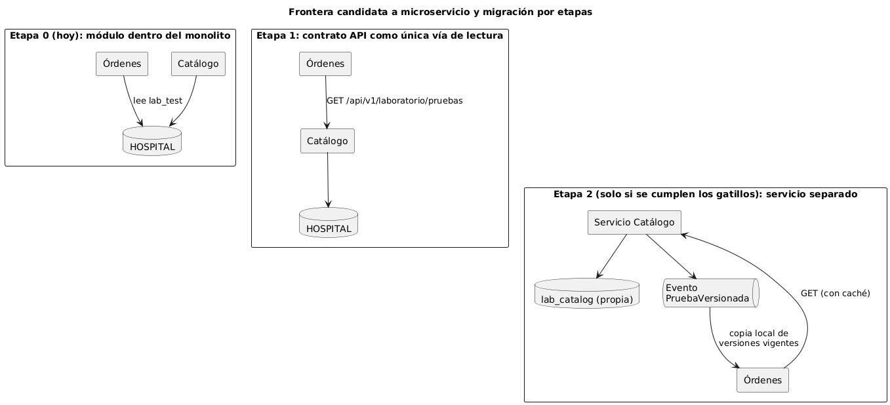

# Evaluación de frontera de microservicio

**Pregunta:** ¿conviene separar el Catálogo de pruebas de laboratorio como microservicio?
**Respuesta corta:** todavía no. Se diseña la frontera y se deja lista la etapa 1 (contrato API), pero la separación física solo se justifica si se cumplen los gatillos medibles de la sección 3.

## 1. Por qué es buen candidato

- Tiene **datos propios**: solo el Catálogo escribe en `lab_test`.
- Su interfaz es **pequeña y estable**: tres endpoints, sin depender de otros módulos para responder.
- Cambia **a otro ritmo** que órdenes o resultados: se actualiza pocas veces y se lee mucho.

## 2. Aspectos de la frontera

| Aspecto | Decisión |
|---|---|
| Propiedad de datos | El Catálogo es dueño de `lab_test`. Los demás módulos leen por el contrato API (etapa 1); nunca escriben. |
| Comunicación | Síncrona HTTP/JSON para consultas. Si se separa (etapa 2), un evento `PruebaVersionada` avisa a Órdenes para que mantenga una copia local de las versiones vigentes. |
| Seguridad | JWT del módulo RBAC; el tenant sale del token; permisos `lab.catalogo.gestionar` y `lab.catalogo.consultar`; el catálogo no guarda datos de pacientes. |
| Resiliencia | Las lecturas de Órdenes usan un tiempo de espera corto (2 s) y una caché de vigentes de 5 minutos; si el Catálogo no responde, Órdenes sigue con la última copia y avisa que puede estar desactualizada. El alta es atómica (RN-07). |
| Observabilidad | `X-Request-Id` en cada respuesta y una línea de registro por petición (id, método, ruta, estado), sin datos clínicos. A futuro: tiempo de respuesta por endpoint y tasa de 5xx. |
| Consistencia | Dentro del Catálogo es fuerte (una transacción por versión). Entre módulos es eventual en la etapa 2; se tolera porque una orden guarda el `id` de la versión que usó, así que un retraso no cambia lo ya ordenado. |

## 3. Gatillos medibles para separar (etapa 2)

Se separa solo si se cumple **al menos uno** de manera sostenida durante un mes:

| Gatillo | Umbral | Fuente |
|---|---|---|
| Lecturas del catálogo | Más de 50 peticiones por segundo en hora pico | Registro de la API |
| Despliegues bloqueados | Más de 2 por mes en que un cambio del catálogo tuvo que esperar al resto del SHI | Historial de PR y despliegues |
| Catálogo compartido entre hospitales | Se decide que `lab_test` sea común (base CENTRAL) y lo consumen varias instalaciones | Decisión de arquitectura del curso |

Hoy no hay datos que muestren ninguno de los tres; por eso la decisión es no separar.

## 4. Migración razonada

| Etapa | Qué se hace | Criterio para avanzar |
|---|---|---|
| 0 — Hoy | Módulo dentro del monolito; Órdenes podría leer `lab_test` directamente | — |
| 1 — Contrato | Órdenes y Recepción de muestras leen solo por `GET /api/v1/laboratorio/pruebas`; se quitan las lecturas directas a la tabla | Contrato publicado y pruebas T-13 a T-16 en verde |
| 2 — Separación | Base propia `lab_catalog`, despliegue independiente y evento `PruebaVersionada` | Se cumple un gatillo de la sección 3 |

Lo que **no** se hace en este curso: infraestructura de producción, colas reales ni dividir el sistema sin un gatillo cumplido.
