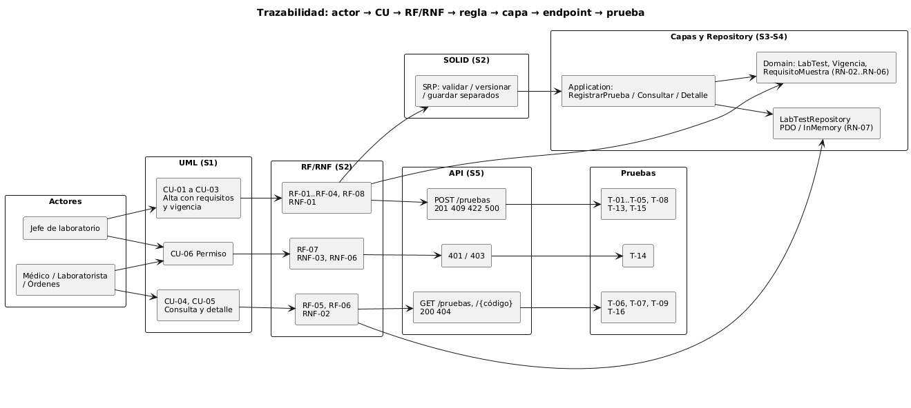

# Catálogo de pruebas de laboratorio — Semana 6

**Tema:** primera evaluación parcial
**Tarea:** defender la arquitectura de «alta y consulta de prueba con requisitos de muestra y vigencia» conectando actores, UML, RF/RNF, SOLID, capas, Repository y contrato API, y responder un cambio práctico

| Entregable | Archivo |
|---|---|
| Presentación (Marp): 7 diapositivas más la portada | [presentacion.md](presentacion.md) |
| Diagrama trazable | [diagramas/diagrama-trazable.puml](diagramas/diagrama-trazable.puml) ·  |
| Matriz decisión → evidencia | [matriz-decision-evidencia.md](matriz-decision-evidencia.md) |
| Registro del cambio práctico | [cambio-practico.md](cambio-practico.md) |

Para ver la presentación: abrir `presentacion.md` en VS Code con la extensión «Marp for VS Code» y usar la vista previa o «Export Slide Deck» a PDF.

El cambio práctico está preparado con un caso probable (varios tipos de muestra por prueba). Si en la evaluación se pide otro, se registra en el mismo archivo con el mismo formato.
