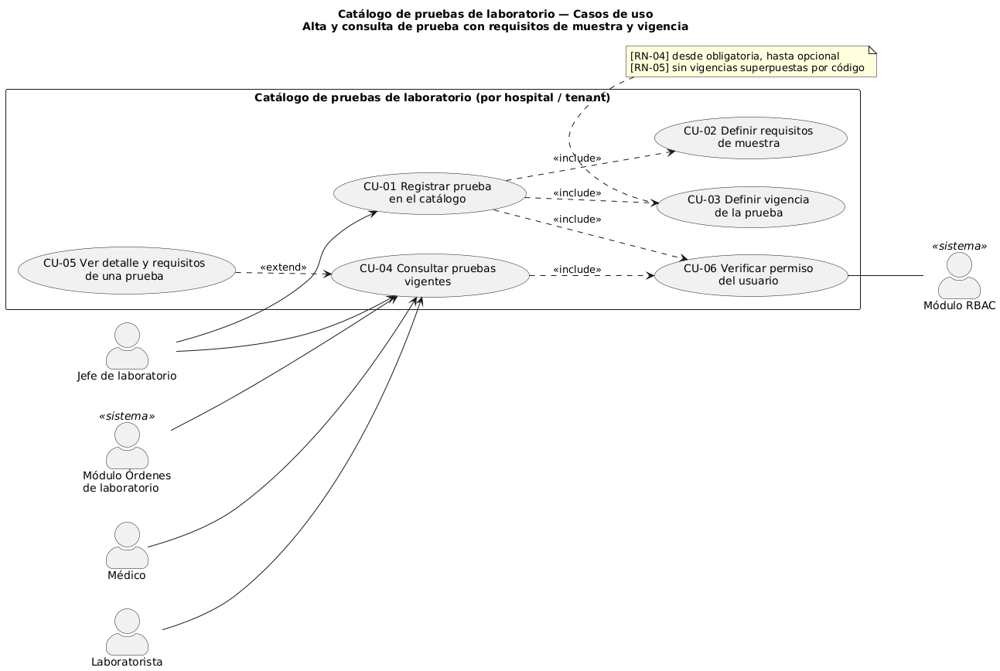
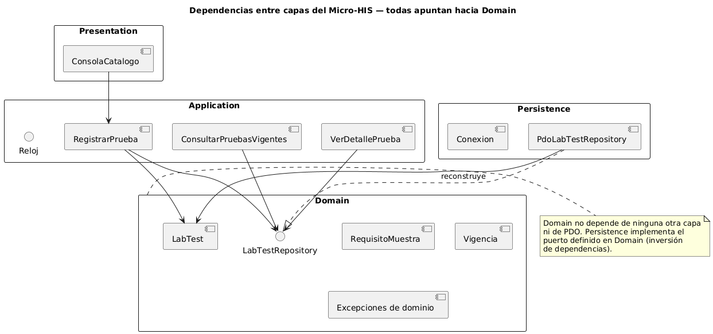
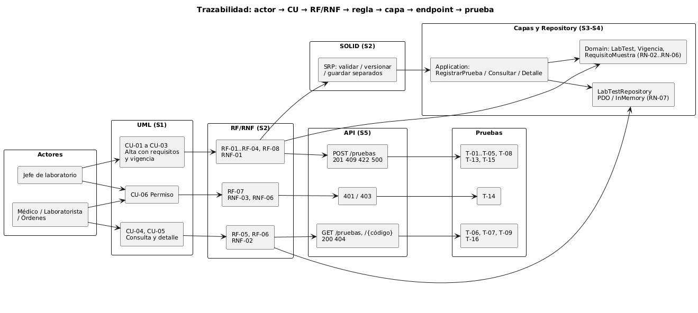

# Catálogo de pruebas de laboratorio
## Alta y consulta de prueba con requisitos de muestra y vigencia

Primera evaluación parcial — Análisis de Sistemas II 2026
Erick Rolando Ramazzini Muralles

---

## 1. Problema y actores

- El catálogo dice **qué se puede pedir**, **qué muestra necesita** y **desde cuándo y hasta cuándo**.
- Actores: Jefe de laboratorio (alta), médico, laboratorista y módulo Órdenes (consulta).
- Fuera de alcance: órdenes, muestras, resultados, rangos de referencia.

---

## 2. UML y reglas

- Casos de uso CU-01 a CU-06, actividad y secuencia con trazabilidad (S1).
- Reglas clave: **RN-05** una versión nueva cierra la anterior; nunca se superponen. **RN-06** solo se ofrece lo vigente a la fecha. **RN-07** todo o nada al guardar.

---

## 3. Requisitos y SOLID

- 8 RF, 6 RNF y 10 criterios de aceptación trazados a los CU (S2).
- **SRP**: validar, versionar y guardar en clases separadas; `verificar.php` compara el antes y el después con los mismos escenarios.

---

## 4. Capas y Repository

- Presentation → Application → **Domain** ← Persistence.
- `LabTestRepository` definido en Domain; adaptadores **PDO** (PostgreSQL, 55441) e **InMemory**.
- El controlador no tiene SQL ni reglas (prueba T-12).

---

## 5. Contrato API

| Método | Ruta | Permiso |
|---|---|---|
| GET | `/api/v1/laboratorio/pruebas?fecha=` | consultar |
| GET | `/api/v1/laboratorio/pruebas/{código}` | consultar |
| POST | `/api/v1/laboratorio/pruebas` | gestionar |

Errores: 401, 403, 404 (con vigencia), 409, 422 (por campo), 500. Tenant desde el token.

---

## 6. Trazabilidad y evidencia

Matriz decisión → evidencia: 10 decisiones, cada una con su prueba o diagrama.

---

## 7. Cambio práctico

- Cambio: una prueba acepta **varios tipos de muestra**.
- Impacto: Domain (lista de requisitos), tabla hija, API `/v2`; versión nueva por RN-05.
- La arquitectura lo absorbe sin tocar el flujo de los casos de uso.
