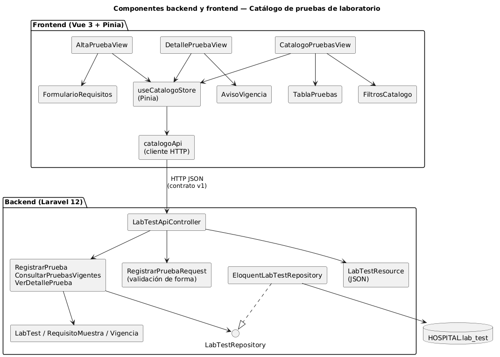
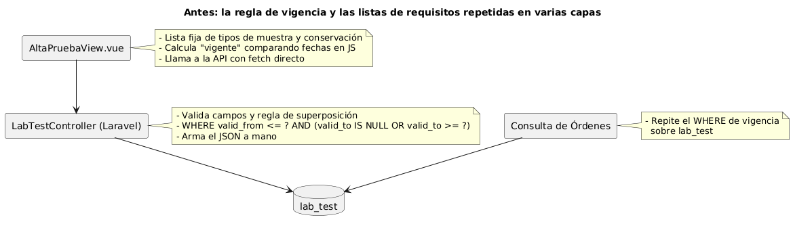
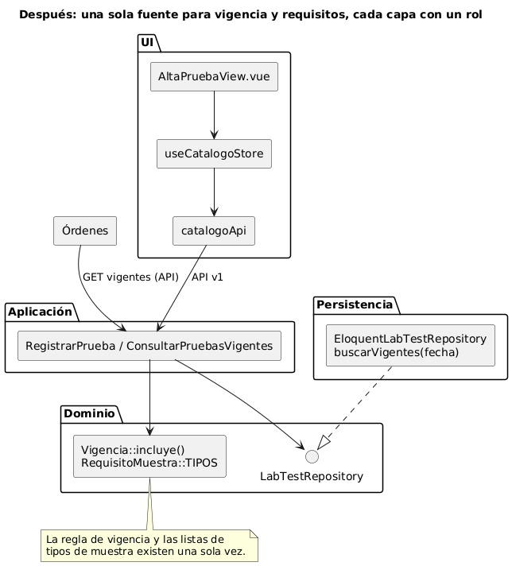

# Catálogo de pruebas de laboratorio — Semana 7

**Tema:** diseño de componentes y refactorización
**Tarea:** diseñar los componentes backend y frontend de «alta y consulta de prueba con requisitos de muestra y vigencia» y refactorizar conceptualmente el punto con mayor acoplamiento, sin ampliar el módulo

## 1. Componentes

Los componentes del backend corresponden a las capas del Micro-HIS, llevadas a Laravel 12: el controlador y el `FormRequest` en Presentation, los casos de uso en Application, las entidades y la interfaz en Domain y Eloquent en Persistence. El frontend Vue 3 separa vistas (rutas), componentes de presentación, el store de Pinia y el cliente HTTP.

Contratos de cada componente: [contratos-entrada-salida.md](contratos-entrada-salida.md).

## 2. Punto con mayor acoplamiento

La **regla de vigencia** (`valid_from <= fecha AND (valid_to IS NULL OR valid_to >= fecha)`) y las **listas de tipos de muestra y conservación** aparecen en tres lugares: la vista de alta, el controlador y las consultas de Órdenes. Si cambia la regla (por ejemplo, que `valid_to` sea exclusivo) o se agrega un tipo de muestra, hay que cambiar y probar tres sitios, y basta olvidar uno para que el médico vea una prueba que Órdenes rechaza.

## 3. Antes y después

| Antes | Después |
|---|---|
|  |  |

| Aspecto | Antes | Después |
|---|---|---|
| Regla de vigencia | Repetida en la vista, el controlador y Órdenes | `Vigencia::incluye()` y `LabTestRepository::buscarVigentes()`; la vista y Órdenes usan la API |
| Listas de tipos de muestra y conservación | Fijas en la vista y en la validación | Definidas una vez en `RequisitoMuestra`; el frontend las recibe en un solo archivo de opciones |
| Validación | Mezclada en el controlador | Forma en `RegistrarPruebaRequest`; reglas RN-02 a RN-05 en el dominio |
| JSON de salida | Armado a mano en el controlador | `LabTestResource` según el contrato v1 |
| Acceso a datos | Consultas directas desde dos módulos | Solo el repositorio del Catálogo toca `lab_test` |

## 4. Justificación

- **Menos puntos de cambio:** un cambio en la regla de vigencia pasa de tres archivos en dos módulos a uno.
- **Consistencia clínica:** lo que el médico ve como vigente es exactamente lo que Órdenes acepta.
- **Pruebas:** la regla se prueba una vez con InMemory y PDO (T-09), en vez de en cada capa.
- **Sin ampliar el módulo:** no se agregan casos de uso ni endpoints; solo se mueve cada responsabilidad a su capa.
