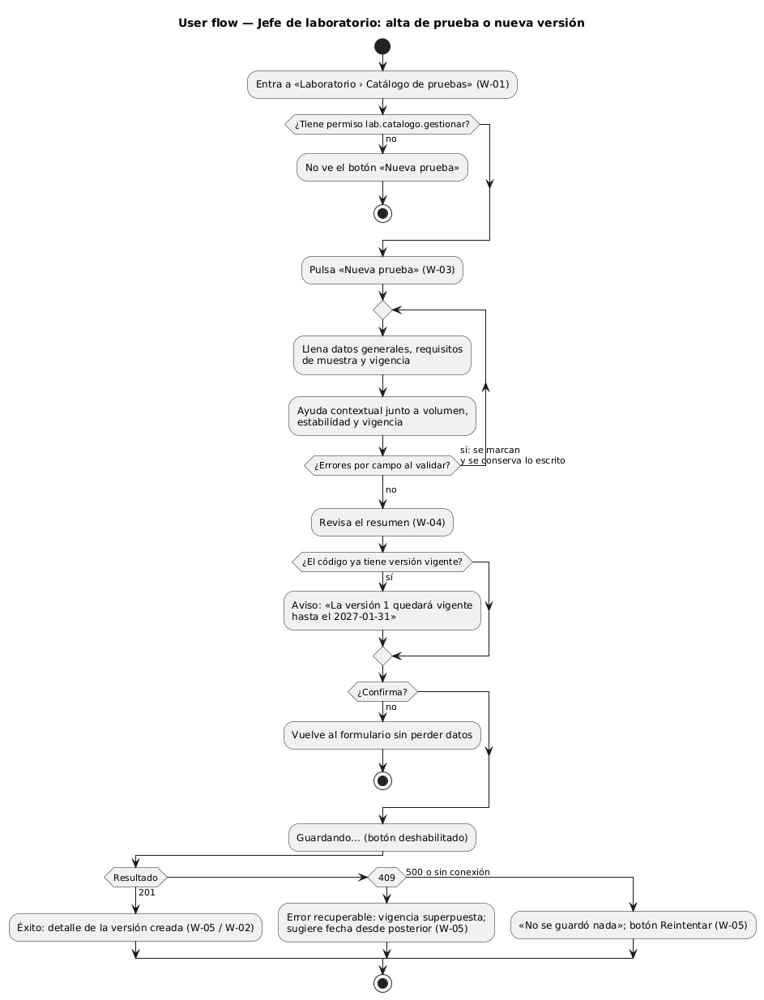
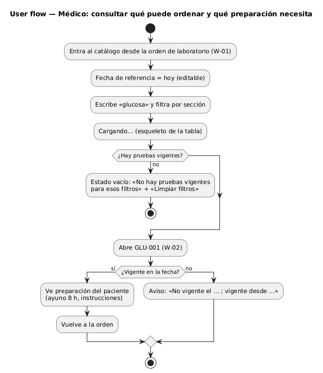
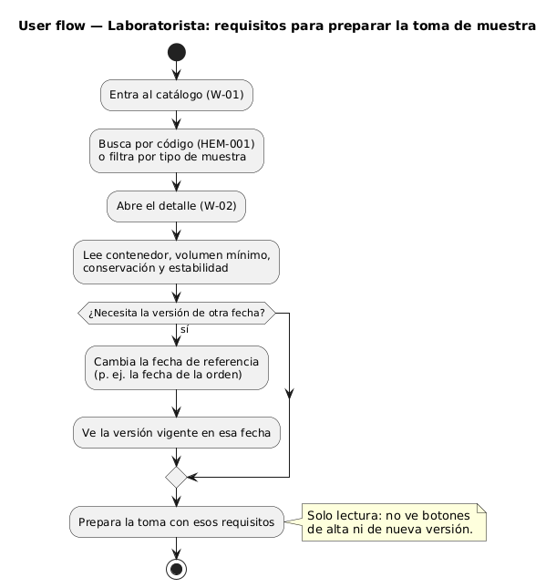
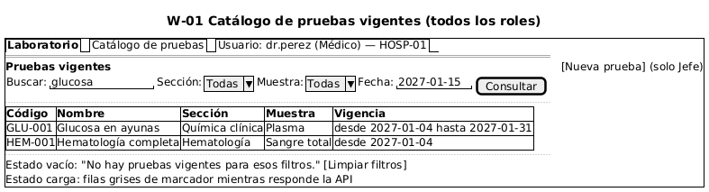
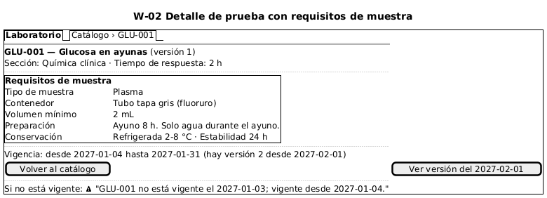
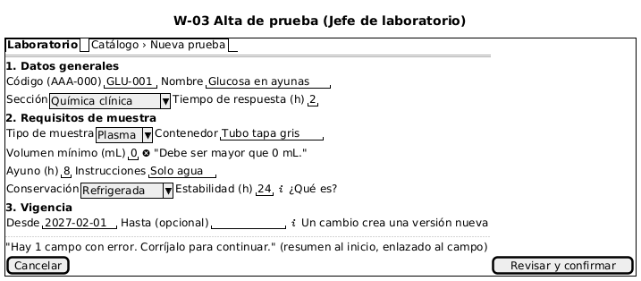
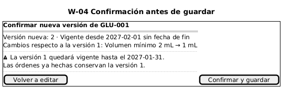
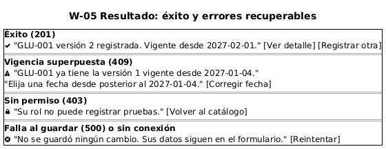

# Catálogo de pruebas de laboratorio — Semana 8

**Tema:** diseño de experiencia de usuario
**Tarea:** flujo UX de «alta y consulta de prueba con requisitos de muestra y vigencia» por rol, con inicio, decisión, confirmación, estados, errores recuperables, ayuda contextual y protección de datos

## 1. User flow por rol

| Rol | Objetivo | Flujo |
|---|---|---|
| Jefe de laboratorio | Registrar una prueba o una versión nueva |  |
| Médico | Saber qué puede ordenar hoy y qué preparación necesita el paciente |  |
| Laboratorista | Conocer contenedor, volumen, conservación y estabilidad |  |

El módulo Órdenes es un consumidor por API (semana 5); no tiene interfaz propia en este módulo.

## 2. Wireframes anotados

| ID | Pantalla | Imagen |
|---|---|---|
| W-01 | Catálogo de pruebas vigentes |  |
| W-02 | Detalle con requisitos de muestra |  |
| W-03 | Alta de prueba |  |
| W-04 | Confirmación antes de guardar |  |
| W-05 | Resultado: éxito y errores recuperables |  |

### Anotaciones

| ID | Estados | Mensajes | Validaciones | Reglas de interacción |
|---|---|---|---|---|
| W-01 | Carga (filas de marcador), vacío, con resultados, error de red | «No hay pruebas vigentes para esos filtros.» · «No se pudo cargar el catálogo. [Reintentar]» | Fecha con formato válido (422 → mensaje bajo el campo) | La fecha inicia en hoy; los filtros se conservan en la URL; «Nueva prueba» solo aparece con `lab.catalogo.gestionar` (RN-01) |
| W-02 | Vigente, no vigente (404 con vigencia), carga | «GLU-001 no está vigente el 2027-01-03; vigente desde 2027-01-04.» | — | Si existe una versión posterior, ofrece verla; nunca muestra datos de pacientes |
| W-03 | Edición, errores por campo, guardando | Mensaje junto a cada campo y resumen arriba: «Hay N campos con error.» | RN-02 a RN-04 en el servidor; en el cliente solo formato (números, fechas) | Lo escrito se conserva tras un error; ayuda contextual (ícono «¿Qué es?») en estabilidad y vigencia; el botón continúa a W-04 |
| W-04 | Confirmación | «La versión 1 quedará vigente hasta el 2027-01-31. Las órdenes ya hechas conservan la versión 1.» | — | Se muestra siempre antes de guardar; si hay versión vigente, el aviso de cierre es obligatorio (RN-05) |
| W-05 | Éxito 201, 409, 403, 500 / sin conexión | Ver imagen; cada error dice qué pasó y qué hacer | — | 409 regresa al campo «Desde»; 500 no borra el formulario y ofrece «Reintentar»; el botón se deshabilita mientras guarda para evitar dobles envíos |

## 3. Protección de datos

- El catálogo **no contiene datos de pacientes**: ningún wireframe muestra nombres, códigos de paciente ni resultados.
- El hospital (tenant) sale de la sesión; la interfaz nunca ofrece elegir otro hospital.
- Los botones de alta solo se muestran a quien tiene el permiso; aun así, el servidor vuelve a verificarlo (403).
- La auditoría (quién registró cada versión) se ve en el detalle solo para el Jefe de laboratorio.

## 4. Trazabilidad

| Pantalla | CU | RF | Regla |
|---|---|---|---|
| W-01 | CU-04 | RF-05 | RN-06 |
| W-02 | CU-05 | RF-06 | RN-06 |
| W-03 | CU-01, CU-02, CU-03 | RF-01, RF-02, RF-03 | RN-02, RN-03, RN-04 |
| W-04 | CU-03 | RF-04 | RN-05 |
| W-05 | CU-01, CU-06 | RF-04, RF-07 | RN-01, RN-05, RN-07 |
