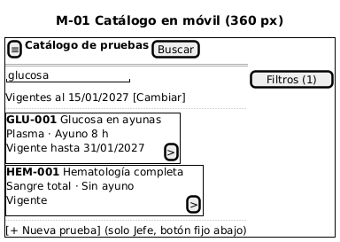
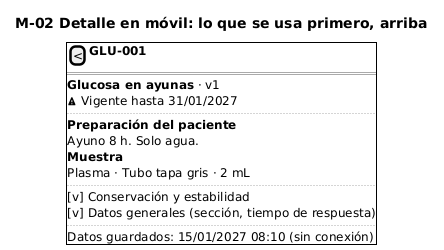
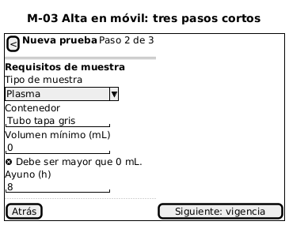
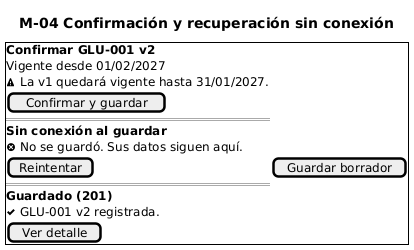

# Catálogo de pruebas de laboratorio — Semana 10

**Tema:** diseño para movilidad
**Tarea:** adaptar «alta y consulta de prueba con requisitos de muestra y vigencia» a móvil (320–430 px): jerarquía de datos y acciones, menos carga cognitiva, navegación, tablas y formularios, confirmaciones y recuperación con conexión limitada

## 1. Pantallas móviles

| ID | Pantalla | Equivale a | Imagen |
|---|---|---|---|
| M-01 | Catálogo como lista de tarjetas | W-01 |  |
| M-02 | Detalle con preparación y muestra primero | W-02 |  |
| M-03 | Alta en tres pasos | W-03 |  |
| M-04 | Confirmación, sin conexión y éxito | W-04, W-05 |  |

## 2. Jerarquía y carga cognitiva

| Decisión | Por qué |
|---|---|
| En la tarjeta del catálogo solo van código, nombre, tipo de muestra, ayuno y estado de vigencia | Es lo que el médico y el laboratorista deciden en la ronda; sección y tiempo de respuesta van en el detalle |
| En el detalle, «Preparación del paciente» y «Muestra» arriba; conservación y datos generales en secciones plegables | Lo primero que se necesita junto al paciente es la preparación |
| La vigencia se muestra como estado («Vigente», «Vigente hasta 31/01/2027», «No vigente») | Evita comparar fechas mentalmente |
| El alta de 13 campos se divide en 3 pasos: datos generales, requisitos de muestra y vigencia | Menos campos por pantalla; los errores se muestran en el paso donde están |
| Fechas en formato local DD/MM/AAAA en pantalla; la API sigue usando AAAA-MM-DD | Lectura natural para el usuario sin cambiar el contrato |

## 3. Reglas de breakpoint

| Ancho | Navegación | Catálogo | Detalle | Alta |
|---|---|---|---|---|
| 320–430 px | Barra superior con menú (≡) y botón de acción fijo abajo | Tarjetas apiladas; filtros en un panel que se abre con «Filtros (n)» | Una columna; secciones plegables | Tres pasos, un campo por fila |
| 431–767 px | Igual que móvil | Tarjetas en una columna más ancha | Una columna, secciones abiertas | Tres pasos, dos campos por fila |
| 768 px o más | Menú lateral | Tabla (W-01) con filtros en línea | Dos columnas: requisitos y vigencia | Formulario completo en una página (W-03) |

Reglas comunes: áreas táctiles de al menos 44 × 44 px; sin scroll horizontal a 320 px; texto base de 16 px; la tabla nunca se encoge, se convierte en tarjetas.

## 4. Escenarios móviles

### Escenario 1 — Médico en la ronda, con señal débil

- **Contexto:** el médico va a pedir una glucosa y quiere confirmar la preparación del paciente desde el teléfono, en un pasillo con poca señal.
- **Contenido:** busca «glucosa» y en la tarjeta ya ve «Plasma · Ayuno 8 h». Al abrir el detalle, la preparación está arriba.
- **Error y recuperación:** si la búsqueda tarda más de 5 segundos, se muestra la última lista consultada con la marca «Datos guardados: hora (sin conexión)» y un botón «Reintentar». Solo se guarda en el teléfono el catálogo, que no tiene datos de pacientes. Si los datos guardados son de otro día, se avisa que la vigencia puede haber cambiado.

### Escenario 2 — Jefe de laboratorio registra una versión nueva y se cae la conexión

- **Contexto:** el Jefe registra `GLU-001` versión 2 (volumen 1 mL desde el 01/02/2027) desde la tableta del laboratorio.
- **Contenido:** completa los tres pasos y ve la confirmación con el aviso de cierre de la versión 1 (RN-05).
- **Error y recuperación:** al confirmar se pierde la conexión. La pantalla dice «No se guardó. Sus datos siguen aquí.» con «Reintentar» y «Guardar borrador». El reintento envía la misma petición; si la primera sí llegó al servidor, el segundo envío responde 409 y la interfaz lo explica como «Esta versión ya fue registrada» y muestra el detalle, en lugar de un error genérico.
