# Catálogo de pruebas de laboratorio — Semana 11

**Tema:** mejores prácticas para diseño móvil/web
**Tarea:** prototipo navegable desktop y móvil del flujo principal, con camino feliz y un error crítico, consistente en roles, estados y accesibilidad

## 1. Prototipo

- Archivo: [`prototipo/index.html`](prototipo/index.html). Es un solo archivo, sin dependencias; se abre con doble clic en Chrome.
- Datos ficticios en memoria (`GLU-001`, `HEM-001`) con las mismas reglas y mensajes que el Micro-HIS: RN-04, RN-05 y RN-06.
- Selector «Rol de la demostración»: Jefe de laboratorio, médico o laboratorista. Solo el Jefe ve «Nueva prueba»; los otros roles reciben «Sin permiso» (RN-01).
- Responsive: desde 768 px muestra una tabla; por debajo, tarjetas (reglas de la semana 10).

## 2. Mapa de navegación

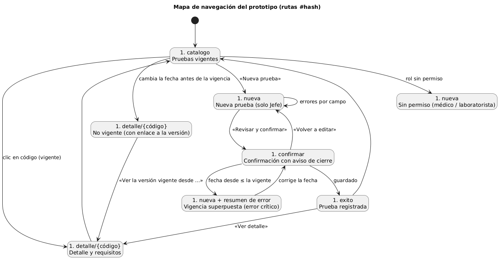

## 3. Recorridos

**Camino feliz (Jefe de laboratorio):** Catálogo → «Nueva prueba» (viene precargada `GLU-001` versión nueva: 1 mL desde 2027-02-01) → «Revisar y confirmar» → aviso «La versión 1 quedará vigente hasta el 2027-01-31» → «Confirmar y guardar» (el botón muestra «Guardando…») → «Prueba registrada» → «Ver detalle».

**Error crítico — vigencia superpuesta (RN-05):** después del camino feliz, «Nueva prueba» con la misma fecha desde (2027-02-01) → confirmar → el formulario vuelve con un resumen de error anunciado (`role="alert"`), el campo «Vigente desde» marcado y la indicación de elegir una fecha posterior. No se guarda nada. Se eligió este error porque registrar mal la vigencia cambia lo que médicos y Órdenes pueden pedir.

## 4. Capturas

Generadas con Chromium sin interfaz (Playwright) recorriendo el prototipo: 1280 × 800 para desktop y 375 × 760 para móvil. En ningún caso hubo errores de JavaScript ni desplazamiento horizontal.

| Paso | Desktop | Móvil |
|---|---|---|
| Catálogo | 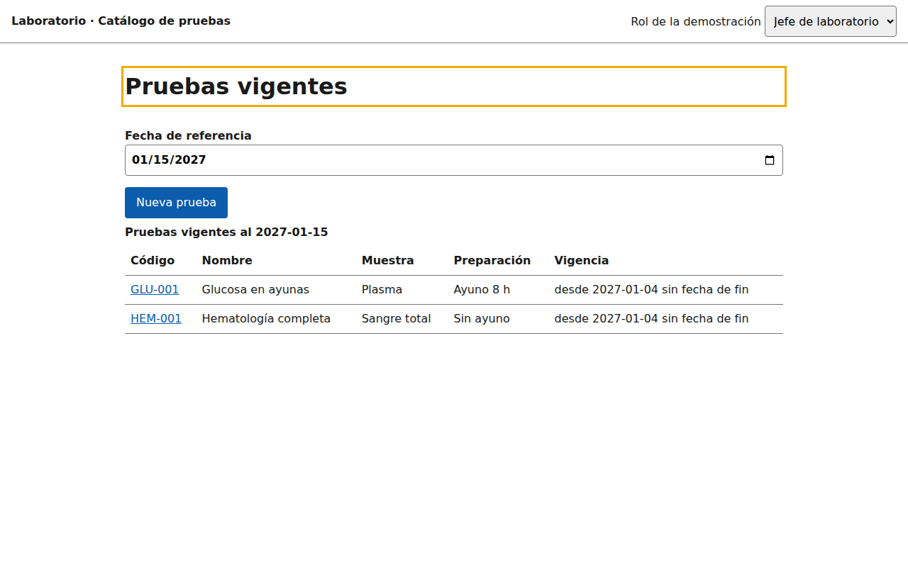 | 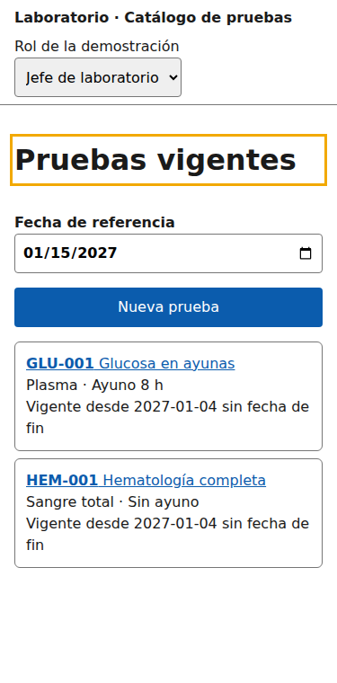 |
| Alta | 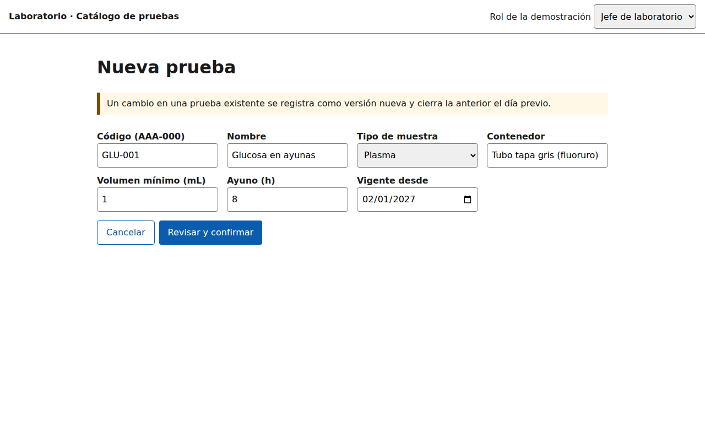 | 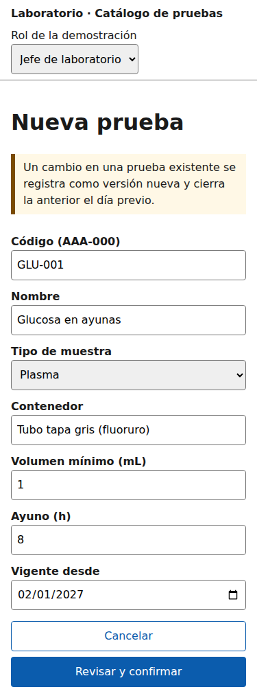 |
| Confirmación | 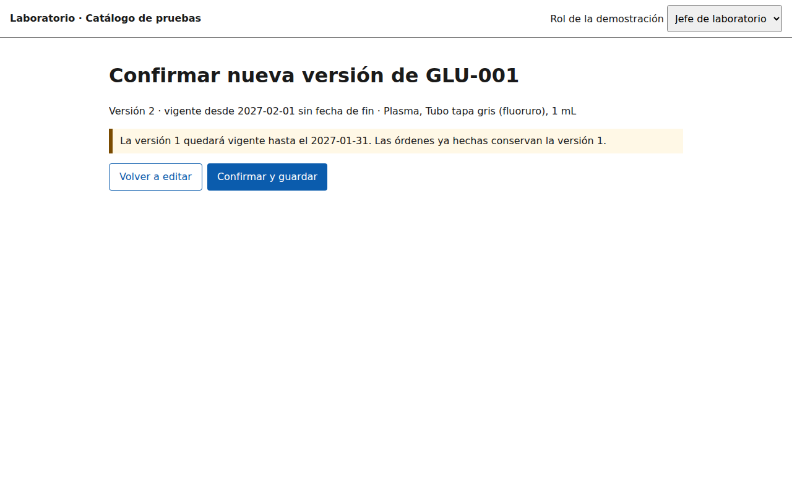 | 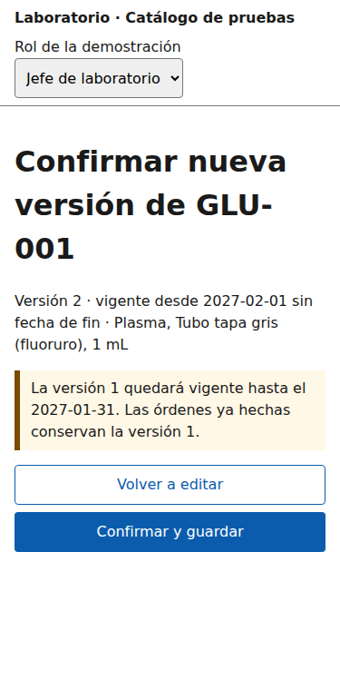 |
| Éxito | 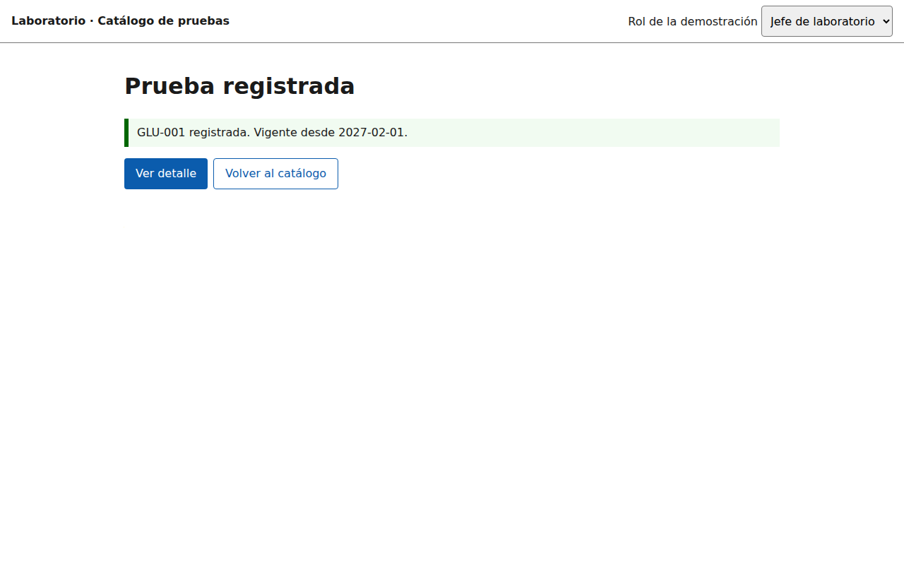 | 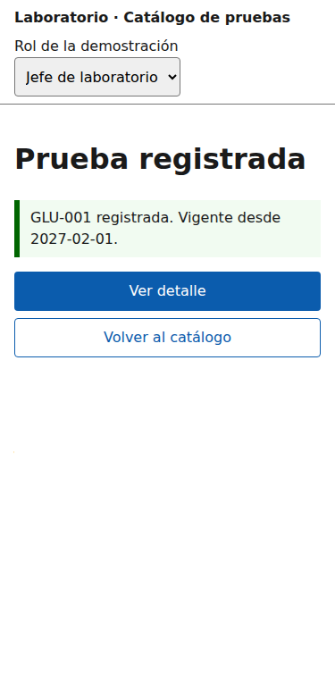 |
| Error crítico (409) | 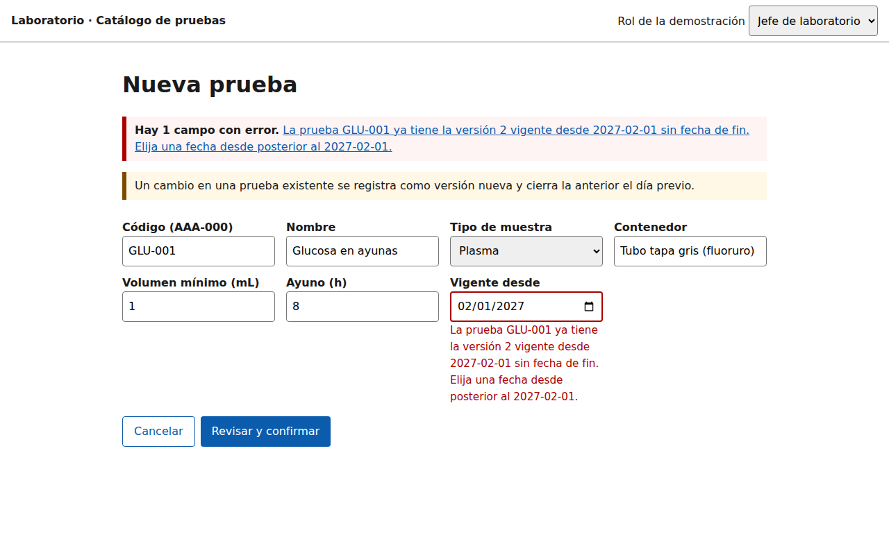 | 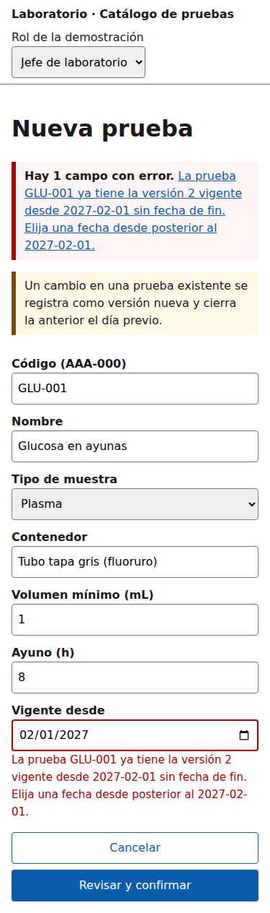 |

## 5. Consistencia y accesibilidad aplicada (backlog de la semana 9)

| Hallazgo | Cómo quedó en el prototipo |
|---|---|
| H-01 | Tipo de muestra como lista desplegable |
| H-02 | Resumen de errores con `role="alert"`, foco en el resumen y enlaces a cada campo |
| H-03 | Paso de confirmación con aviso de cierre de la versión anterior |
| H-04 | Tabla con `<caption>` y `scope="col"` |
| H-05 | «Vigente desde» con selector de fecha |
| H-06 | Enlace «Saltar al contenido» y título distinto por vista |
| H-07 | Botón deshabilitado con «Guardando…» |
| H-08 | La página «no vigente» ofrece ir a la versión vigente |

Contraste del texto sobre blanco, calculado con la fórmula WCAG: azul `#0b5cad` 6.67:1, rojo `#aa0000` 7.75:1 y verde `#006600` 7.24:1 (mínimo 4.5:1). El foco visible es un contorno amarillo de 3 px. **Por verificar a mano:** recorrido completo solo con teclado y lectura con NVDA.

El prototipo no simula el error sin conexión ni el 500. Están diseñados en W-05 y M-04; no se incluyeron para mantener el prototipo en el flujo principal.
