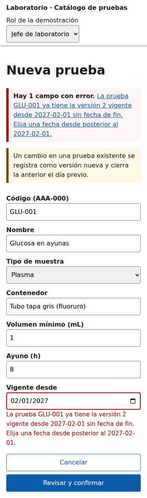

# Catálogo de pruebas de laboratorio
## Componentes, UX, accesibilidad y movilidad

Segunda evaluación parcial — Análisis de Sistemas II 2026
Erick Rolando Ramazzini Muralles

---

## 1. Componentes (S7)

- Backend Laravel: controlador → caso de uso → dominio ← repositorio Eloquent.
- Frontend Vue: vistas, componentes de presentación, store Pinia y cliente HTTP.
- Refactor: la regla de vigencia y las listas de muestra existen **una sola vez**.

---

## 2. UX por rol (S8)

- Jefe: alta → confirmación con aviso de cierre (RN-05) → resultado.
- Médico: consulta a la fecha de hoy → preparación del paciente.
- Laboratorista: detalle de solo lectura con contenedor, volumen y estabilidad.

---

## 3. Accesibilidad (S9)

- 9 hallazgos; los 3 de severidad alta (H-01 a H-03) están corregidos en el prototipo.
- Resumen de errores anunciado, listas cerradas, confirmación antes de guardar.
- Contraste calculado: 6.67:1 a 7.75:1 (mínimo 4.5:1).

---

## 4. Móvil (S10)

- Tarjetas en vez de tabla por debajo de 768 px; alta en 3 pasos.
- Preparación y muestra primero en el detalle.
- Sin conexión: datos guardados con hora y «Reintentar»; el doble envío se explica, no se oculta.

---

## 5. Demostración del prototipo (S11)

1. Camino feliz como Jefe: `GLU-001` versión 2.
2. Error crítico: misma fecha desde → vigencia superpuesta.
3. Cambio de rol a médico: sin «Nueva prueba».

---

## 6. Cambio solicitado

- Avisar cuando una prueba vence en 7 días o menos.
- Se resuelve en la presentación con datos que la API ya entrega (`vigencia.hasta`); no cambia reglas ni el contrato.
