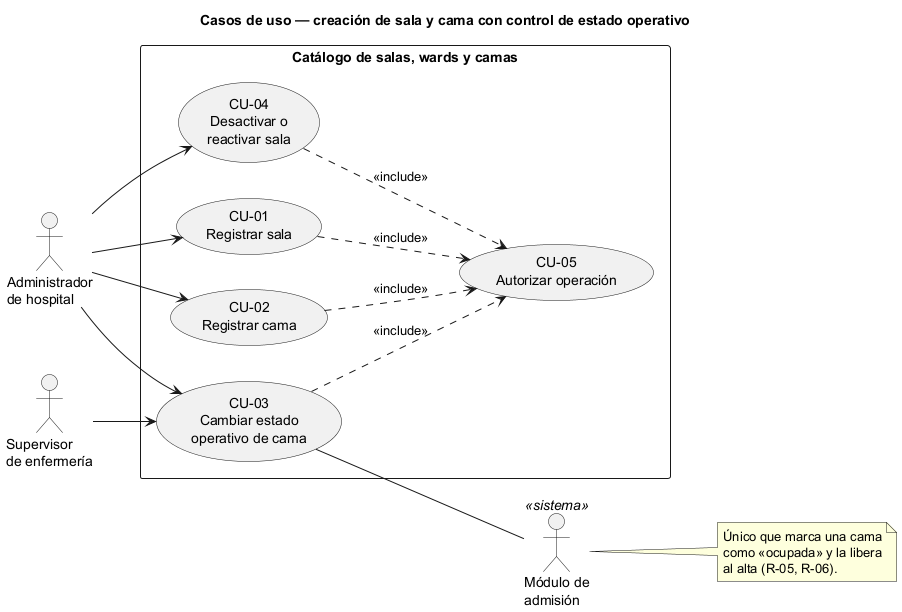
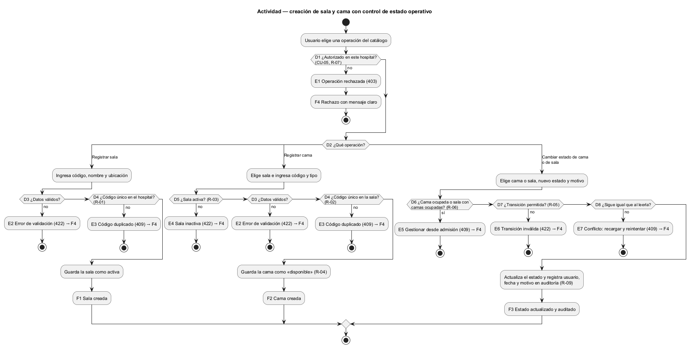
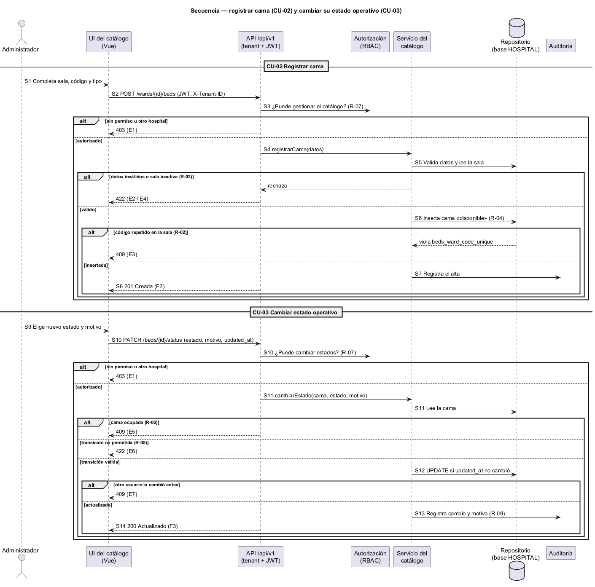

# Semana 1 — Modelado UML del proceso del Catálogo de salas y camas

| | |
|---|---|
| **Curso** | Análisis de Sistemas II — Proyecto Final 2026 |
| **Proyecto** | Sistema Hospitalario Integrado (HIS) |
| **Módulo** | Catálogo de salas, wards y camas |
| **Tarea Odoo** | 2443 — Semana 1: Conceptos generales, orientación a objetos y UML |
| **Proceso modelado** | «Creación de sala y cama con control de estado operativo» |
| **Estudiante** | Josué David Morales Ramírez (carné 1890-23-10545) |
| **Fecha** | Octubre 2026 |

## 1. Introducción

Admisión, traslados y el dashboard de ocupación necesitan saber **qué camas existen y cuáles se pueden usar**. Si una cama en mantenimiento aparece como disponible, se asigna un paciente a una cama que no sirve. Este documento modela el proceso en tres vistas UML que comparten identificadores (CU, R, D, E, F, S) para poder trazarlas entre sí (§9).

## 2. Narrativa de alcance

| | |
|---|---|
| **Objetivo** | Registrar salas y camas sin duplicados y controlar el estado operativo de cada cama con transiciones válidas y trazables. |
| **Dentro del alcance** | Registrar sala; registrar cama en una sala; cambiar el estado operativo de una cama; desactivar y reactivar una sala. |
| **Fuera del alcance** | Asignar o liberar una cama a un paciente (módulo de admisión); traslados y altas; indicadores de ocupación (dashboard de ocupación); eliminar registros. |
| **Supuestos** | «Sala» y «ward» son sinónimos: el esquema HOSPITAL usa las tablas `wards` y `beds` (`database/migrations/hospital/..._000300_create_scheduling_and_bed_tables.php`). Cada hospital (tenant) tiene su propio catálogo. Los endpoints son una propuesta; el contrato se formaliza en la Semana 5. |

## 3. Actores

| Actor | Tipo | Objetivo en el proceso |
|---|---|---|
| Administrador de hospital | Primario | Crear salas y camas y mantener al día su estado operativo. |
| Supervisor de enfermería | Primario | Poner una cama en mantenimiento o devolverla a disponible. |
| Módulo de admisión | Secundario (sistema) | Marcar una cama como ocupada al asignarla y liberarla al alta. Es el único que maneja el estado «ocupada». |

La autorización (RBAC) y la bitácora de auditoría son servicios internos del HIS: aparecen en la actividad y la secuencia, no como actores.

## 4. Reglas de negocio

| ID | Regla | Origen |
|---|---|---|
| R-01 | El código de sala es único en el hospital. | `wards_code_unique` |
| R-02 | El código de cama es único dentro de su sala. | `beds_ward_code_unique` |
| R-03 | Solo se registran camas en salas activas. | Decisión de diseño |
| R-04 | Una cama nueva empieza en «disponible». | `beds.status DEFAULT 'available'` |
| R-05 | Transiciones manuales permitidas: disponible ↔ mantenimiento; disponible o mantenimiento → inactiva; inactiva → disponible. | Decisión de diseño |
| R-06 | Una cama ocupada no cambia de estado manualmente, y una sala con camas ocupadas no se desactiva. | Decisión de diseño |
| R-07 | Solo opera quien tenga el permiso de gestión del catálogo en el mismo hospital. | Módulo RBAC, cabecera `X-Tenant-ID` |
| R-08 | Salas y camas no se eliminan: se desactivan, para conservar el historial. | `ON DELETE RESTRICT` |
| R-09 | Todo cambio de estado guarda usuario, fecha y motivo. | Módulo de auditoría |

## 5. Diagrama de casos de uso

Fuente editable: [diagramas/semana-01-casos-de-uso.puml](diagramas/semana-01-casos-de-uso.puml)

## 6. Especificación de casos de uso

| CU | Nombre | Actor | Flujo principal | Alternativas y excepciones | Reglas |
|---|---|---|---|---|---|
| CU-01 | Registrar sala | Administrador | Ingresa código, nombre y ubicación; el sistema valida y guarda la sala activa. | Datos inválidos (E2); código duplicado (E3). | R-01, R-07 |
| CU-02 | Registrar cama | Administrador | Elige una sala e ingresa código y tipo; el sistema guarda la cama como disponible. | Sala inactiva (E4); código duplicado en la sala (E3). | R-02, R-03, R-04, R-07 |
| CU-03 | Cambiar estado operativo de cama | Administrador, Supervisor, Admisión | Elige la cama, el nuevo estado y el motivo; el sistema valida la transición, actualiza y audita. | Cama ocupada (E5); transición no permitida (E6); otro usuario la cambió antes (E7). | R-05, R-06, R-09 |
| CU-04 | Desactivar o reactivar sala | Administrador | Elige la sala y confirma; el sistema cambia su estado y audita. | Sala con camas ocupadas (E5). | R-06, R-08, R-09 |
| CU-05 | Autorizar operación (incluido) | — | Verifica sesión, hospital y permiso antes de CU-01 a CU-04. | Sin permiso u otro hospital (E1). | R-07 |

**Relaciones:** CU-01 a CU-04 *incluyen* CU-05 porque toda operación exige autorización. El Supervisor solo participa en CU-03, y Admisión solo usa CU-03 para «ocupada» y «disponible».

## 7. Diagrama de actividad

Fuente editable: [diagramas/semana-01-actividad.puml](diagramas/semana-01-actividad.puml)

| Decisión | Pregunta | Si falla |
|---|---|---|
| D1 | ¿Usuario autorizado en este hospital? | E1 Operación rechazada (403) |
| D2 | ¿Qué registra o cambia: sala, cama o estado? | — |
| D3 | ¿Datos completos y válidos? | E2 Error de validación (422) |
| D4 | ¿Código único (en el hospital o en la sala)? | E3 Código duplicado (409) |
| D5 | ¿La sala está activa? | E4 Sala inactiva (422) |
| D6 | ¿La cama está ocupada, o la sala tiene camas ocupadas? | E5 Gestionar desde admisión (409) |
| D7 | ¿La transición está permitida? | E6 Transición inválida (422) |
| D8 | ¿El estado sigue igual que cuando se leyó? | E7 Conflicto: recargar y reintentar (409) |

**Resultados:** F1 sala creada · F2 cama creada como disponible · F3 estado actualizado y auditado · F4 operación rechazada con mensaje claro.

## 8. Diagrama de secuencia

Fuente editable: [diagramas/semana-01-secuencia.puml](diagramas/semana-01-secuencia.puml)

Participantes: Administrador, UI del catálogo (Vue), API `/api/v1`, Autorización (RBAC), Servicio del catálogo, Repositorio (base HOSPITAL) y Auditoría.

| Paso | Mensaje | Validación o respuesta |
|---|---|---|
| S1–S2 | Formulario de cama → `POST /wards/{id}/beds` con JWT y `X-Tenant-ID` | — |
| S3 | API → RBAC: ¿puede gestionar el catálogo? | No → 403 |
| S4–S5 | Servicio valida los datos y lee la sala | Inválido → 422; sala inactiva → 422 |
| S6 | Repositorio inserta la cama como «disponible» | Código duplicado → 409 |
| S7–S8 | Auditoría registra el alta → 201 Creada | — |
| S9–S10 | Nuevo estado y motivo → `PATCH /beds/{id}/status` | RBAC → 403 |
| S11 | Servicio lee la cama y valida la transición | Ocupada → 409; inválida → 422 |
| S12 | Repositorio actualiza si `updated_at` no cambió | Cambió → 409 |
| S13–S14 | Auditoría registra el cambio → 200 Actualizado | — |

## 9. Matriz de trazabilidad

| CU | Reglas | Actividad | Secuencia |
|---|---|---|---|
| CU-01 | R-01, R-07 | D1–D4, E1–E3, F1 | (mismo patrón que S1–S8) |
| CU-02 | R-02, R-03, R-04, R-07 | D1–D5, E1–E4, F2 | S1–S8 |
| CU-03 | R-05, R-06, R-09 | D1, D6–D8, E5–E7, F3 | S9–S14 |
| CU-04 | R-06, R-08, R-09 | D1, D6, E5, F3 | (mismo patrón que S9–S14) |
| CU-05 | R-07 | D1, E1, F4 | S3, S10 |

## 10. Conclusión

El catálogo es dueño de la existencia y del estado operativo de las camas, pero no del estado «ocupada», que pertenece a admisión. Separar esa responsabilidad evita que un usuario libere a mano una cama con un paciente. Las reglas R-01, R-02, R-04 y R-08 ya las garantiza el esquema; R-03, R-05 y R-06 deberá aplicarlas el servicio del catálogo.

## 11. Bibliografía

- Object Management Group. (2017). *Unified Modeling Language (UML) Version 2.5.1*. https://www.omg.org/spec/UML/2.5.1
- Sommerville, I. (2016). *Software Engineering* (10.ª ed.). Pearson.
- Esquema HOSPITAL del repositorio: `database/migrations/hospital/2026_08_11_000300_create_scheduling_and_bed_tables.php`.
