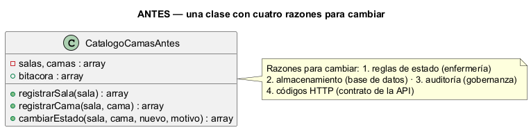
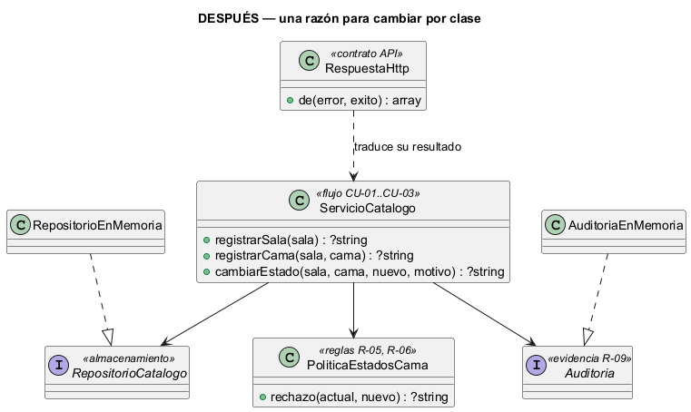

# Semana 2 — RF/RNF, criterios de aceptación y SRP en el Catálogo de salas y camas

| | |
|---|---|
| **Módulo** | Catálogo de salas, wards y camas |
| **Tarea Odoo** | 2444 — Semana 2: Proceso y modelo de diseño; principios SOLID |
| **Flujo** | «Creación de sala y cama con control de estado operativo» (modelado en la [Semana 1](../semana-01/semana-01-uml-catalogo-camas.md)) |
| **Principio aplicado** | SRP — principio de responsabilidad única |
| **Estudiante** | Josué David Morales Ramírez (carné 1890-23-10545) |

## 1. Requerimientos funcionales

| ID | Requerimiento | Trazado a |
|---|---|---|
| RF-01 | Registrar una sala con código único en el hospital. | CU-01, R-01 |
| RF-02 | Registrar una cama con código único dentro de una sala activa; la cama inicia «disponible». | CU-02, R-02–R-04 |
| RF-03 | Cambiar el estado operativo de una cama con motivo obligatorio. | CU-03, R-09 |
| RF-04 | Rechazar transiciones no permitidas (solo disponible ↔ mantenimiento, disponible o mantenimiento → inactiva, inactiva → disponible). | CU-03, R-05 |
| RF-05 | Rechazar cualquier cambio manual sobre una cama ocupada: ese estado lo maneja admisión. | CU-03, R-06 |
| RF-06 | Registrar en auditoría cada alta y cada cambio de estado. | R-09 |

## 2. Requerimientos no funcionales

| ID | Requerimiento | Cómo se verifica |
|---|---|---|
| RNF-01 | Seguridad: solo opera quien tiene permiso de catálogo en el mismo hospital (`X-Tenant-ID`). | Prueba de API en la Semana 15 (403 fuera de permiso) |
| RNF-02 | Mantenibilidad: cambiar las reglas de estado solo modifica una clase. | §4: `PoliticaEstadosCama` es la única que contiene las transiciones |
| RNF-03 | Facilidad de prueba: las reglas de estado se prueban sin base de datos. | `verificar.php`: «política aislada» |
| RNF-04 | Consistencia de errores: cada rechazo tiene un código (E2–E6) y un HTTP fijo. | `RespuestaHttp::CODIGOS` |
| RNF-05 | Trazabilidad: cada cambio queda auditado con el motivo. | `verificar.php`: «auditoría: eventos iguales» |

## 3. Criterios de aceptación

| CA | Dado / Cuando / Entonces | RF | Evidencia |
|---|---|---|---|
| CA-01 | Dado un hospital sin la sala A, cuando la registro, entonces responde 201. | RF-01 | `verificar.php` |
| CA-02 | Dada la sala A, cuando registro otra A o una sin código, entonces responde 409 o 422. | RF-01 | `verificar.php` |
| CA-03 | Dada una sala inexistente o inactiva, cuando registro una cama en ella, entonces responde 422 (E4). | RF-02 | `verificar.php` |
| CA-04 | Dada la sala A, cuando registro A/101, entonces queda «disponible»; si la repito, 409. | RF-02 | `verificar.php` |
| CA-05 | Dada A/101 disponible, cuando la paso a mantenimiento con motivo, entonces responde 200 y se audita. | RF-03, RF-06 | `verificar.php` |
| CA-06 | Dada A/101 en mantenimiento, cuando intento pasarla a «ocupada», entonces responde 422 (E6). | RF-04 | `verificar.php` |
| CA-07 | Cuando cambio sin motivo, o una cama que no existe, entonces responde 422 o 404. | RF-03 | `verificar.php` |
| CA-08 | Dada A/102 ocupada por admisión, cuando intento ponerla en mantenimiento, entonces responde 409 (E5). | RF-05 | `verificar.php` |

## 4. SRP: diseño antes y después

**El problema (antes).** [`ejemplo-srp/antes.php`](ejemplo-srp/antes.php) concentra todo en `CatalogoCamasAntes`. Esa clase cambia por cuatro motivos distintos, que piden personas distintas: las reglas de estado (enfermería), el almacenamiento (base de datos), la auditoría (gobernanza) y los códigos HTTP (contrato de la API). Un cambio en cualquiera obliga a tocar y volver a probar todo.



**La solución (después).** [`ejemplo-srp/despues.php`](ejemplo-srp/despues.php) separa una clase por razón de cambio:

| Clase | Única responsabilidad | Quién pide el cambio | Depende de |
|---|---|---|---|
| `ServicioCatalogo` | Ordenar el flujo de CU-01 a CU-03 | Analista del proceso | Las tres abstracciones de abajo |
| `PoliticaEstadosCama` | Decidir si una transición es válida (R-05, R-06) | Enfermería | Nada |
| `RepositorioCatalogo` (+ `RepositorioEnMemoria`) | Guardar y leer salas y camas | Base de datos | Nada |
| `Auditoria` (+ `AuditoriaEnMemoria`) | Dejar evidencia de cada cambio (R-09) | Gobernanza | Nada |
| `RespuestaHttp` | Traducir E2–E6 a 422, 409 o 404 | Contrato de la API | Nada |



**Por qué estas dependencias.** El servicio recibe por constructor sus colaboradores; ninguno de ellos conoce al servicio. Así, la política se prueba sola y el repositorio en memoria se puede cambiar por uno PDO sin tocar las reglas. El servicio ya no devuelve HTTP: devuelve un código de error del dominio, y `RespuestaHttp` lo traduce.

## 5. Evidencia verificable

```powershell
php docs/modulos/catalogo-salas-camas/semana-02/ejemplo-srp/verificar.php
```

Salida real: [`evidencia/salida-verificar.txt`](evidencia/salida-verificar.txt). Resultado: 11 de 11 escenarios con el mismo comportamiento antes y después, la auditoría con los mismos 4 eventos y 3 de 3 pruebas de la política aislada. Para comprobar que las pruebas detectan errores, se quitó la regla de cama ocupada en una copia de `despues.php`: el script falló (exit 255) en el escenario CA-08.

## 6. Conclusión

SRP no cambió lo que hace el catálogo (la paridad lo demuestra), pero sí dónde vive cada decisión: la regla más delicada del módulo, que una cama ocupada no se toca a mano, ahora está en una clase de 10 líneas que se prueba sin base de datos.

## 7. Bibliografía

- MVP Cluster. (s. f.). *Diseño de software 2: principios SOLID*. https://mvpcluster.com/diseno-de-software-2/
- Martin, R. C. (2018). *Clean Architecture*. Prentice Hall.
