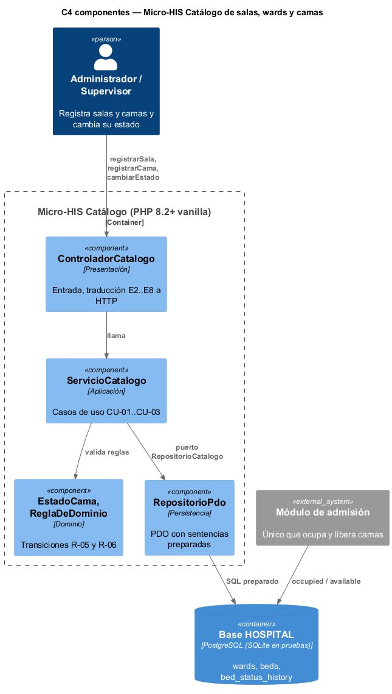
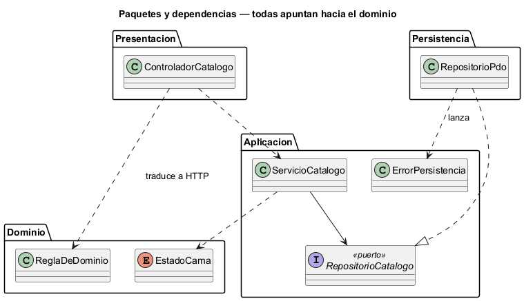

# Semana 3 — Vista arquitectónica del Micro-HIS Catálogo de salas, wards y camas

| | |
|---|---|
| **Tarea Odoo** | 2445 — Semana 3: Diseño arquitectónico, vistas y patrones |
| **Flujo** | «Creación de sala y cama con control de estado operativo» (semanas [1](../semana-01/semana-01-uml-catalogo-camas.md) y [2](../semana-02/semana-02-srp-requerimientos-diseno.md)) |
| **Código** | [`micro-his-catalogo-camas/`](../micro-his-catalogo-camas/): PHP 8.2+ vanilla, sin framework |
| **Estudiante** | Josué David Morales Ramírez |

## 1. Decisiones arquitectónicas

| Decisión | Por qué |
|---|---|
| Cuatro capas: Presentación, Aplicación, Dominio y Persistencia | Lo pide el enunciado y separa las razones de cambio de la semana 2 (SRP). |
| Las dependencias apuntan hacia el dominio | El dominio (reglas R-05 y R-06) no conoce ni la base ni HTTP; se prueba solo. |
| Puerto `RepositorioCatalogo` en Aplicación, adaptador `RepositorioPdo` en Persistencia | DIP: el caso de uso define lo que necesita; la base lo implementa. |
| PDO con sentencias preparadas y `PDOException` → `ErrorPersistencia` | Evita inyección SQL y separa un fallo técnico (503) de una regla de negocio (409/422). |
| Concurrencia optimista: `UPDATE … WHERE status = ?` | Si otro usuario cambió la cama, no se pisa su cambio (E7). |
| `bootstrap.php` como único punto de composición | Solo ahí se conocen y conectan las cuatro capas. |

## 2. Vista C4 de componentes



| Componente | Capa | Responsabilidad | Depende de |
|---|---|---|---|
| `ControladorCatalogo` | Presentación | Recibir la petición y traducir E2–E8 a HTTP | `ServicioCatalogo`, `ReglaDeDominio` |
| `ServicioCatalogo` | Aplicación | Ordenar CU-01 a CU-03 | `EstadoCama`, `RepositorioCatalogo` (puerto) |
| `EstadoCama`, `ReglaDeDominio` | Dominio | Transiciones válidas y errores de negocio | Nada |
| `RepositorioPdo` | Persistencia | SQL preparado, transacción e historial (R-09) | Puerto y `ErrorPersistencia` |

## 3. Vista de paquetes y regla de dependencias



Dominio no depende de nadie; Aplicación solo del dominio; Persistencia implementa el puerto de Aplicación; Presentación nunca toca Persistencia. Las pruebas lo comprueban leyendo los `use` de cada capa.

## 4. Pruebas y evidencia

```powershell
php docs/modulos/catalogo-salas-camas/micro-his-catalogo-camas/pruebas/pruebas.php
```

| Tipo pedido | Cómo se prueba | Resultado |
|---|---|---|
| Camino feliz | Base SQLite de prueba (`database/schema.sql`): sala → cama disponible → mantenimiento con historial | 5/5 |
| Regla de dominio | Sala repetida (E3), sala inexistente (E4), inactiva → mantenimiento (E6), cama ocupada (E5) | 4/4 |
| Error de persistencia | Doble que simula la base caída y `PDOException` real (tabla borrada): 503 sin detalles técnicos | 2/2 |
| Dependencias y SQL | Ninguna capa apunta hacia afuera; ninguna consulta concatena variables | 5/5 |

Salida real: [`evidencia/salida-pruebas.txt`](evidencia/salida-pruebas.txt) (16/16, exit 0). En una prueba de mutación se permitió inactiva → mantenimiento en una copia del dominio, y las pruebas fallaron (exit 1).

**Limitaciones:** el esquema de pruebas es una versión SQLite de `wards` y `beds` (producción usa PostgreSQL); la Semana 4 agrega MVC con Repository y la Semana 5, el contrato cliente-servidor.

**Bibliografía:** Brown, S. (2018). *The C4 model*. https://c4model.com · Martin, R. C. (2018). *Clean Architecture*. Prentice Hall.
