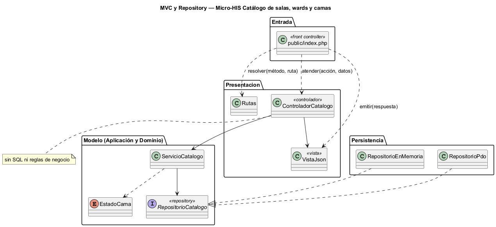
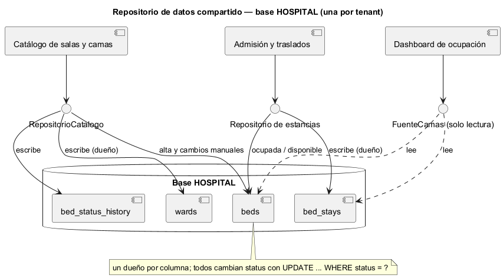

# Semana 4 — MVC, Repository y repositorio de datos compartido en el Micro-HIS Catálogo de salas, wards y camas

| | |
|---|---|
| **Tarea Odoo** | 2446 — Semana 4: Arquitectura en capas y patrón repositorio |
| **Flujo** | «Creación de sala y cama con control de estado operativo» (mismo Micro-HIS de la [Semana 3](../semana-03/semana-03-arquitectura-micro-his.md)) |
| **Código** | [`micro-his-catalogo-camas/`](../micro-his-catalogo-camas/): PHP 8.2+ vanilla, sin framework |
| **Estudiante** | Josué David Morales Ramírez |

## 1. Entrada organizada con MVC

| Pieza | Archivo | Responsabilidad |
|---|---|---|
| Front controller | `public/index.php` | Único punto de entrada HTTP: resuelve la ruta, arma la petición y emite la respuesta. |
| Rutas | `Presentacion/Rutas.php` | Método y ruta → acción (`POST /salas`, `POST /salas/{sala}/camas`, `PATCH /salas/{sala}/camas/{cama}/estado`). |
| Controlador | `Presentacion/ControladorCatalogo.php` | Elige el caso de uso y entrega el resultado a la vista. **Sin SQL ni reglas de negocio** (lo comprueba una prueba). |
| Vista | `Presentacion/VistaJson.php` | Única dueña de los códigos HTTP y de los textos al usuario (E2–E8). |
| Modelo | `Aplicacion/ServicioCatalogo.php` + `Dominio/EstadoCama.php` | Casos de uso y reglas R-01 a R-06; sin cambios respecto a la Semana 3. |

El modelo no se tocó: MVC reorganizó solo la entrada. Antes, el controlador también mapeaba errores a HTTP; ahora eso es de la vista, y el controlador quedó en una sola razón de cambio (SRP de la semana 2).

## 2. Interfaz Repository en el límite y sus adaptadores

`RepositorioCatalogo` vive en **Aplicación**, el límite entre los casos de uso y los detalles: la aplicación dice qué necesita (salas, camas y cambio de estado con concurrencia optimista) y la persistencia lo implementa. Así el modelo no depende de PDO (DIP).

| Adaptador | Para qué | Cómo cumple el contrato |
|---|---|---|
| `RepositorioPdo` | Producción (PostgreSQL) y pruebas (SQLite) | Sentencias preparadas, `UPDATE … WHERE status = ?` y transacción con el historial. |
| `RepositorioEnMemoria` | Pruebas y demos sin base | Arreglos en memoria, la misma comparación del estado anterior y su propio historial. |

Las pruebas corren **el mismo guion** de camino feliz y reglas contra los dos adaptadores (8 + 8) y comprueban la regla del contrato: si el estado cambió antes, `cambiarEstado` devuelve `false` (E7).

## 3. Capas, responsabilidades y objetos reutilizables

| Capa | Objetos | Responsabilidad | Reutilizable en |
|---|---|---|---|
| Dominio | `EstadoCama`, `ReglaDeDominio` | Estados de cama y transiciones (R-05, R-06) | Admisión, traslados y el dashboard de ocupación: los mismos estados de `beds.status` |
| Aplicación | `ServicioCatalogo`, puerto `RepositorioCatalogo`, `ErrorPersistencia` | Casos de uso CU-01 a CU-03 | Cualquier entrada (HTTP, consola o cola) que llame al servicio |
| Persistencia | `RepositorioPdo`, `RepositorioEnMemoria` | Guardar y leer el catálogo | `RepositorioEnMemoria` como doble en las pruebas de otros módulos que lean camas |
| Presentación | `Rutas`, `ControladorCatalogo`, `VistaJson` | Entrada y salida HTTP | El patrón vista/rutas se repite en los demás Micro-HIS |

## 4. Cómo lo integraría un repositorio de datos compartido

En el estilo de **repositorio de datos compartido**, varios módulos trabajan sobre un mismo almacén en lugar de llamarse entre sí. En el HIS ese almacén ya existe: la base HOSPITAL de cada tenant, con las migraciones de `database/migrations/hospital/`.

| Decisión | Regla propuesta |
|---|---|
| Dueño de cada dato | Catálogo es el único que escribe `wards`, `beds.code` y los cambios manuales de `beds.status`; Admisión escribe `bed_stays` y pasa la cama a ocupada o disponible; Ocupación solo lee. |
| Acceso | Cada módulo entra por **su propia** interfaz Repository y su adaptador; ningún módulo usa la clase de otro. |
| Concurrencia | Todos los que cambian `beds.status` usan `UPDATE … WHERE status = ?`; el que llega tarde recibe E7 y recarga. |
| Esquema | Lo controlan las migraciones compartidas; un cambio de columna exige revisar los adaptadores de los módulos que la leen. |
| Aislamiento | Una base por hospital: el repositorio compartido nunca mezcla tenants. |

**Ventajas:** un solo dato de verdad, sin copias que se desincronicen, y módulos que no se conocen entre sí. **Riesgos:** acoplamiento al esquema y bloqueos si muchos escriben la misma fila; se mitigan con un solo dueño por columna y con concurrencia optimista. La interfaz Repository es lo que permite cambiar después a una API o a eventos sin tocar el modelo.

## 5. Evidencia

`php docs/modulos/catalogo-salas-camas/micro-his-catalogo-camas/pruebas/pruebas.php` → [`evidencia/salida-pruebas.txt`](evidencia/salida-pruebas.txt) (28/28, exit 0). Prueba HTTP real con `php -S` y `curl` → [`evidencia/salida-http.txt`](evidencia/salida-http.txt). En una prueba de mutación se quitó la comparación del estado anterior en una copia de `RepositorioEnMemoria`, y la prueba de contrato falló (exit 1).

**Limitaciones:** sin autenticación ni RBAC en la entrada; no hay consulta de catálogo (`GET`) porque el flujo es de creación y cambio de estado. **Bibliografía:** Pressman, R. S. y Maxim, B. R. (2020). *Ingeniería del software* (9.ª ed.), cap. de diseño arquitectónico. McGraw-Hill · Fowler, M. (2002). *Patterns of Enterprise Application Architecture* (Repository, Front Controller). Addison-Wesley.
