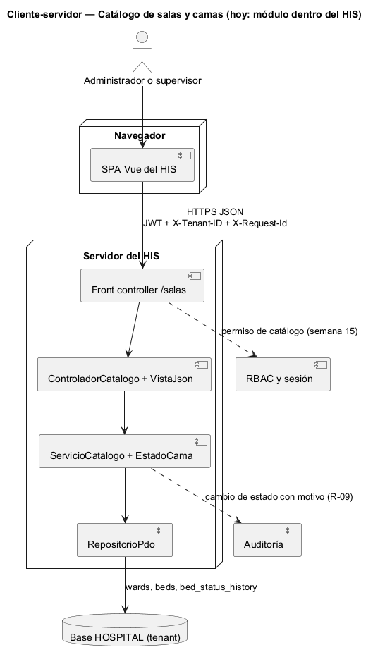
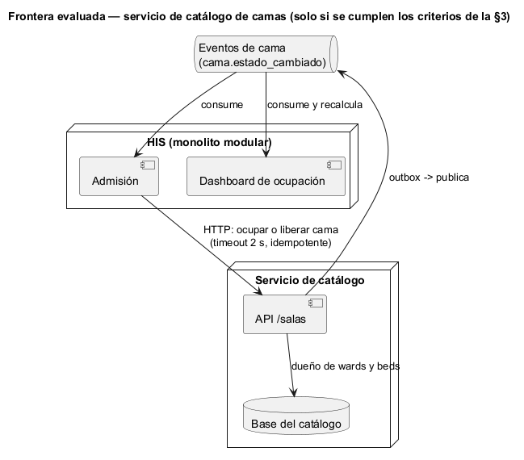

# Semana 5 — Cliente-servidor, contrato API y frontera de microservicio del Catálogo de salas, wards y camas

| | |
|---|---|
| **Tarea Odoo** | 2447 — Semana 5: Cliente-servidor, API REST, microservicios e integración |
| **Flujo** | «Creación de sala y cama con control de estado operativo» (mismo Micro-HIS de las [semanas 3](../semana-03/semana-03-arquitectura-micro-his.md) y [4](../semana-04/semana-04-mvc-repository.md)) |
| **Contrato** | [api/openapi.yaml](api/openapi.yaml) (OpenAPI 3.1, validado con Redocly) |
| **Estudiante** | Josué David Morales Ramírez |

## 1. Diseño cliente-servidor

El cliente es la SPA del HIS en el navegador y el servidor es el Micro-HIS detrás de su front controller. Hablan solo por HTTPS con JSON. El cliente no conoce la base ni las reglas: manda la intención (registrar o cambiar) y muestra el código y el mensaje que decide la vista.

## 2. Contrato API

| Método | Ruta | Caso de uso | Éxito | Errores documentados |
|---|---|---|---|---|
| POST | `/salas` | CU-01 registrar sala | 201 | 409 E3 duplicada, 422 E2 datos, 503 E8 |
| POST | `/salas/{sala}/camas` | CU-02 registrar cama | 201 | 409 E3, 422 E2 o E4 sala inactiva, 503 E8 |
| PATCH | `/salas/{sala}/camas/{cama}/estado` | CU-03 cambiar estado | 200 | 404 NF, 409 E5 ocupada o E7 concurrencia, 422 E2 o E6 transición, 503 E8 |

Cada error responde `{"error", "mensaje"}` sin detalles técnicos. Las rutas son las que ya implementa la semana 4, en español; las de la semana 1 (`/wards/{id}/beds`) eran un borrador y el contrato las reemplaza. **Prueba de contrato:** [verificar-contrato.php](evidencia/verificar-contrato.php) hace pasar 9 escenarios por las rutas y el controlador reales y comprueba que cada respuesta esté documentada en su operación. Comprueba también que las 3 operaciones coincidan con las acciones del controlador ([salida](evidencia/salida-contrato.txt)).

## 3. Frontera de microservicio: evaluación con criterios medibles

La frontera candidata es un **servicio de catálogo de camas**, dueño de `wards` y `beds`. Encaja bien: el catálogo es un contexto con lenguaje propio (sala, cama, estado operativo) y pocos datos. Pero dividir solo tiene sentido si un criterio medible lo pide:

| Criterio para extraerlo | Umbral | Valor hoy | ¿Lo pide? |
|---|---|---|---|
| Despliegue independiente: cambios del catálogo frenados por otros módulos | Más de 1 por mes | 0: ninguno de los 9 PR del módulo integrados en `develop` esperó un cambio de otro módulo | No |
| Carga propia: lecturas de camas por segundo frente al resto del HIS | Más de 10 veces el resto | Sin datos de producción; el tablero lee cortes, no camas en vivo | No |
| Equipo propio que lo mantenga | Al menos 1 equipo aparte | 1 estudiante, el mismo de los otros módulos | No |
| Consumidores que escriben en `beds` | Más de 1 con reglas en conflicto | 1 (Admisión: ocupada o disponible) | No |

**Decisión:** el catálogo sigue como **módulo del monolito**, con su frontera ya marcada por la interfaz Repository de la semana 4. Extraerlo hoy añadiría red, eventos y una segunda base sin ningún criterio que lo pida.

## 4. Si se extrae: propiedad, comunicación, seguridad, resiliencia, observabilidad y consistencia

| Aspecto | Decisión |
|---|---|
| Propiedad de datos | El servicio es el único que escribe `wards` y `beds`; Admisión deja de escribir `beds` y llama a la API. |
| Comunicación | Síncrona (HTTP) para órdenes que necesitan respuesta (ocupar o liberar); asíncrona (evento `cama.estado_cambiado`) para quien solo necesita enterarse (ocupación). |
| Seguridad | JWT y `X-Tenant-ID` en cada petición (RNF-01); permiso de catálogo con RBAC; el servicio filtra siempre por hospital. |
| Resiliencia | Timeout de 2 s del lado de Admisión; reintento solo de `PATCH` idempotentes con el mismo estado; si el servicio cae, 503 E8 y Admisión no ocupa la cama a ciegas. |
| Observabilidad | `X-Request-Id` de punta a punta, log con el código de error (E2 a E8) y métricas de 409 E7, que muestran la contención por una misma cama. |
| Consistencia | Concurrencia optimista (`UPDATE … WHERE status = ?`, E7) dentro del servicio; patrón outbox para publicar el evento en la misma transacción que el cambio; ocupación es eventual y muestra la hora de su corte. |

## 5. Migración razonada (si un criterio de la §3 se cumple)

1. **Contrato primero:** congelar `openapi.yaml` y su prueba de contrato en el CI. Ya está hecho en esta entrega.
2. **Fachada en el monolito:** Admisión cambia `UPDATE beds` por una llamada a la API del catálogo, todavía dentro del mismo proceso. Se mide el número de llamadas y de errores.
3. **Eventos:** publicar `cama.estado_cambiado` con outbox, y ocupación consume en vez de leer `beds`.
4. **Extracción (*strangler fig*):** se mueve el módulo a su servicio con su base y el monolito redirige `/salas`. La salida se mide con la prueba de contrato en verde y los 409 E7 sin cambios.
5. **Reversa:** si el p95 de las operaciones sube más de 200 ms o aparecen camas inconsistentes en ocupación, se vuelve a la fachada en proceso.

## 6. Plan de issue, rama, worktree y PR

| Paso | Valor |
|---|---|
| Issue | «Semana 5: Catálogo — contrato API y frontera de microservicio»; criterios de aceptación: lint sin errores, prueba de contrato en verde, decisión con criterios medibles. |
| Rama | `semana-5-catalogo-salas-camas`, desde `origin/develop` actualizado. |
| Worktree | `git worktree add ../wt-catalogo-s5 -b semana-5-catalogo-salas-camas origin/develop`. Aísla la tarea sin cambiar de rama en la copia principal. Para esta entrega se usó una rama normal, porque había una sola tarea activa. |
| PR | Hacia `develop`, 1 commit, máximo 400 líneas, con la plantilla del repositorio, la salida del lint y de la prueba de contrato, y la revisión pedida al revisor asignado. |

**Evidencia:** [salida del lint](evidencia/salida-lint-openapi.txt) (`npx @redocly/cli@1.34.3 lint`, sin errores ni avisos) y [salida de la prueba de contrato](evidencia/salida-contrato.txt) (11 de 11). **Bibliografía:** Newman, S. (2021). *Building Microservices* (2.ª ed.). O'Reilly · Fowler, M. (2004). *StranglerFigApplication*. martinfowler.com · OpenAPI Initiative (2021). *OpenAPI Specification 3.1.0*.
