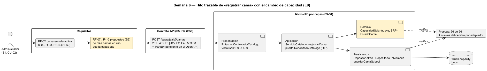

# Semana 6 — Defensa de la arquitectura del Catálogo de salas, wards y camas

| | |
|---|---|
| **Tarea Odoo** | 2448 — Semana 6: Primera evaluación parcial |
| **Flujo** | «Creación de sala y cama con control de estado operativo» |
| **Presentación** | [semana-06-diapositivas.md](semana-06-diapositivas.md) (8 diapositivas) |
| **Estudiante** | Josué David Morales Ramírez |

## 1. Hilo trazable

Un solo hilo conecta las semanas 1 a 5: el actor pide un caso de uso, el caso de uso tiene requisitos y reglas, el contrato expone la operación, y cada capa del Micro-HIS cumple una parte. Las pruebas verifican el resultado. En amarillo está lo que añade el cambio práctico de esta semana (§3).

## 2. Matriz decisión → evidencia

| # | Decisión | Por qué | RF/RNF | Evidencia verificable |
|---|---|---|---|---|
| D-01 | Tres actores (administrador, supervisor y admisión) y CU-01 a CU-05; solo admisión maneja «ocupada» | Cada estado tiene un único dueño | RF-05 | [Casos de uso S1](../semana-01/semana-01-uml-catalogo-camas.md) |
| D-02 | **SRP**: las transiciones viven solo en `EstadoCama` | Cambiar una regla toca una sola clase | RNF-02, RNF-03 | [Antes/después S2](../semana-02/semana-02-srp-requerimientos-diseno.md); prueba «inactiva -> mantenimiento = 422 E6» |
| D-03 | Cuatro capas y puerto `RepositorioCatalogo` en Aplicación (DIP) | La regla no depende de la base | RNF-02 | [C4 S3](../semana-03/semana-03-arquitectura-micro-his.md); 4 pruebas «dependencias: …» |
| D-04 | MVC: el controlador solo elige el caso de uso; `VistaJson` es dueña de los HTTP | Errores con un código fijo | RNF-04 | [S4](../semana-04/semana-04-mvc-repository.md); prueba «el controlador no tiene SQL…» |
| D-05 | Repository con adaptadores PDO e InMemory y el mismo guion de pruebas | Probar sin base y cambiar de motor | RNF-03 | 12 pruebas por adaptador en [salida-pruebas.txt](evidencia/salida-pruebas.txt) |
| D-06 | Concurrencia optimista: `UPDATE … WHERE status = ?` → E7 | Dos supervisores no se pisan | RF-03 | Prueba «contrato: … devuelve false (E7)» |
| D-07 | Contrato OpenAPI con prueba de contrato | El documento y el código no se separan | RNF-04 | S5, PR #350 (abierto): lint sin avisos, contrato 11 de 11 |
| D-08 | Cambio práctico: `CapacidadSala` en el dominio y alta atómica en el adaptador | La regla en un lugar y la consistencia garantizada en la base | RF-07 | §3; 4 pruebas «cambio S6» por adaptador |

## 3. Registro del cambio práctico defendido

**Solicitud:** «Cada sala tiene una capacidad habilitada. No se puede registrar una cama si la sala ya tiene en uso tantas camas como su capacidad.» Se proponen **R-10** (regla) y **RF-07** (rechazar con 409 E9). Las camas inactivas no cuentan, porque salieron de servicio (R-08).

| Capa | Qué cambió | Qué no cambió |
|---|---|---|
| Dominio | Nueva [`CapacidadSala`](../micro-his-catalogo-camas/src/Dominio/CapacidadSala.php): valida la capacidad (E2) y decide si admite otra cama (E9). | `EstadoCama` y sus transiciones. |
| Aplicación | `registrarCama` consulta capacidad y camas en uso; el puerto suma `capacidad()`, `camasEnUso()`, y `guardarCama()` devuelve `bool`. | El orden de las validaciones E4, E2 y E3. |
| Persistencia | `wards.capacity` (NULL = sin tope). El `INSERT … SELECT` vuelve a contar en la misma sentencia; `false` → E9, como E7. | Las demás consultas y el historial. |
| Presentación | El controlador pasa `capacidad`; `VistaJson` traduce E9 → 409. | Rutas y acciones: el contrato no suma operaciones. |

**Compatibilidad:** `capacidad` es opcional y `NULL` significa sin tope. Por eso las salas actuales y las 28 pruebas anteriores siguen igual: ahora son 36 de 36.

| Escenario (mismo guion, PDO e InMemory) | [Antes](evidencia/salida-capacidad-antes.txt) | [Después](evidencia/salida-capacidad-despues.txt) |
|---|---|---|
| Tercera cama en una sala de capacidad 2 | 201 (se pasa el tope) | 409 E9 |
| Otra cama tras inactivar una | 409 E3 (la 103 ya existía) | 201 |
| Sala con capacidad 0 | 201 | 422 E2 |

**Riesgo defendido:** dos altas simultáneas podrían pasar la comprobación del servicio. Por eso el adaptador cuenta de nuevo dentro del `INSERT`. En SQLite la sentencia es atómica. En el PostgreSQL real del HIS, que no tiene `capacity` en `wards` (supuesto: requiere una migración del esquema compartido), haría falta bloquear la fila de la sala con `SELECT … FOR UPDATE` en la misma transacción.

## 4. Evidencia y bibliografía

[probar-capacidad.php](evidencia/probar-capacidad.php) se corrió antes y después del cambio. [salida-pruebas.txt](evidencia/salida-pruebas.txt) muestra las 36 pruebas del Micro-HIS en verde. El diagrama se generó con PlantUML local (`-charset UTF-8`).

**Bibliografía:** Martin, R. C. (2017). *Clean Architecture*. Prentice Hall · Fowler, M. (2002). *Patterns of Enterprise Application Architecture* (Repository, Optimistic Offline Lock). Addison-Wesley.
