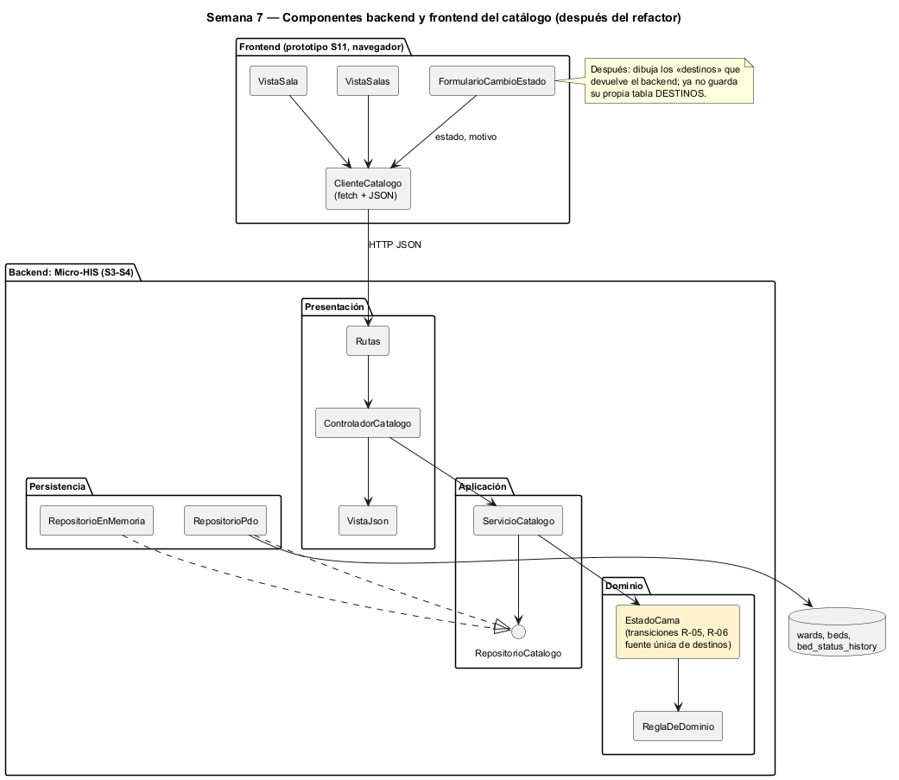

# Semana 7 — Componentes y refactorización del Catálogo de salas, wards y camas

| | |
|---|---|
| **Tarea Odoo** | 2449 — Semana 7: Diseño de componentes y refactorización |
| **Flujo** | «Creación de sala y cama con control de estado operativo» |
| **Base** | Micro-HIS de las semanas 3 y 4, contrato de la [semana 5](../semana-05/semana-05-cliente-servidor.md) y prototipo de la [semana 11](../semana-11/semana-11-prototipo.md) |
| **Estudiante** | Josué David Morales Ramírez |

## 1. Componentes backend y frontend

| Componente | Lado | Responsabilidad única | Depende de |
|---|---|---|---|
| `VistaSalas`, `VistaSala` | Frontend | Mostrar salas con sus conteos y las camas de una sala | `ClienteCatalogo` |
| `FormularioCambioEstado` | Frontend | Pedir destino y motivo; mostrar el impacto y los errores E5, E6 y E7 | `ClienteCatalogo` |
| `ClienteCatalogo` | Frontend | Hablar HTTP y JSON con el contrato de la S5; nada más | Contrato API |
| `Rutas`, `ControladorCatalogo`, `VistaJson` | Backend: Presentación | Ruta → acción → caso de uso → respuesta HTTP | `ServicioCatalogo` |
| `ServicioCatalogo` | Backend: Aplicación | Orden de CU-01 a CU-03 | `RepositorioCatalogo`, `EstadoCama` |
| `EstadoCama`, `ReglaDeDominio` | Backend: Dominio | Transiciones R-05 y R-06, y los códigos de rechazo | Nada |
| `RepositorioPdo`, `RepositorioEnMemoria` | Backend: Persistencia | Implementar el puerto con SQL preparado o en memoria | `RepositorioCatalogo` |

## 2. Contratos de entrada y salida

| Contrato | Entrada | Salida | Errores |
|---|---|---|---|
| HTTP `POST /salas` | `{codigo, nombre}` | 201 | 409 E3, 422 E2, 503 E8 |
| HTTP `POST /salas/{sala}/camas` | `{codigo}` | 201 | 409 E3, 422 E2 o E4, 503 E8 |
| HTTP `PATCH /salas/{sala}/camas/{cama}/estado` | `{estado, motivo}` | 200 | 404 NF, 409 E5 o E7, 422 E2 o E6, 503 E8 |
| `Rutas::resolver` | método, ruta | `[acción, parámetros]`; `''` si no existe | — |
| `ControladorCatalogo::atender` | acción, datos | `['status', 'error'?, 'mensaje'?]` | Nunca lanza: traduce a la vista |
| `ServicioCatalogo` | códigos, nombre, estado, motivo | `void` | `ReglaDeDominio` (E2 a E7, NF) |
| `RepositorioCatalogo` | sala, cama, estados | `?bool`, `?string`, `bool` (E7) | `ErrorPersistencia` |
| `EstadoCama::validarCambioA` | estado destino | `void` | E5 ocupada, E6 no permitida |

## 3. El punto con mayor acoplamiento

**Dentro del backend**, [medir-acoplamiento.php](evidencia/medir-acoplamiento.php) cuenta para cada tipo propio cuántos usa (Ce) y cuántos lo usan (Ca) ([salida](evidencia/salida-acoplamiento.txt)). El máximo es 4: `ControladorCatalogo` (Ce 4, I = 1,00), `ServicioCatalogo` (Ce 3, Ca 1) y `ReglaDeDominio` (Ca 4, I = 0,00). Es el patrón sano: lo concreto (el controlador) depende de lo estable (el dominio), y el dominio no depende de nada. El script no encuentra una dependencia que apunte hacia afuera.

**Entre UI y dominio está el acoplamiento que el script no ve.** Las transiciones de estado (R-05 y R-06) están escritas dos veces:

| Lugar | Qué guarda | Problema |
|---|---|---|
| `EstadoCama::validarCambioA` (backend, dominio) | Las transiciones de R-05 y el rechazo de «ocupada» (R-06) | Es la fuente legítima |
| `DESTINOS` en [`app.js`](../semana-11/prototipo/app.js) (frontend, S11) | Las mismas transiciones, más una regla por rol (el supervisor solo d ↔ m) | Duplica R-05, y la regla de rol **solo existe en el cliente**: un `PATCH` directo la salta |

Cambiar R-05 obliga hoy a tocar 2 archivos de 2 capas que se despliegan por separado. Si se olvida uno, la UI ofrece destinos que el backend rechaza con E6, u oculta destinos válidos. Este es el punto de mayor acoplamiento entre estados operativos, camas y consistencia del catálogo.

## 4. Refactor concreto: antes y después

| | Antes | Después |
|---|---|---|
| Dominio | `validarCambioA` con un `match` interno de destinos | `EstadoCama::destinos(): array` es la única tabla; `validarCambioA` la consulta (`in_array($nuevo, $this->destinos(), true)`) |
| Aplicación | — | La consulta de la cama devuelve `{estado, destinos}` con los destinos del dominio, filtrados por el permiso del rol cuando llegue RBAC (R-07, semana 15) |
| Frontend | `const destinos = [...(DESTINOS[rol][c.estado] ?? '')]` | `const { estado, destinos } = await cliente.cama(sala, cama)`: dibuja lo que recibe |
| Archivos a tocar si cambia R-05 | 2 (`EstadoCama.php` y `app.js`) | 1 (`EstadoCama.php`) |
| Regla por rol | Solo en el cliente | En la aplicación del backend; la UI no decide |

**Justificación:**
- Aplica SRP y DIP entre capas: la UI deja de conocer una regla de dominio y depende solo del contrato.
- No amplía el módulo: los destinos son la parte de lectura de CU-03, que ya pide «elegir el nuevo estado», y no se agrega ningún caso de uso.
- El riesgo se mide con lo que ya existe. La prueba de contrato de la S5 obliga a documentar el campo `destinos`, y las pruebas de `EstadoCama` (R-05 y R-06) siguen siendo la red.
- Es un refactor conceptual, como pide el enunciado: no cambia el código de esta entrega.

## 5. Evidencia y bibliografía

[salida-acoplamiento.txt](evidencia/salida-acoplamiento.txt) se midió sobre `develop` en `402fd68`. El diagrama se generó con PlantUML local (`-charset UTF-8`).

**Bibliografía:** Martin, R. C. (2017). *Clean Architecture*, caps. 13 y 14 (acoplamiento y estabilidad). Prentice Hall · Fowler, M. (2018). *Refactoring* (2.ª ed.). Addison-Wesley.
