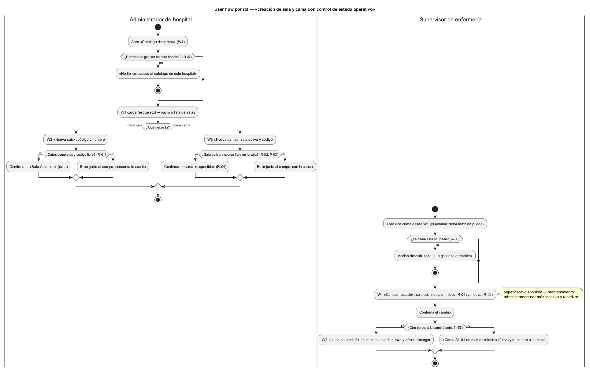

# Semana 8 — Flujo UX de «creación de sala y cama con control de estado operativo»

| | |
|---|---|
| **Tarea Odoo** | 2450 — Semana 8: Diseño de experiencia de usuario |
| **Módulo** | Catálogo de salas, wards y camas |
| **Base** | Actores y reglas R-01 a R-09 de la [Semana 1](../semana-01/semana-01-uml-catalogo-camas.md); códigos de error E2–E8 del Micro-HIS ([Semana 3](../semana-03/semana-03-arquitectura-micro-his.md)) |
| **Estudiante** | Josué David Morales Ramírez |

## 1. Roles autorizados y lo que ve cada uno

| Rol | Puede | No ve |
|---|---|---|
| Administrador de hospital | Crear salas y camas; cambiar el estado de una cama a mantenimiento, disponible o inactiva | — |
| Supervisor de enfermería | Poner una cama en mantenimiento o devolverla a disponible | Los botones «Nueva sala» y «Nueva cama», y el destino «Inactiva» |
| Sin permiso de gestión en el hospital (R-07) | Nada | La pantalla: ve «No tienes acceso al catálogo de este hospital» |

Admisión no usa estas pantallas: es el único que pasa una cama a «ocupada» (R-06), y aquí esa opción nunca se ofrece.

## 2. User flow por rol

Inicio: W1. Decisión: crear sala, crear cama o cambiar estado. Confirmación: botón explícito en W2, W3 y W4. Salida: mensaje de éxito o un error que se puede recuperar (W5).

## 3. Wireframes anotados

| W | Pantalla | Estados | Mensajes | Validaciones | Reglas de interacción |
|---|---|---|---|---|---|
| [W1](diagramas/semana-08-wf1-lista-salas.png) | Lista de salas | Carga: filas de esqueleto. Vacío: «Aún no hay salas: crea la primera». Resumen: tabla por estado | Contadores por estado, sin datos de pacientes | El buscador acepta código de sala o cama | Los botones de creación solo aparecen para el administrador; Enter en el buscador filtra sin recargar |
| [W2](diagramas/semana-08-wf2-nueva-sala.png) | Nueva sala | Formulario → enviando (botón deshabilitado) → «Sala A creada» | «Ya existe una sala con el código A» (409 E3) | Código y nombre obligatorios (E2); código único (R-01) | El error aparece junto al campo y conserva lo escrito; Esc cancela sin guardar |
| [W3](diagramas/semana-08-wf3-nueva-cama.png) | Nueva cama | Igual que W2 | «La sala Z no existe o está inactiva» (E4); «La cama A/101 ya existe» (E3) | Solo se listan salas activas (R-03); código único en la sala (R-02) | El estado inicial se muestra fijo en «Disponible» (R-04) para que nadie lo busque |
| [W4](diagramas/semana-08-wf4-cambiar-estado.png) | Cambiar estado (confirmación) | Cama elegida → confirmando → «Cama A/101 en mantenimiento» | «El motivo es obligatorio» (E2) | Solo destinos permitidos para el estado actual y el rol (R-05); motivo obligatorio (R-09) | Para una cama ocupada, la acción está deshabilitada con la ayuda «La gestiona admisión» (R-06) |
| [W5](diagramas/semana-08-wf5-error-recuperable.png) | Errores recuperables | Conflicto (E7) o servicio no disponible (E8) | «La cama cambió mientras la editabas»; «El catálogo no está disponible» | — | Nunca se pierde lo escrito: «Recargar» muestra el estado nuevo y «Reintentar» reenvía; ningún mensaje muestra detalles técnicos |

## 4. Ayuda contextual

Cada formulario tiene un botón «[?] Ayuda» y textos cortos junto a cada campo: por qué el código debe ser único, por qué solo hay salas activas, por qué no aparece «Ocupada» y para qué sirve el motivo. La ayuda nunca se abre sola ni tapa el formulario.

## 5. Protección de datos

- W1 y los mensajes solo muestran salas, camas y conteos: ningún nombre de paciente, aunque la cama esté ocupada.
- Las pantallas muestran solo el hospital de la sesión (`X-Tenant-ID`); no hay selector para ver otro.
- El motivo del cambio queda en el historial con usuario y fecha (R-09), pero la pantalla no muestra quién cambió cada cama: eso es de la auditoría.
- Salas y camas no tienen botón «Eliminar», solo «Desactivar» (R-08), para no perder historial.

## 6. Trazabilidad y evidencia

| Regla | Dónde se aplica |
|---|---|
| R-01, R-02 | W2 y W3: validación de código único |
| R-03, R-04 | W3: lista de salas activas y estado inicial fijo |
| R-05, R-06 | W4: destinos según estado y rol; ocupada deshabilitada |
| R-07 | Inicio del user flow: sin permiso, no hay pantalla |
| R-08, R-09 | W4 y §5: motivo obligatorio y sin borrado |

Fuentes editables en [`diagramas/`](diagramas/) (`.puml` con PlantUML Salt para los wireframes); los PNG se generaron con PlantUML local. Las pantallas siguen las rutas y errores del front controller propuesto en la semana 4 (PR #194, aún no integrado); si ese PR cambia, se ajustan los códigos de los mensajes.

**Bibliografía:** Nielsen, J. (1994). *10 Usability Heuristics for User Interface Design*. Nielsen Norman Group · W3C (2023). *Web Content Accessibility Guidelines (WCAG) 2.2*.
