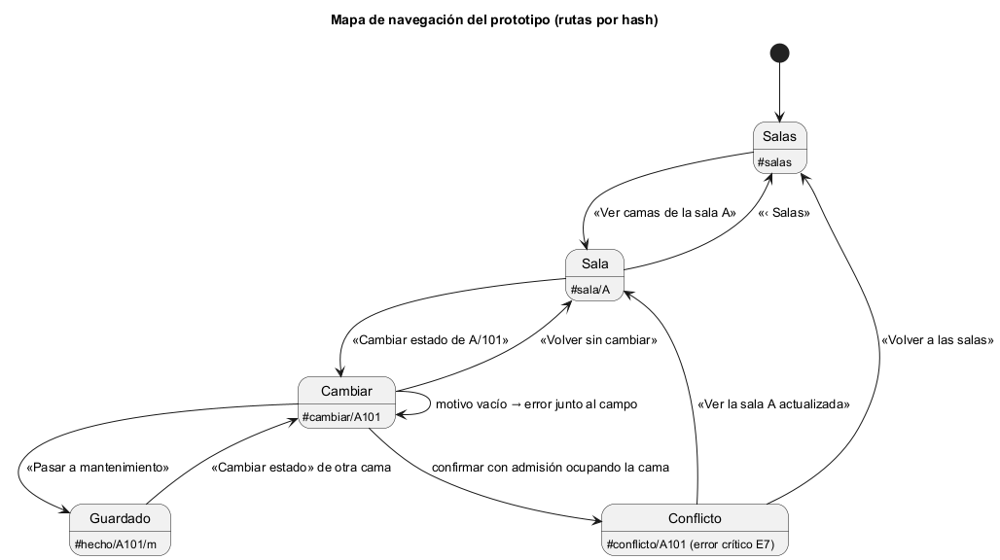

# Semana 11 — Prototipo navegable del Catálogo de salas, wards y camas

| | |
|---|---|
| **Tarea Odoo** | 2453 — Semana 11: Mejores prácticas para diseño móvil/web |
| **Módulo** | Catálogo de salas, wards y camas |
| **Base** | Flujo de la semana 8 (PR #202), backlog de la semana 9 (PR #208) y diseño móvil de la semana 10 (PR #225) |
| **Estudiante** | Josué David Morales Ramírez |

## 1. Prototipo

**Archivo:** [prototipo/index.html](prototipo/index.html). Se abre en cualquier navegador, sin servidor ni instalación. Es HTML, CSS y JavaScript sin dependencias, con datos ficticios en memoria; no se conecta a la API. Flujo principal: cambiar el estado operativo de una cama («creación de sala y cama con control de estado operativo», semana 8). Un mismo código sirve para escritorio y móvil: desde 431 px se ve como tabla y por debajo, como tarjetas (semana 10).

El **panel del prototipo**, al pie y marcado como tal, permite cambiar de rol y simular el error crítico.

## 2. Mapa de navegación

## 3. Camino feliz y error crítico

| Paso | Escritorio (1280 px) | Móvil (360 px) | Qué se ve |
|---|---|---|---|
| 1. Salas | [captura](capturas/escritorio/01-salas.png) | [captura](capturas/movil/01-salas.png) | Capacidad por sala: «5 de 11 operativas» |
| 2. Camas de la sala A | [captura](capturas/escritorio/02-sala-a.png) | [captura](capturas/movil/02-sala-a.png) | Estado de cada cama en texto; una ocupada no tiene acción (R-06) |
| 3. Cambiar A/101 | [captura](capturas/escritorio/03-cambiar-estado.png) | [captura](capturas/movil/03-cambiar-estado.png) | Grupo «Nuevo estado», motivo e impacto: «pasará de 5 a 4 camas disponibles» |
| 4. **Camino feliz** | [captura](capturas/escritorio/04-cambio-guardado.png) | [captura](capturas/movil/04-cambio-guardado.png) | «Cama A/101: ahora está en mantenimiento», anunciado en una región `role="status"` |
| 5. **Error crítico** | [captura](capturas/escritorio/05-error-conflicto.png) | [captura](capturas/movil/05-error-conflicto.png) | Admisión ocupó la cama mientras se editaba (E7): el cambio no se guarda, el motivo se conserva y la cama queda sin acción |

Este es el error crítico porque toca los estados operativos y la consistencia del catálogo: si el cambio se guardara, una cama con un paciente pasaría a mantenimiento y la capacidad de la sala A sería falsa. Las capturas 4 y 5 no se armaron a mano: el script escribió el motivo y pulsó el botón, igual que un usuario.

## 4. Consistencia de roles, estados y accesibilidad

- **Roles:** el supervisor de enfermería solo alterna entre disponible y mantenimiento; el administrador también puede inactivar y reactivar (R-05). Ningún rol cambia una cama ocupada (R-06).
- **Estados:** los mismos cuatro de las semanas 8 a 10 (Disponible, Ocupada, Mantenimiento, Inactiva), siempre escritos en texto.
- **Accesibilidad**, con las correcciones de la semana 9:
  - `lang="es"` y un título distinto por pantalla;
  - foco en el `<h1>` al navegar y enlace «Saltar al contenido»;
  - anillo de foco de 2 px en `#2563eb`, bordes `#64748b` y objetivos de 44 px;
  - el error del motivo vacío va junto al campo, con «Error:», `aria-invalid` y el foco devuelto al campo;
  - el botón dice lo que hace («Pasar a mantenimiento»).

## 5. Evidencia y validación

[capturar.mjs](evidencia/capturar.mjs) abre Edge sin interfaz por el protocolo DevTools, fija el ancho exacto del viewport, recorre cada ruta (ejecutando la acción del usuario cuando la hay), toma las capturas y mide el scroll horizontal a 320, 360 y 430 px. Su salida está en [salida-medicion.txt](evidencia/salida-medicion.txt):

- 15 de 15 mediciones sin scroll horizontal (WCAG 1.4.10);
- un título distinto en cada pantalla;
- el foco en `H1` después de cada navegación.

Para comprobar que la medición sí detecta fallos, se inyectó un bloque de 600 px y marcó «SÍ» en los tres anchos. Con el motivo vacío, el foco quedó en el `TEXTAREA`.

El modo nuevo de Edge sin interfaz no reduce la ventana por debajo de unos 500 px. Por eso se emula el viewport con el protocolo DevTools en vez de usar `--window-size`.

**Bibliografía:** W3C (2023). *WCAG 2.2* · Nielsen, J. (1994). *10 Usability Heuristics for User Interface Design* · Chrome DevTools Protocol: `Emulation.setDeviceMetricsOverride`.
