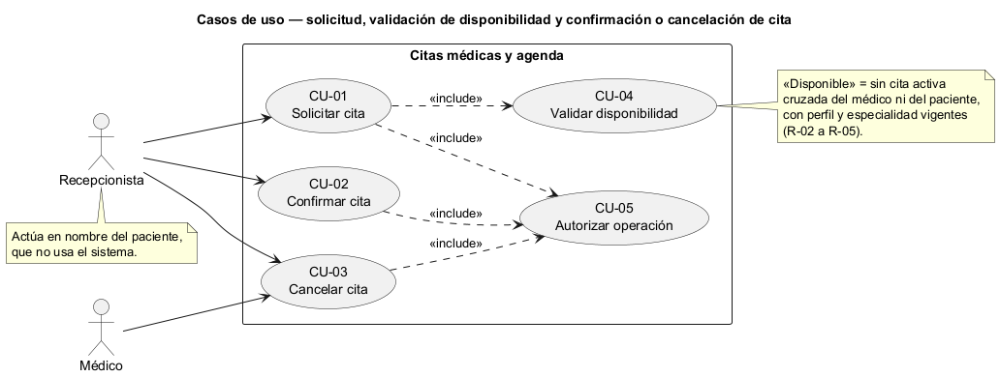
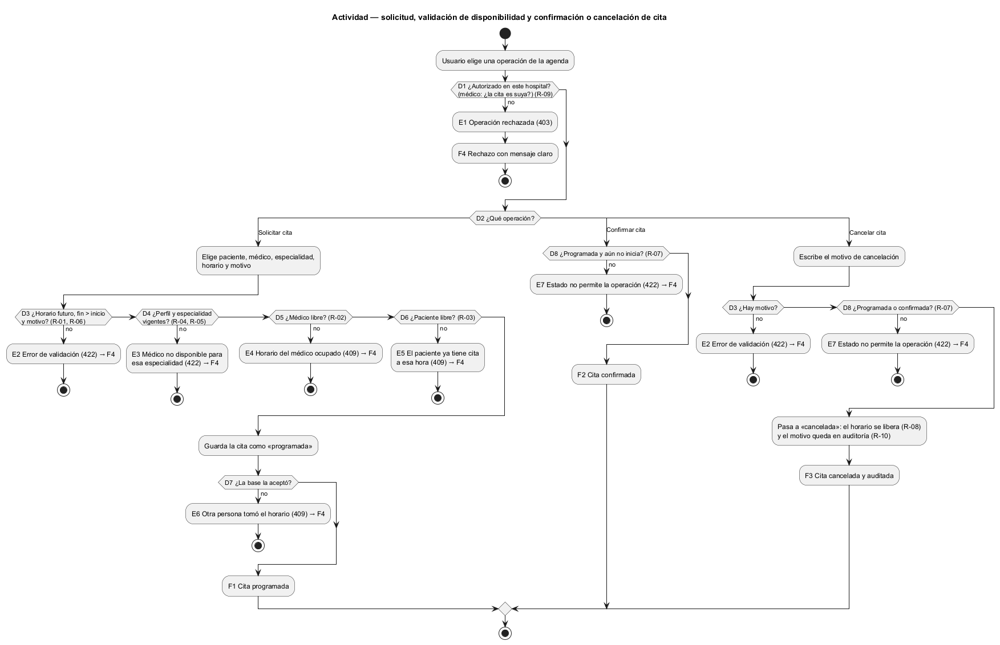
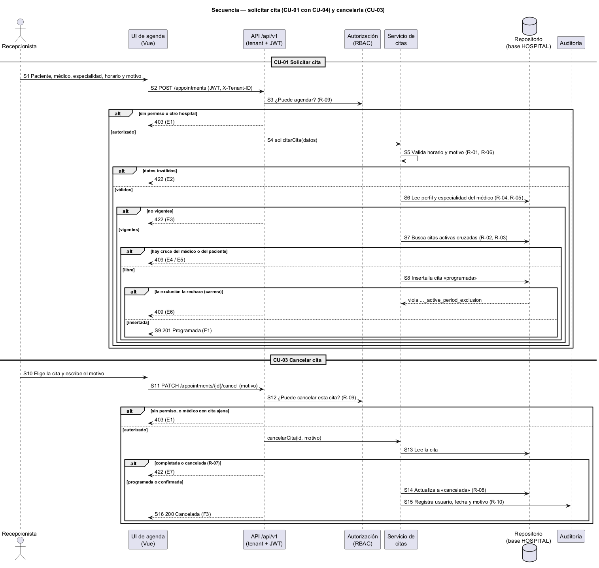

# Semana 1 — Modelado UML del proceso de Citas médicas y agenda

| | |
|---|---|
| **Curso** | Análisis de Sistemas II — Proyecto Final 2026 |
| **Proyecto** | Sistema Hospitalario Integrado (HIS) |
| **Módulo** | Citas médicas y agenda |
| **Tarea Odoo** | 2458 — Semana 1: Conceptos generales, orientación a objetos y UML |
| **Proceso modelado** | «Solicitud, validación de disponibilidad y confirmación o cancelación de cita» |
| **Estudiante** | Josué David Morales Ramírez (carné 1890-23-10545) |
| **Fecha** | Octubre 2026 |

## 1. Introducción

Una agenda mal controlada produce dos errores caros: **dos pacientes citados con el mismo médico a la misma hora**, o **un paciente citado en dos consultas a la vez**. Este documento modela con UML cómo se solicita una cita, cómo se valida la disponibilidad y cómo se confirma o se cancela. Las tres vistas comparten identificadores (CU, R, D, E, F, S) para trazarlas entre sí (§9).

## 2. Narrativa de alcance

| | |
|---|---|
| **Objetivo** | Agendar citas sin cruces de horario, con un médico y una especialidad vigentes, y confirmarlas o cancelarlas de forma trazable. |
| **Dentro del alcance** | Solicitar cita; validar disponibilidad; confirmar cita; cancelar cita con motivo. |
| **Fuera del alcance** | Horario de atención del médico (turnos, días libres); marcar la cita como atendida (consulta clínica); recordatorios al paciente; portal del paciente; reprogramar (se modela como cancelar y solicitar otra). |
| **Supuesto de disponibilidad** | **«Disponible» = sin otra cita activa cruzada del médico ni del paciente, y con el perfil del médico y su especialidad vigentes en la fecha.** Es lo que el esquema HOSPITAL permite comprobar hoy (`database/migrations/hospital/..._000300_create_scheduling_and_bed_tables.php`). |
| **Limitación** | El esquema no tiene horario de atención del médico, así que hoy se podría agendar a las 3:00 a. m. Se documenta como requisito pendiente para la Semana 2. |
| **Otros supuestos** | Cada hospital (tenant) tiene su propia agenda. Los endpoints son una propuesta; el contrato se formaliza en la Semana 5. |

## 3. Actores

| Actor | Tipo | Objetivo en el proceso |
|---|---|---|
| Recepcionista | Primario | Solicitar, confirmar y cancelar citas en nombre del paciente. |
| Médico | Primario | Cancelar sus propias citas cuando no puede atenderlas. |

El **paciente** no es actor: no usa el sistema (no hay portal), sino que la recepcionista actúa por él. Los registros de pacientes y de médicos tampoco son actores: son datos de la misma base que la cita referencia con llaves foráneas. La autorización (RBAC) y la auditoría son servicios internos.

## 4. Reglas de negocio

| ID | Regla | Origen |
|---|---|---|
| R-01 | El fin es posterior al inicio, y no se agenda en el pasado. | `appointments_status_time_check`; lo del pasado es decisión de diseño |
| R-02 | Un médico no tiene dos citas activas (programada o confirmada) que se crucen. | `appointments_doctor_active_period_exclusion` |
| R-03 | Un paciente no tiene dos citas activas que se crucen. | `appointments_patient_active_period_exclusion` |
| R-04 | El médico debe tener la especialidad activa y vigente en la fecha de la cita. | Trigger `appointments_specialty_trigger` |
| R-05 | El perfil del médico debe estar activo y vigente. | Decisión de diseño: el trigger no lo revisa |
| R-06 | El motivo de la cita es obligatorio. | `appointments_reason_check` |
| R-07 | Transiciones: programada → confirmada; programada o confirmada → cancelada. Una cita completada o cancelada ya no cambia. | Trigger `appointments_finalized_immutable` |
| R-08 | Las citas no se borran; cancelar libera el horario. | Trigger `appointments_delete_protection`; la exclusión solo cubre citas activas |
| R-09 | Solo personal autorizado del mismo hospital; el médico solo cancela sus propias citas. | Módulo RBAC, cabecera `X-Tenant-ID` |
| R-10 | Toda cancelación guarda usuario, fecha y motivo en la auditoría. | Decisión de diseño: `appointments` no tiene columna para el motivo de cancelación |

## 5. Diagrama de casos de uso

Fuente editable: [diagramas/semana-01-casos-de-uso.puml](diagramas/semana-01-casos-de-uso.puml)

## 6. Especificación de casos de uso

| CU | Nombre | Actor | Flujo principal | Alternativas y excepciones | Reglas |
|---|---|---|---|---|---|
| CU-01 | Solicitar cita | Recepcionista | Elige paciente, médico, especialidad, horario y motivo; si está disponible, la cita queda «programada». | Datos inválidos (E2); médico no vigente (E3); horario ocupado (E4, E5); otra persona tomó el horario al mismo tiempo (E6). | R-01–R-06, R-09 |
| CU-02 | Confirmar cita | Recepcionista | Elige una cita programada y la confirma. | La cita no está programada o ya empezó (E7). | R-07, R-09 |
| CU-03 | Cancelar cita | Recepcionista, Médico | Elige la cita y escribe el motivo; la cita queda «cancelada», el horario se libera y se audita. | Sin motivo (E2); la cita ya está completada o cancelada (E7); médico con una cita ajena (E1). | R-07–R-10 |
| CU-04 | Validar disponibilidad (incluido) | — | Comprueba perfil y especialidad vigentes y que no haya cruces del médico ni del paciente. | E3, E4, E5. | R-02–R-05 |
| CU-05 | Autorizar operación (incluido) | — | Verifica sesión, hospital y permiso; para el médico, que la cita sea suya. | E1. | R-09 |

**Relaciones:** CU-01 *incluye* CU-04, porque no se agenda sin validar. CU-01, CU-02 y CU-03 *incluyen* CU-05. Confirmar no revalida la disponibilidad: la cita programada ya ocupa su horario (R-02, R-03).

## 7. Diagrama de actividad

Fuente editable: [diagramas/semana-01-actividad.puml](diagramas/semana-01-actividad.puml)

| Decisión | Pregunta | Si falla |
|---|---|---|
| D1 | ¿Autorizado en este hospital (y, si es médico, la cita es suya)? | E1 Operación rechazada (403) |
| D2 | ¿Qué operación: solicitar, confirmar o cancelar? | — |
| D3 | ¿Datos válidos (horario futuro, fin > inicio, motivo)? | E2 Error de validación (422) |
| D4 | ¿Perfil del médico y especialidad vigentes? | E3 Médico no disponible para esa especialidad (422) |
| D5 | ¿El médico está libre en ese horario? | E4 Horario del médico ocupado (409) |
| D6 | ¿El paciente está libre en ese horario? | E5 El paciente ya tiene una cita a esa hora (409) |
| D7 | ¿La base aceptó la cita al guardarla? | E6 Otra persona tomó el horario: elegir otro (409) |
| D8 | ¿La cita está en un estado que permite el cambio? | E7 Estado no permite la operación (422) |

**Resultados:** F1 cita programada · F2 cita confirmada · F3 cita cancelada, horario liberado y auditado · F4 operación rechazada con mensaje claro.

## 8. Diagrama de secuencia

Fuente editable: [diagramas/semana-01-secuencia.puml](diagramas/semana-01-secuencia.puml)

Participantes: Recepcionista, UI de agenda (Vue), API `/api/v1`, Autorización (RBAC), Servicio de citas, Repositorio (base HOSPITAL) y Auditoría.

| Paso | Mensaje | Validación o respuesta |
|---|---|---|
| S1–S2 | Formulario → `POST /appointments` con JWT y `X-Tenant-ID` | — |
| S3 | API → RBAC: ¿puede agendar? | No → 403 |
| S4–S5 | Servicio valida los datos | Inválido → 422 |
| S6 | Lee el perfil y la especialidad del médico | No vigente → 422 |
| S7 | Busca citas activas cruzadas del médico y del paciente | Cruce → 409 |
| S8 | Inserta la cita «programada» | La exclusión rechaza → 409 |
| S9 | 201 Programada | — |
| S10–S11 | Cita y motivo → `PATCH /appointments/{id}/cancel` | — |
| S12 | API → RBAC: ¿puede cancelar esta cita? | No → 403 |
| S13 | Lee la cita | Completada o cancelada → 422 |
| S14–S16 | Actualiza a «cancelada», audita el motivo → 200 | — |

## 9. Matriz de trazabilidad

| CU | Reglas | Actividad | Secuencia |
|---|---|---|---|
| CU-01 | R-01–R-06, R-09 | D1–D7, E1–E6, F1 | S1–S9 |
| CU-02 | R-07, R-09 | D1, D8, E7, F2 | (mismo patrón que S10–S16) |
| CU-03 | R-07–R-10 | D1, D3, D8, E1, E2, E7, F3 | S10–S16 |
| CU-04 | R-02–R-05 | D4–D7, E3–E6 | S6–S8 |
| CU-05 | R-09 | D1, E1, F4 | S3, S12 |

## 10. Conclusión

La base de datos ya protege lo más crítico, que son los cruces (R-02, R-03), la especialidad vigente (R-04) y la inmutabilidad (R-07, R-08). Por eso la validación previa (D5, D6) sirve para dar un buen mensaje, y D7 cubre la carrera entre dos recepcionistas. Lo que falta modelar es el horario de atención del médico: sin él, «disponible» solo significa «sin cruces».

## 11. Bibliografía

- Object Management Group. (2017). *Unified Modeling Language (UML) Version 2.5.1*. https://www.omg.org/spec/UML/2.5.1
- Sommerville, I. (2016). *Software Engineering* (10.ª ed.). Pearson.
- Esquema HOSPITAL del repositorio: `database/migrations/hospital/2026_08_11_000100_create_local_identity_and_professional_tables.php` y `..._000300_create_scheduling_and_bed_tables.php`.
