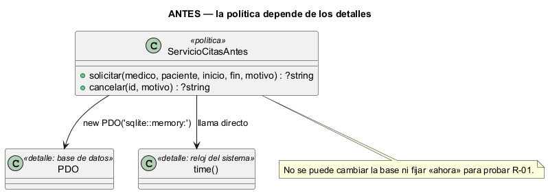
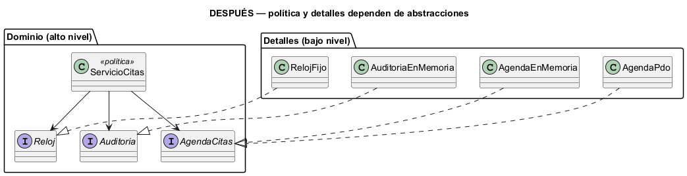

# Semana 2 — RF/RNF, criterios de aceptación y DIP en Citas médicas y agenda

| | |
|---|---|
| **Módulo** | Citas médicas y agenda |
| **Tarea Odoo** | 2459 — Semana 2: Proceso y modelo de diseño; principios SOLID |
| **Flujo** | «Solicitud, validación de disponibilidad y confirmación o cancelación de cita» (modelado en la [Semana 1](../semana-01/semana-01-uml-citas.md)) |
| **Principio aplicado** | DIP — principio de inversión de dependencias |
| **Estudiante** | Josué David Morales Ramírez (carné 1890-23-10545) |

## 1. Requerimientos funcionales

| ID | Requerimiento | Trazado a |
|---|---|---|
| RF-01 | Solicitar una cita futura, con fin posterior al inicio y motivo. | CU-01, R-01, R-06 |
| RF-02 | Rechazar la cita si el médico tiene otra cita activa cruzada. | CU-04, R-02 |
| RF-03 | Rechazar la cita si el paciente tiene otra cita activa cruzada. | CU-04, R-03 |
| RF-04 | Exigir perfil y especialidad del médico vigentes. | CU-04, R-04, R-05 |
| RF-05 | Cancelar una cita programada o confirmada con motivo obligatorio; cancelar libera el horario. | CU-03, R-07, R-08 |
| RF-06 | Registrar en auditoría el motivo de cada cancelación. | R-10 |

## 2. Requerimientos no funcionales

| ID | Requerimiento | Cómo se verifica |
|---|---|---|
| RNF-01 | Seguridad: solo agenda o cancela personal autorizado del mismo hospital; el médico, solo sus citas. | Prueba de API en la Semana 15 |
| RNF-02 | Portabilidad: cambiar la base de datos no modifica la política de agendamiento. | `verificar.php`: los mismos casos con memoria y con PDO/SQLite |
| RNF-03 | Facilidad de prueba: «ahora» se puede fijar para probar R-01 sin depender del reloj real. | `verificar.php` usa `RelojFijo(1000)` |
| RNF-04 | Integridad: en producción, la exclusión `gist` de la base es la última barrera ante citas cruzadas. | `appointments_*_active_period_exclusion` |
| RNF-05 | Trazabilidad: cada cancelación queda auditada con su motivo. | `verificar.php`: «auditoría con el motivo» |

## 3. Criterios de aceptación

| CA | Dado / Cuando / Entonces | RF | Evidencia |
|---|---|---|---|
| CA-01 | Dada una agenda vacía, cuando pido m1/p1 a futuro, entonces se acepta. | RF-01 | `verificar.php` |
| CA-02 | Cuando pido una cita en el pasado, con fin antes del inicio o sin motivo, entonces E2 (422). | RF-01 | `verificar.php` |
| CA-03 | Dada una cita de m1, cuando pido m1 con otro paciente a una hora cruzada, entonces E4 (409). | RF-02 | `verificar.php` |
| CA-04 | Dada una cita de p1, cuando pido p1 con otro médico a una hora cruzada, entonces E5 (409). | RF-03 | `verificar.php` |
| CA-05 | Dada una cita en [2000, 3000), cuando pido otra en [3000, 4000), entonces se acepta (los intervalos no se cruzan). | RF-02 | `verificar.php` |
| CA-06 | Cuando cancelo sin motivo, entonces E2; con motivo, se cancela y se audita. | RF-05, RF-06 | `verificar.php` |
| CA-07 | Cuando cancelo una cita ya cancelada o que no existe, entonces E7 (422) o 404. | RF-05 | `verificar.php` |
| CA-08 | Dada una cita cancelada, cuando pido ese mismo horario, entonces se acepta. | RF-05 | `verificar.php` |
| CA-09 | Dado un médico sin especialidad vigente, cuando pido una cita, entonces E3 (422). | RF-04 | Trigger `appointments_specialty_trigger`; prueba en la Semana 15 |

## 4. DIP: diseño antes y después

**El problema (antes).** En [`ejemplo-dip/antes.php`](ejemplo-dip/antes.php), `ServicioCitasAntes` es la política de alto nivel (las reglas de agendamiento), pero crea su base con `new PDO(...)` y lee la hora con `time()`. La política depende de los detalles: no se puede cambiar SQLite por PostgreSQL sin tocar las reglas, ni probar R-01 con una fecha fija.



**La solución (después).** En [`ejemplo-dip/despues.php`](ejemplo-dip/despues.php), la política define lo que necesita (`AgendaCitas`, `Reloj`, `Auditoria`) y lo recibe por constructor. Los detalles implementan esas interfaces:

| Pieza | Nivel | Responsabilidad | Depende de |
|---|---|---|---|
| `ServicioCitas` | Alto | Reglas de agendamiento y cancelación | Solo de las tres interfaces |
| `AgendaCitas`, `Reloj`, `Auditoria` | Alto (abstracciones del dominio) | Decir qué necesita la política | Nada |
| `AgendaPdo` | Bajo | Guardar citas con PDO (SQLite o PostgreSQL) | `AgendaCitas`, `PDO` |
| `AgendaEnMemoria`, `RelojFijo`, `AuditoriaEnMemoria` | Bajo | Detalles para pruebas | Su interfaz |



**Por qué así.** La dependencia se invierte: antes la flecha iba de la política a PDO; ahora PDO (a través de `AgendaPdo`) depende de una interfaz que pertenece al dominio. Las interfaces viven con la política y no con la base, porque es la política la que decide qué necesita.

## 5. Evidencia verificable

```powershell
php docs/modulos/citas-medicas/semana-02/ejemplo-dip/verificar.php
```

Salida real: [`evidencia/salida-verificar.txt`](evidencia/salida-verificar.txt). La misma política pasa los 13 controles con memoria y los 13 con PDO/SQLite. Por reflexión, se comprueba que `ServicioCitas` depende solo de interfaces y que `ServicioCitasAntes` crea sus detalles: 29 de 29 en total. En una prueba de mutación se quitó la regla «no agendar en el pasado» de una copia de `despues.php`, y el script falló en CA-02 con los dos adaptadores (exit 1).

## 6. Conclusión

DIP no cambió las reglas de la agenda, pero las separó de la base y del reloj. Gracias a eso, R-01 ya se prueba con una hora fija y cambiar SQLite por PostgreSQL no toca `ServicioCitas`. CA-09 queda para la Semana 15, porque la especialidad vigente la garantiza un trigger del esquema real.

## 7. Bibliografía

- MVP Cluster. (s. f.). *Diseño de software 2: principios SOLID*. https://mvpcluster.com/diseno-de-software-2/
- Martin, R. C. (2018). *Clean Architecture*. Prentice Hall.
